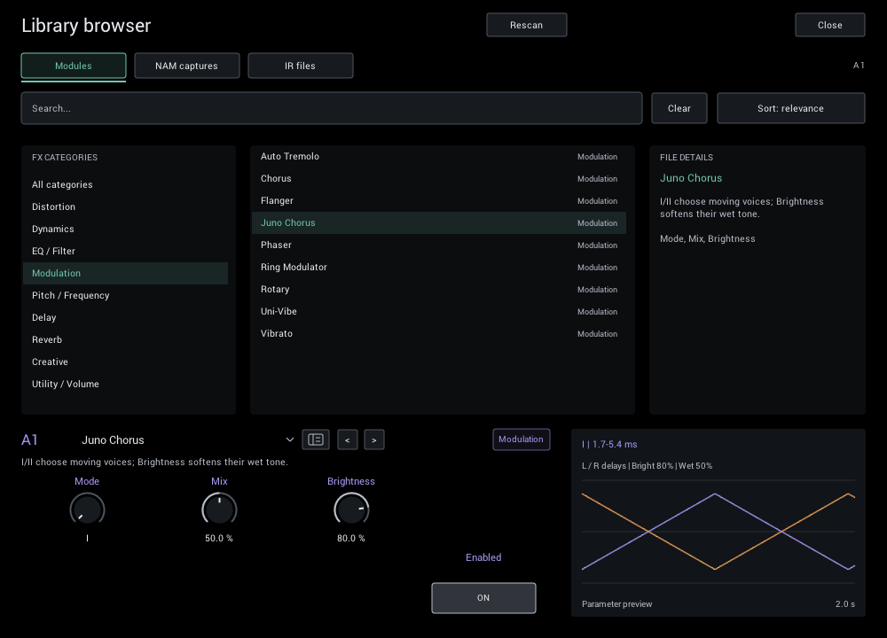

# nam-grid

[](https://github.com/Fannon/nam-grid/actions/workflows/build-test.yml?query=branch%3Amain)

An open-source guitar rig in one **CLAP / VST3 plugin**. Combine
[Neural Amp Modeler](https://github.com/sdatkinson/NeuralAmpModelerPlugin) captures,
cabinet impulse responses and built-in effects, then blend two parallel chains
for anything from a simple amp sound to layered ambient textures.


*An example pedalboard using built-in effects only, with Cosmic Echo selected.
Add your own NAM captures and cabinet IRs when building an amp rig.*

## What you can do

- **Build a complete rig:** load `.nam` amp/pedal captures, `.wav` cabinet IRs,
  gates, compressors, EQ, drives, modulation, pitch effects, delays and reverbs.
- **Blend two sounds:** run separate amp chains or effects in parallel and use
  **A/B** to find the balance. Empty slots pass audio through.
- **Explore creative effects:** try [Cosmic Echo](docs/cosmic-echo.md), shimmer,
  freeze, multi-head tape delay and [LoFi Tape Machine](docs/lofi-tape.md).
- **Keep playing controls close:** use the tuner, tempo-synced effects, macros,
  modulation and performance scenes. Visualizations help explain each effect.
- **Save your whole rig:** recall module choices and settings with `.ngrid`
  presets, or save them with your DAW project.

## Download and install

Download the latest release from
[GitHub Releases](https://github.com/Fannon/nam-grid/releases/latest):

| Platform | Archive | Status |
| --- | --- | --- |
| Windows x64 | `nam-grid-windows-x64.zip` | Built and tested in CI, including the native editor |
| macOS Apple Silicon | `nam-grid-macos-arm64.zip` | Built and tested in CI; not code-signed |
| Linux | — | No plugin build available with the current framework |

1. Extract the archive. It contains `nam-grid.clap`, the `nam-grid.vst3` bundle,
   `ThirdPartyNotices.txt` and a `notices/` folder.
2. Install `nam-grid.clap` or the complete `nam-grid.vst3` bundle in a plugin
   location your DAW scans:
   - Windows: `C:\Program Files\Common Files\CLAP\` or
     `C:\Program Files\Common Files\VST3\`, or a test folder added to your
     host's scan paths.
   - macOS: `~/Library/Audio/Plug-Ins/CLAP/` or `~/Library/Audio/Plug-Ins/VST3/`.
3. **macOS only:** the plugins are not code-signed or notarized, so macOS blocks
   downloaded copies. After copying, clear the quarantine flag in Terminal:

   ```sh
   xattr -dr com.apple.quarantine ~/Library/Audio/Plug-Ins/CLAP/nam-grid.clap ~/Library/Audio/Plug-Ins/VST3/nam-grid.vst3
   ```

4. Rescan plugins in your DAW and insert **nam-grid** (vendor Simon Heimler) on an
   audio track. Choose either CLAP or VST3, according to your host's support.

Keep `ThirdPartyNotices.txt` and `notices/` with the plugins when sharing them.
There is no bundled NAM capture or cabinet IR collection. Built-in effects work
without additional files; amp sounds require your own captures. Builds of every
`main` commit are also available as
[GitHub Actions artifacts](https://github.com/Fannon/nam-grid/actions/workflows/build-test.yml?query=branch%3Amain)
(sign-in required).

**0.1.0 is the first release.** Earlier preview builds used different plugin and
parameter IDs; their projects and presets do not load and must be rebuilt. From
0.1.0 onward, plugin IDs, automation and saved rigs remain compatible
([compatibility contract](docs/development.md#parameter-and-project-compatibility)).
DAW listening, low-buffer sessions and host validation are tracked in the
[release checklist](docs/release-checklist.md).

## Your first guitar rig

1. Connect your guitar through an audio interface, select that input on your DAW
   track, and enable input monitoring.
2. Click an empty **Pre** tile to open the browser. Choose **NAM captures**, then
   **+ Add folder** to index your captures. Select a capture and double-click it
   or press **Load**.
3. If it is an **amp-head / direct** capture without a cabinet, load a cabinet
   `.wav` IR in the next Pre slot. If the capture already includes a cabinet,
   start with that capture alone.
4. Add an effect to lane **A** and turn **A/B** to **0%** to hear that lane alone.
   Add a different chain to **B**, then raise A/B to blend it in.
5. Adjust **IN** for the level driving the rig and **OUT** for listening volume.
   Click a tile and close the browser to edit its controls; use the small tile
   switch to bypass a module. Double-click a knob to restore its default, or
   click its value to type a setting.
6. Click the preset name in the header and choose **Save preset as…** to keep
   your rig. Open **Tuner** whenever you need to tune.

The signal follows four rows, left to right within each row:

```text
               ┌→ A1 → A2 → A3 → A4 ─┐
IN → Pre 1–4 ──┤                      ├→ A/B → Post 1–4 → OUT
               └→ B1 → B2 → B3 → B4 ─┘
```

Pre and Post affect both lanes. **A/B = 0%** selects A, **50%** mixes the lanes
equally, and **100%** selects B. Built-in effects and IRs retain stereo;
a mono NAM capture sums its input to mono, so place stereo effects after it
when you want to keep their width. See [routing](docs/grid.md) for details.

## Find sounds and save rigs



Click a tile to browse effects, captures or IRs for that slot. Search by name,
folder or NAM metadata, inspect a result, then double-click or press **Load**.
Browsing and selecting results leave the current sound playing until you load
your choice. Click the header preset name to browse complete rigs instead.

Captures and IRs stay as **external files**: presets reference them rather than
embedding or copying them. Include those files when sharing a rig. If you move
them, add their new folder and rescan; stored content hashes help relink them.
Loading a large capture can briefly occupy the editor.

| Learn more | Guide |
| --- | --- |
| Choose and edit modules | [Editor](docs/ui.md), [library browser](docs/browser.md) |
| Find an effect and a useful starting point | [Module reference](docs/modules.md), [starting settings](docs/effect-defaults.md) |
| Save, recall and share sounds | [Rig presets](docs/presets.md) |
| Tune and perform | [Tuner](docs/tuner.md), [macros, modulation and scenes](docs/performance.md) |
| Reduce background noise | [Noise Gate (Smart)](docs/noise-gate-smart.md) |

To report a problem, [open an issue](https://github.com/Fannon/nam-grid/issues)
with your OS, DAW and version, plugin format, build commit and steps to reproduce.
For audio problems, include sample rate, buffer size and the modules involved.

## For developers

nam-grid is based on NAM, NAM Core, AudioDSPTools and iPlug2. The supported
build entry point is **CMake**. Follow [build.md](docs/build.md) for dependencies,
submodule patches, build commands, CTest and packaging, and
[CONTRIBUTING.md](CONTRIBUTING.md) for contribution guidance.

- **Architecture and controls:** [grid routing](docs/grid.md),
  [implementation and compatibility](docs/development.md),
  [visualizations](docs/ui.md).
- **Verification:** [release checklist](docs/release-checklist.md) and
  [on-demand FX benchmarks](docs/fx-performance.md).
- **DSP sources:** [Airwindows outboard](docs/airwindows-outboard.md),
  [dynamics](docs/airwindows-dynamics.md) and
  [reverb core adaptations](NeuralAmpModeler/dsp/reverb/README.md).

See the [documentation index](docs/README.md) for all guides. Reviews and
measurement reports belong in PR descriptions/comments or ignored `tmp/` files.

New controls, modules and modes follow the append-only
[compatibility contract](docs/development.md#parameter-and-project-compatibility).
Algorithm selections are saved in presets/projects and are not automatable.

## License and credits

Licensed under [MIT](LICENSE). Adapted algorithms, dependencies and the
[Roboto](https://github.com/googlefonts/roboto) font (Apache 2.0) retain their own notices; see [ThirdPartyNotices.txt](ThirdPartyNotices.txt)
and the accompanying notice files in distributed builds.

### Acknowledgments

nam-grid is built on the work of many open-source projects:

- **[Neural Amp Modeler](https://github.com/sdatkinson/NeuralAmpModelerPlugin)** by
  Steven Atkinson — the plugin foundation, together with the
  [NAM Core](https://github.com/sdatkinson/NeuralAmpModelerCore) and
  [AudioDSPTools](https://github.com/sdatkinson/AudioDSPTools) (NAM captures,
  cabinet IRs, EQ and compressor filter coefficients).
- **[Gateway](https://www.neuralampmodeler.com/)** — the official pre-built NAM
  plugin by Steven Atkinson, the starting point for nam-grid's editor.
- **[iPlug2](https://github.com/iPlug2/iPlug2)** — the C++ plugin framework behind
  the CLAP and VST3 builds.
- FX algorithms adapted or informed by (all used under permissive licenses; see the
  shipped [third-party notices](ThirdPartyNotices.txt)
  for details and full license texts):
  - **[Airwindows](https://github.com/airwindows/airwindows)** (Chris Johnson) —
    [Tape](https://www.airwindows.com/tape/),
    [kPlate140](https://www.airwindows.com/kplate140/),
    [kGuitarHall2](https://www.airwindows.com/kguitarhall2/), Galactic3,
    CStrip2, BussColors4, ButterComp2, DigitalBlack, CStrip's gate and Pressure6.
  - **[Faust reverb library](https://faustlibraries.grame.fr/libs/reverbs/)**
    (GRAME) — [JPverb](https://faustlibraries.grame.fr/libs/reverbs/#rejpverb),
    Greyhole, and David Braun's MIT Faust reconstruction of the
    [Valhalla Supermassive](https://faustlibraries.grame.fr/libs/reverbs/#revalhallasupermassive)
    algorithms behind Cosmic Echo.
  - **[Signalsmith Audio basics](https://github.com/Signalsmith-Audio/basics)**
    (Geraint Luff) — the Room/Hall reverb cores.
  - **[Mutable Instruments Clouds](https://github.com/pichenettes/eurorack/tree/master/clouds)**
    (Émilie Gillet) — the Dattorro/Griesinger tank behind Dense Plate.
  - **Schwung modules** — [Shimwash](https://github.com/twinpowers/schwung-shimwash)
    (shimmer), [Junologue Chorus](https://github.com/charlesvestal/schwung-junologue-chorus),
    and [Ruminant](https://github.com/mestela/schwung-ruminant) (frequency-shifting
    delay), reimplemented as rate-scaled double-precision code.
  - **[LEAF](https://github.com/spiricom/LEAF)** — compressor dynamics.

Thanks to all contributors credited in the
[third-party notices](ThirdPartyNotices.txt).
