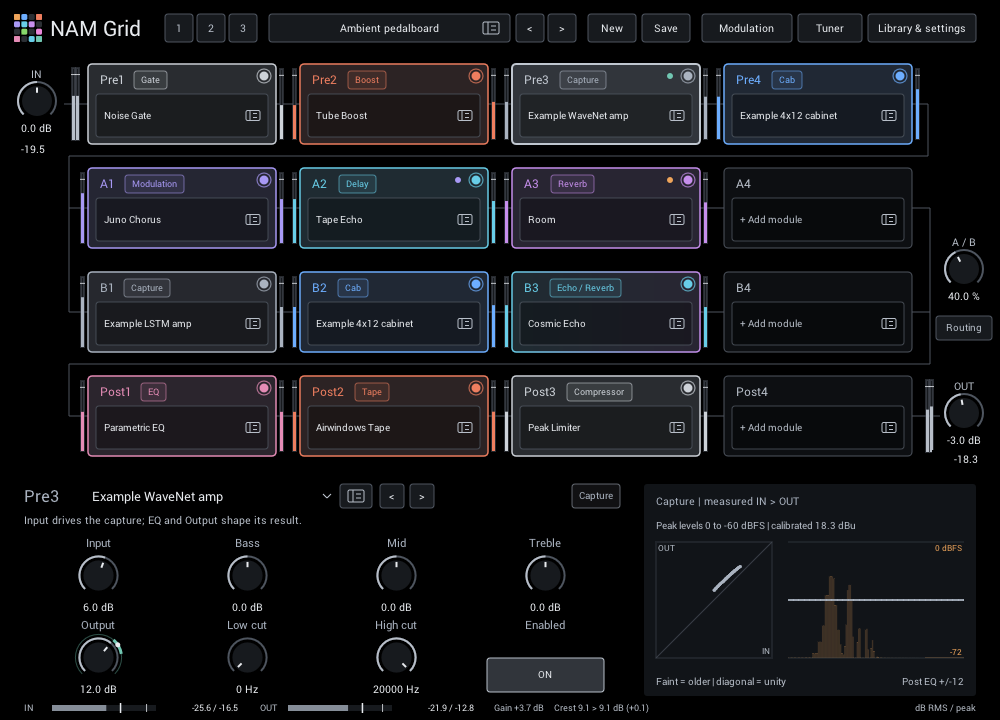
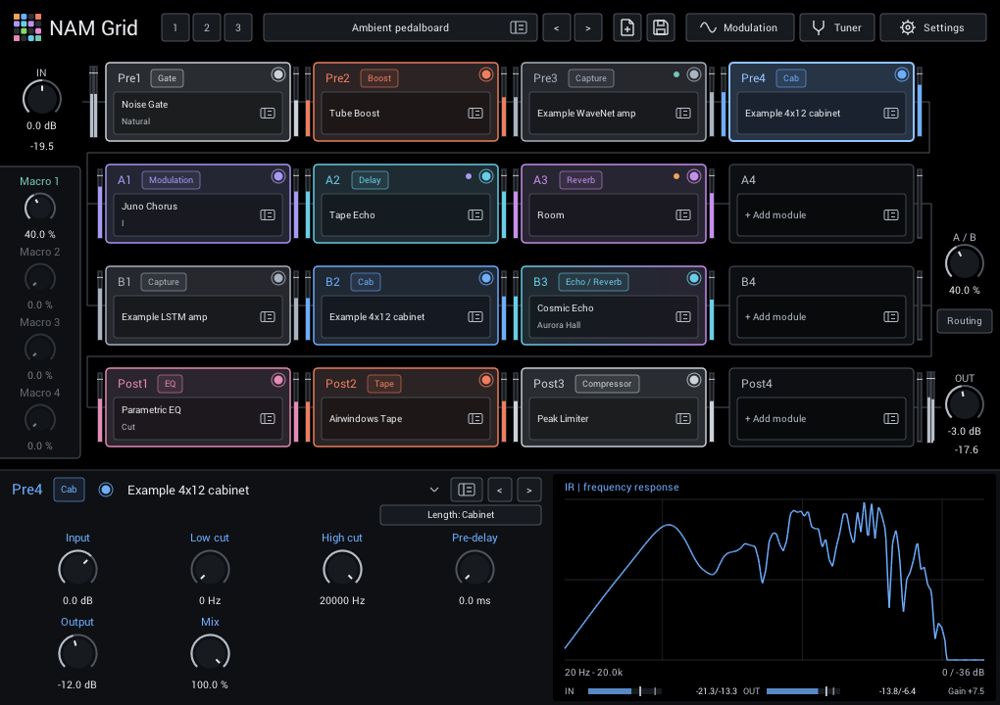
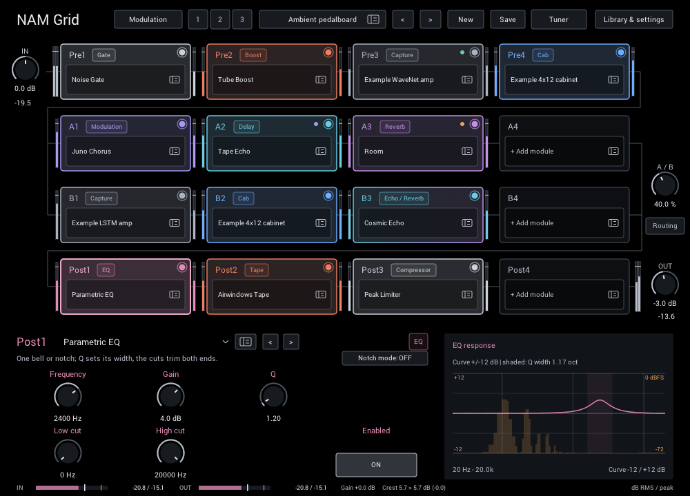
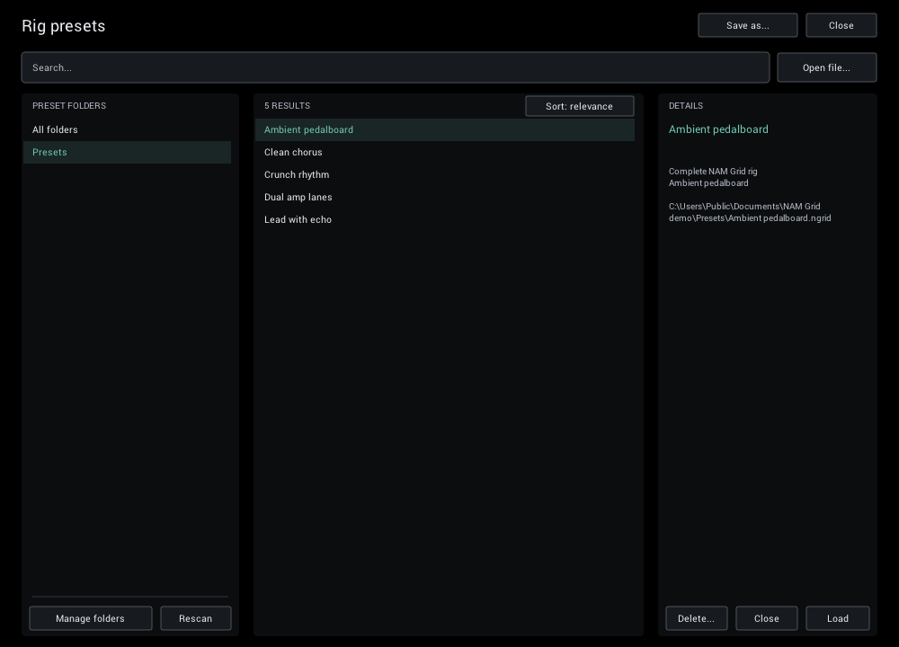
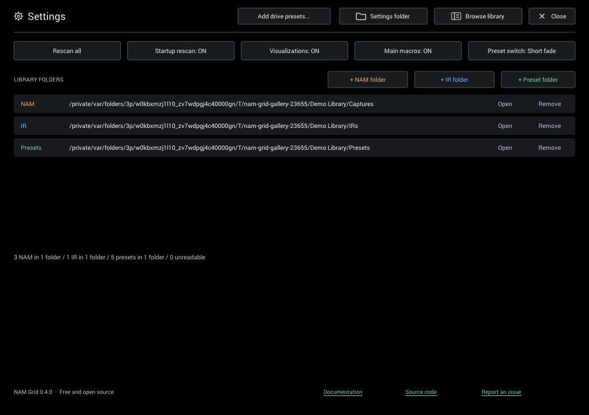
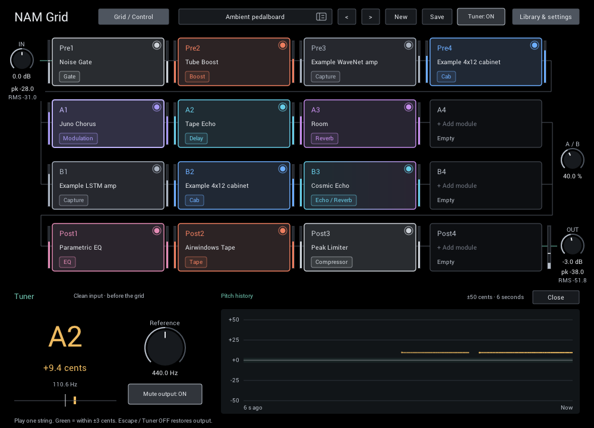

# NAM Grid

[](https://github.com/Fannon/nam-grid/actions/workflows/build-test.yml?query=branch%3Amain)

An open-source guitar rig in one **CLAP / VST3 plugin**. Combine
[Neural Amp Modeler](https://github.com/sdatkinson/NeuralAmpModelerPlugin) captures,
cabinet impulse responses and built-in effects, then blend two parallel chains
for anything from a simple amp sound to layered ambient textures.


*An example rig: two NAM captures in parallel lanes, each followed by a cabinet IR,
plus built-in effects, with Cosmic Echo selected. The captures are NAM Core's
example models; use your own captures and IRs for real amp sounds, for example from
[TONE3000](https://www.tone3000.com), which hosts free NAM captures and IRs.*

## About this project

NAM Grid stands on the shoulders of a lot of excellent open-source work. The
neural amp modeling is [Neural Amp Modeler](https://github.com/sdatkinson/NeuralAmpModelerPlugin)
by Steven Atkinson, the plugin framework is [iPlug2](https://github.com/iPlug2/iPlug2),
and many effects are adapted from or informed by Airwindows, the Faust reverb
library, Signalsmith Audio, Mutable Instruments and others (see
[acknowledgments](#acknowledgments)). NAM Grid ties these together into the guitar
plugin I wanted: several captures, cabinets and effects in one flexible rig.

NAM Grid was developed with AI coding agents. I directed the design, reviewed the
changes and tested the results, supported by an extensive automated test suite.

## Why NAM Grid

- **A free grid instead of a fixed chain:** 16 slots in four rows (Pre, two
  parallel lanes A and B, Post). Any slot takes any module, so you can run
  several NAM captures, cabinet IRs or the same effect more than once, and
  blend the two lanes with **A/B**.
- **54 built-in effects:** gates, compressors and outboard-style dynamics,
  EQs and filters, drives, modulation, pitch effects, delays and reverbs,
  including [Cosmic Echo](docs/cosmic-echo.md) and the
  [LoFi Tape Machine](docs/lofi-tape.md).
- **Visualizations that explain each effect:** live curves, spectra and
  response plots show what every control does and what your signal is doing.
- **Built for low latency:** no added buffering latency for effects or IRs;
  cabinet IRs switch between direct and FFT convolution automatically, and the
  DSP is tuned for small buffers with no allocation on the audio thread.
- **Browse while you listen:** audition modules, captures and IRs in a slot
  before keeping them, and save complete rigs as `.ngrid` presets.
- **Performance controls:** tuner, tempo sync, an eight-row modulation matrix
  with an LFO, an input envelope, an eight-step sequencer and four macros
  (right-click any knob to modulate it), lane controls and three scenes.

<table>
  <tr>
    <td align="center" width="33%"><a href="docs/screenshots/nam.png"></a><br><b>NAM capture</b><br><sub>Measured input/output curve of the loaded capture</sub></td>
    <td align="center" width="33%"><a href="docs/screenshots/ir.png"></a><br><b>Cabinet IR</b><br><sub>Frequency response of the loaded impulse response</sub></td>
    <td align="center" width="33%"><a href="docs/screenshots/delay.png"></a><br><b>Tape Echo</b><br><sub>Echo pattern, modulation and saturation at a glance</sub></td>
  </tr>
  <tr>
    <td align="center" width="33%"><a href="docs/screenshots/eq.png"></a><br><b>Parametric EQ</b><br><sub>EQ curve over the live output spectrum</sub></td>
    <td align="center" width="33%"><a href="docs/screenshots/browser-modules.png"></a><br><b>Module browser</b><br><sub>Audition effects in a slot while you browse</sub></td>
    <td align="center" width="33%"><a href="docs/screenshots/browser-presets.png"></a><br><b>Rig presets</b><br><sub>Full-height browser for complete rigs</sub></td>
  </tr>
  <tr>
    <td align="center" width="33%"><a href="docs/screenshots/settings.png"></a><br><b>Library & settings</b><br><sub>NAM, IR and preset folders, scanning and visualizations</sub></td>
    <td align="center" width="33%"><a href="docs/screenshots/control.png"></a><br><b>Grid / Control</b><br><sub>Modulation sources and matrix</sub></td>
    <td align="center" width="33%"><a href="docs/screenshots/tuner.png"></a><br><b>Tuner</b><br><sub>Tuner with cents, reference pitch and pitch history</sub></td>
  </tr>
</table>

## Download and install

Download the latest release from
[GitHub Releases](https://github.com/Fannon/nam-grid/releases/latest):

| Platform | Archive | Status |
| --- | --- | --- |
| Windows x64 | `nam-grid-windows-x64.zip` | Built and tested in CI, including the native editor |
| macOS Apple Silicon | `nam-grid-macos-arm64.zip` | Built and tested in CI; not code-signed |
| Linux | — | No plugin build available with the current framework |

1. Extract the archive. It contains `nam-grid.clap`, the `nam-grid.vst3` bundle,
   `ThirdPartyNotices.txt` and a `notices/` folder.
2. Install `nam-grid.clap` or the complete `nam-grid.vst3` bundle in a plugin
   location your DAW scans:
   - Windows: `C:\Program Files\Common Files\CLAP\` or
     `C:\Program Files\Common Files\VST3\`, or a test folder added to your
     host's scan paths.
   - macOS: `~/Library/Audio/Plug-Ins/CLAP/` or `~/Library/Audio/Plug-Ins/VST3/`.
3. **macOS only:** the plugins are not code-signed or notarized, so macOS blocks
   downloaded copies. After copying, clear the quarantine flag in Terminal:

   ```sh
   xattr -dr com.apple.quarantine ~/Library/Audio/Plug-Ins/CLAP/nam-grid.clap ~/Library/Audio/Plug-Ins/VST3/nam-grid.vst3
   ```

4. Rescan plugins in your DAW and insert **NAM Grid** (vendor Simon Heimler) on an
   audio track. Choose either CLAP or VST3, according to your host's support.

Keep `ThirdPartyNotices.txt` and `notices/` with the plugins when sharing them.
There is no bundled NAM capture or cabinet IR collection. Built-in effects work
without additional files; amp sounds require your own captures, such as the free NAM
captures and cabinet IRs on [TONE3000](https://www.tone3000.com). Builds of every
`main` commit are also available as
[GitHub Actions artifacts](https://github.com/Fannon/nam-grid/actions/workflows/build-test.yml?query=branch%3Amain)
(sign-in required).

**0.1.0 is the first release.** Earlier preview builds used different plugin and
parameter IDs; their projects and presets do not load and must be rebuilt. From
0.1.0 onward, plugin IDs, automation and saved rigs remain compatible
([compatibility contract](docs/development.md#parameter-and-project-compatibility)).
DAW listening, low-buffer sessions and host validation are tracked in the
[release checklist](docs/release-checklist.md).

## Your first guitar rig

1. Connect your guitar through an audio interface, select that input on your DAW
   track, and enable input monitoring.
2. Open **Library & settings** and add your captures with **+ NAM folder** (and
   cabinet IRs with **+ IR folder**). Then click an empty **Pre** tile, choose
   **NAM captures**, select a capture to hear it, then double-click it or press **Apply**.
3. If it is an **amp-head / direct** capture without a cabinet, load a cabinet
   `.wav` IR in the next Pre slot. If the capture already includes a cabinet,
   start with that capture alone.
4. Add an effect to lane **A** and turn **A/B** to **0%** to hear that lane alone.
   Add a different chain to **B**, then raise A/B to blend it in.
5. Adjust **IN** for the level driving the rig and **OUT** for listening volume.
   Click a tile and close the browser to edit its controls; use the small tile
   switch to bypass a module. Double-click a knob to restore its default, or
   click its value to type a setting.
6. Click **Save** in the header to keep your rig as a preset (the first save asks
   for a filename), or **New** to start again from an empty grid. Open **Tuner**
   whenever you need to tune.

The signal follows four rows, left to right within each row:

```text
               ┌→ A1 → A2 → A3 → A4 ─┐
IN → Pre 1–4 ──┤                      ├→ A/B → Post 1–4 → OUT
               └→ B1 → B2 → B3 → B4 ─┘
```

Pre and Post affect both lanes. **A/B = 0%** selects A, **50%** mixes the lanes
equally, and **100%** selects B. Built-in effects and IRs retain stereo;
a mono NAM capture sums its input to mono, so place stereo effects after it
when you want to keep their width. See [routing](docs/grid.md) for details.

## Find sounds and save rigs

Click a tile to browse effects, captures or IRs for that slot. Search by name,
folder or NAM metadata. Selecting a result auditions it in that slot; double-click,
Enter or **Apply** keeps it, and **Close** restores the original. Click the header
preset name to browse complete rigs instead; a preset loads only with **Load**,
Enter or double-click.

Captures and IRs stay as **external files**: presets reference them rather than
embedding or copying them. Include those files when sharing a rig. If you move
them, add their new folder and rescan; stored content hashes help relink them.
Loading a large capture can briefly occupy the editor.

| Learn more | Guide |
| --- | --- |
| Choose and edit modules | [Editor](docs/ui.md), [library browser](docs/browser.md) |
| Find an effect and a useful starting point | [Module reference](docs/modules.md), [starting settings](docs/effect-defaults.md) |
| Save, recall and share sounds | [Rig presets](docs/presets.md) |
| Tune and perform | [Tuner](docs/tuner.md), [macros, modulation and scenes](docs/performance.md) |
| Reduce background noise | [Noise Gate (Smart)](docs/noise-gate-smart.md) |

To report a problem, [open an issue](https://github.com/Fannon/nam-grid/issues)
with your OS, DAW and version, plugin format, build commit and steps to reproduce.
For audio problems, include sample rate, buffer size and the modules involved.

## For developers

NAM Grid is based on NAM, NAM Core, AudioDSPTools and iPlug2. The supported
build entry point is **CMake**. Follow [build.md](docs/build.md) for dependencies,
submodule patches, build commands, CTest and packaging, and
[CONTRIBUTING.md](CONTRIBUTING.md) for contribution guidance.

- **Architecture and controls:** [grid routing](docs/grid.md),
  [implementation and compatibility](docs/development.md),
  [visualizations](docs/ui.md).
- **Verification:** [release checklist](docs/release-checklist.md) and
  [on-demand FX benchmarks](docs/fx-performance.md).
- **DSP sources:** [Airwindows outboard](docs/airwindows-outboard.md),
  [dynamics](docs/airwindows-dynamics.md) and
  [reverb core adaptations](NeuralAmpModeler/dsp/reverb/README.md).

See the [documentation index](docs/README.md) for all guides. Reviews and
measurement reports belong in PR descriptions/comments or ignored `tmp/` files.

New controls, modules and modes follow the append-only
[compatibility contract](docs/development.md#parameter-and-project-compatibility).
Algorithm selections are saved in presets/projects and are not automatable.

## License and credits

Licensed under [MIT](LICENSE). Adapted algorithms, dependencies and the
[Roboto](https://github.com/googlefonts/roboto) font (Apache 2.0) retain their own notices; see [ThirdPartyNotices.txt](ThirdPartyNotices.txt)
and the accompanying notice files in distributed builds.

### Acknowledgments

NAM Grid is built on the work of many open-source projects:

- **[Neural Amp Modeler](https://github.com/sdatkinson/NeuralAmpModelerPlugin)** by
  Steven Atkinson — the plugin foundation, together with the
  [NAM Core](https://github.com/sdatkinson/NeuralAmpModelerCore) and
  [AudioDSPTools](https://github.com/sdatkinson/AudioDSPTools) (NAM captures,
  cabinet IRs, EQ and compressor filter coefficients).
- **[Gateway](https://www.neuralampmodeler.com/)** — the official pre-built NAM
  plugin by Steven Atkinson, the starting point for NAM Grid's editor.
- **[iPlug2](https://github.com/iPlug2/iPlug2)** — the C++ plugin framework behind
  the CLAP and VST3 builds.
- FX algorithms adapted or informed by (all used under permissive licenses; see the
  shipped [third-party notices](ThirdPartyNotices.txt)
  for details and full license texts):
  - **[Airwindows](https://github.com/airwindows/airwindows)** (Chris Johnson) —
    [Tape](https://www.airwindows.com/tape/),
    [kPlate140](https://www.airwindows.com/kplate140/),
    [kGuitarHall2](https://www.airwindows.com/kguitarhall2/), Galactic3,
    CStrip2, BussColors4, ButterComp2, DigitalBlack and CStrip's gate.
  - **[Faust reverb library](https://faustlibraries.grame.fr/libs/reverbs/)**
    (GRAME) — [JPverb](https://faustlibraries.grame.fr/libs/reverbs/#rejpverb),
    Greyhole, and David Braun's MIT Faust reconstruction of the
    [Valhalla Supermassive](https://faustlibraries.grame.fr/libs/reverbs/#revalhallasupermassive)
    algorithms behind Cosmic Echo.
  - **[Signalsmith Audio basics](https://github.com/Signalsmith-Audio/basics)**
    (Geraint Luff) — the Room/Hall reverb cores.
  - **[Mutable Instruments Clouds](https://github.com/pichenettes/eurorack/tree/master/clouds)**
    (Émilie Gillet) — the Dattorro/Griesinger tank behind Dense Plate.
  - **Schwung modules** — [Shimwash](https://github.com/twinpowers/schwung-shimwash)
    (shimmer), [Junologue Chorus](https://github.com/charlesvestal/schwung-junologue-chorus),
    and [Ruminant](https://github.com/mestela/schwung-ruminant) (frequency-shifting
    delay), reimplemented as rate-scaled double-precision code.
  - **[LEAF](https://github.com/spiricom/LEAF)** — compressor dynamics.

Thanks to all contributors credited in the
[third-party notices](ThirdPartyNotices.txt).
