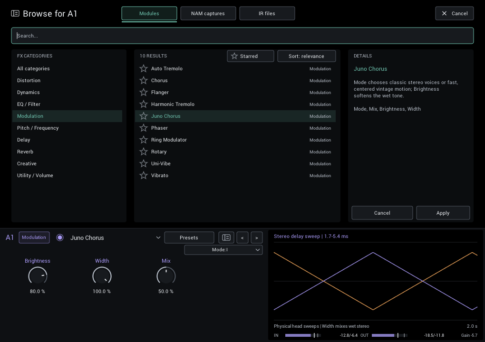

# Library browser

Find effects, NAM captures, cabinet IRs, and rig presets in one place. You can listen before deciding: slot choices are auditions until you apply them.



## Open the right browser

- Click **+ Add module** or a module name to choose something for that slot.
- Click the browser icon in a module editor to jump to its current category or folder.
- Click the preset name in the header to browse complete rigs.
- Open **Settings > Browse library** to search all sound content.

The slot browser offers **Modules**, **NAM captures**, and **IR files**. The preset browser handles complete `.ngrid` rigs; it does not change individual slots.

## Browse and audition

Choose a folder or category, then select a result. The details pane describes the selection and shows capture metadata or a module's controls.

For modules, captures, and IRs:

1. Select a result to hear it in the current slot.
2. Adjust the module below the browser while comparing.
3. Choose **Apply**, press Enter twice from search, or double-click to keep it.
4. Choose **Cancel** or press Escape to restore the original module and settings.

Each effect you audition keeps its temporary adjustments during that visit. Capture and IR changes retain comparable gain settings. Closing the plugin window also cancels an unapplied audition.

Use **Open file...** for a capture, IR, or preset outside your library. This does not add its folder as a permanent source.

## Stars

Click the star left of a result to mark it: empty outline, yellow, orange, red, then empty again. Modules, NAM captures and IR files have stars; rig presets do not.

Turn on **Starred** above the results to list only starred items. Search and the folder column still apply. The browser opens with the filter off, so the current module or file stays selected. A star you clear while the filter is on keeps its row until the list next changes, so you can cycle it back.

Stars are your own notes, kept in your settings rather than in a rig, preset or DAW project. They never change what you hear, and other people opening your rigs see their own stars. Moving or renaming a NAM or IR file loses its star, because the star follows the file's path; a module keeps its star across releases.

## Search

Search is focused whenever the browser opens, including **+ Add module**, so you can start typing immediately. Search matches filenames, paths, preset names, and available NAM metadata. All ordinary words must match; common Latin accents are ignored, so `grun` finds `Grün`.

| Example | Finds |
| --- | --- |
| `vox clean` | Items containing both words |
| `"silver clean" -bright` | That phrase, excluding `bright` |
| `maker:vox model:ac30` | Matching capture maker and model |
| `path:"amp heads" -name:test` | A folder phrase, excluding test filenames |

Use `name:` for filenames and `gear:` for capture type. Relevance sorting puts exact filename matches first; **Sort: name** switches to alphabetical order.

**Ctrl/Cmd+F** focuses search. Use Up/Down, Page Up/Down, Home/End to move through results. Enter accepts a choice; while editing search, the first Enter finishes the edit and the second accepts. Escape first leaves search editing, then cancels the browser.

## Presets

The preset browser works the same way, except that selecting a rig does not audition it: your sound changes only when you choose **Load**, press Enter, or double-click. **Delete...** permanently removes the selected preset after confirmation. Saving is covered in [Rig presets](presets.md).

## Library folders

NAM captures, cabinet IRs and rig presets each have their own list of folders. Add or remove them in **Settings**; **Manage folders** in the browser opens the same page.

- Each folder is scanned only for its own file type: `.nam`, `.wav` or `.ngrid`, including subfolders. Add a mixed folder to more than one list if needed.
- **Open** shows a folder in Explorer or Finder. **Remove** stops scanning it without deleting anything.
- Use **Rescan all** (or **Rescan** in the browser) after adding, moving or renaming files. **Startup rescan** does this whenever NAM Grid starts. With it off, NAM Grid restores the saved index. A missing, invalid, empty or factory-only index still triggers a background rescan of all configured folders. Opening an empty or factory-only browser retries the scan, so files added later can be found. Missing folders and read failures leave the last good saved index intact.
- Missing or invalid files are reported; NAM Grid never silently substitutes another sound.

Until you choose your own folders, NAM Grid uses these in your Documents folder:

| Folder | Contains |
| --- | --- |
| `NAM Grid/NAM Captures` | The bundled **RiffSmith Clean** capture |
| `NAM Grid/IRs` | A place for your cabinet `.wav` files |
| `NAM Grid/Presets` | The **Empty** and **Clean Default** rigs |

Your folder choices belong to you, not to a rig or DAW project, so loading a preset never replaces them. If you remove every folder from a list, NAM Grid remembers that and does not recreate the defaults.

## Excluding files with `.ignore`

Put a `.ignore` text file in a library folder or subfolder to hide files from scans, browsing, and previous/next navigation. Its patterns work like `.gitignore`. On Windows, `.ignore.txt` is accepted too. Rescan after editing it.

```gitignore
# Hide work folders and exports
Catalog/
_Export/

# Hide direct-input captures, except one
*DI.nam
!Keep DI.nam

# Hide only this top-level file
/notes.nam
```

- One pattern per line; blank lines and `#` comments are ignored.
- `*` matches within a name, `?` one character, and `**` any number of folders.
- A trailing `/` matches folders only. A leading or middle `/` anchors the rule to the `.ignore` folder.
- `!` re-includes a match from an earlier rule. Deeper `.ignore` files and later rules take priority.
- Matching ignores letter case. Escape a leading `#` or `!` with `\`.

Rules apply only inside the configured library folder containing the `.ignore` file. A file above that folder is not read.
