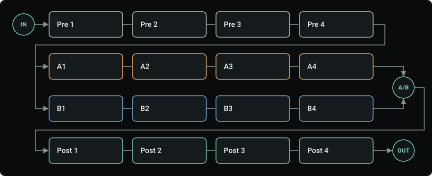

# Grid & routing

NAM Grid gives you 16 slots in four rows: **Pre**, lanes **A** and **B**, and **Post**. Sound flows left to right through each row; empty slots simply pass it on. New rigs and the bundled Clean Default preset start in **Sequential** mode. The single routing button below A/B shows the current mode and flow, with A in amber and B in blue. Click it to open Routing, then choose **Parallel** or **Sequential** there. The grid wires follow the selected mode. Opening the page leaves the sound unchanged.

- **Sequential:** sound runs **Pre → A → B → Post**, using all 16 slots in one chain. Use it for a conventional pedal → amp → cabinet → effects rig. There is no parallel dry return. A/B, lane levels, balances, timing, mute/solo and frequency split are hidden; their saved values return when switching to Parallel. Routing keeps the rig-wide Trails and Keep dry level controls available.
- **Parallel:** A and B both receive the sound from Pre 4; **A/B** blends their results before Post. Use it for two amps, different cabinets, wet/dry layers or a frequency split. Older projects and presets without a lane-mode setting retain this routing, so loading them preserves their sound. The split-bass factory examples explicitly select Parallel.
- **IN** sets the level reaching the rig, the tuner and the envelope follower. **OUT** sets the final level sent to your DAW.

Any slot can hold a NAM capture, a cabinet IR or a built-in effect. Click a slot's name or **+ Add module** to choose one; see [Editor](ui.md#build-and-arrange-a-rig) for moving, copying and bypassing modules.

## Typical placement

There are no fixed rules, but this order is a good start:

| Where | What | Why |
| --- | --- | --- |
| Before the amp | Gate, compressor, boost, drive, wah, octaver | They react to your playing and shape what the amp receives. |
| Amp | NAM capture | A drive in front pushes it harder, like a pedal into an amp. |
| After an amp-only capture | Cabinet IR | *Full rig* captures already include a cabinet. |
| After the cabinet | EQ, modulation, delay, reverb | Stereo effects keep their width after the mono capture. |
| Last in Post | Peak Limiter or Console Colour | Catch peaks or add glue to the whole rig. |

NAM captures are mono: they combine both channels into one. Place stereo effects after the last capture to keep them wide.

Set a healthy level as you go. Use **IN** for the level into the rig, each module's Output for its own gain, and **OUT** for the final level. Match the volume with the module bypassed before judging a tone; the [level meters](ui.md#displays-and-meters) help.

## Parallel lanes and blend

**A/B** sets the balance between the lanes: 0% is A alone, 50% is both equally, and 100% is B alone. The blend moves smoothly and can be automated.

With an amp only in A and an empty B, a centred A/B mixes half amp with half the signal from Pre. Turn A/B fully to A, or choose Sequential to run the amp without the empty lane's dry return.

- Try different amps or cabinets in each lane, or keep one lane dry and put effects in the other.
- An empty lane still passes the sound from Pre. Turn A/B fully toward a lane to hear only that lane.
- Parallel captures can reinforce or cancel frequencies. If the combination sounds thin, adjust the lane levels or [Lane timing](#routing) and compare in mono.
- Captures use CPU even when A/B favours the other lane. Bypass unused ones to save CPU.

## Routing

Click the flow icon below the A/B knob for Routing. Choose Sequential or Parallel in the page header. Select a module, close the page, or press Escape to return.

- **Lane A / Lane B level:** adjust each parallel lane's output before the blend.
- **A / B balance:** place each parallel lane left or right. Centre preserves both channels at unity; turning toward one side attenuates the opposite channel, reaching silence there at the extreme. Stereo material retains its existing left/right content; this does not move one channel's content into the other. These controls can be automated and ramp smoothly.
- **Mute / solo menu:** optional lane isolation. Solo respects the current blend; if both lanes are soloed, both play. Mute wins over solo. Clear mute/solo in the same menu. Muting or blending away a lane does not suspend its processors; bypass unused modules to save CPU.
- **Routing view:** with no frequency split, the diagram shows the two branches, blend percentages, lane levels and stereo positions. With the split on, it shows the crossover curves. Both parallel views include live L/R peak meters for each lane's contribution after its level, balance and blend, before Post. An empty lane is measured too. Sequential shows the single chain instead.
- **Lane timing:** delay one lane by up to 20 ms to explore timing and phase between captures. Positive values delay A; negative values delay B.
- **Trails:** bypassed delays and reverbs ring out instead of stopping. After the 5 ms bypass fade, new playing no longer reaches them, while their repeats or reverb tail continue over the dry signal. Off by default; saved with the rig and recalled by scenes. Re-enabling a ringing module adds new playing to its tail. Turning Trails off fades a ringing tail over 5 ms, and replacing the module drops it with the usual switch fade. A tail ends once it stays below -100 dB: for 2 s with reverbs, and with delays for their longest possible gap between repeats (9 s for most). It also ends within 30 s for delays and Shimmer, 45 s for Room, Dense Plate, Cloud, Hall and Spring, or 60 s for Airwindows reverbs and Cosmic Echo. A tail still ringing fades during the final second of that limit, within the time reported to the host. A ringing module uses as much CPU as an active one, and it then drains silently as before. Freeze, Stutter and the modulation effects keep their normal bypass.
- **Keep dry level:** all delays and reverbs keep dry at unity while Mix sets wet level. Off by default (Linear dry/wet crossfade); saved with the rig and recalled by scenes. Changes ramp over 20 ms. Output trims still affect both dry and wet; at high Mix, allow room for the higher total level. Freeze and Stutter are unchanged.
- **Frequency split:** send the lows to A and the highs to B, divided at **Crossover**. With both lanes empty and A/B centered, the original sound is reconstructed. This is a gentle split by default, not a steep multiband crossover.
- **Slope:** *Gentle* is the released 6 dB/octave split. *Steep* is a 24 dB/octave Linkwitz-Riley split, so a driven lane B receives much less low end. Both slopes keep a flat overall level with empty lanes, but the steep split's phase turns 360° around the crossover, so a half-blended split is not phase-identical to the input. Switching slopes crossfades over 5 ms. The gentler split stays the default, and existing rigs keep it.

Use the split for rigs such as a clean low end in A and a driven high band in B. On a bass rig, try **Steep** so palm-muted lows stay out of the driven lane. Check the combined tone in mono as well as stereo: the steeper split's phase shift around the crossover can change how a capture in each lane combines.

Switching to Gentle clears the steep filters' histories after the fade completes, so selecting Steep again cannot bring back old audio after silence.

A drive in **Pre** acts before this split. A drive in **B** receives its upper branch;
a drive in **Post** receives both branches after they are mixed. A nonlinear Post
module can therefore distort the lows you kept clean in A.

Pedal Drive also offers a local **Low keep** return. It works within one slot, independently
of the grid's split. Start with Low keep at zero when using Pedal Drive in the high lane
of a split rig; otherwise the upper branch is split again. See the
[routing examples](modules/pedal-drive.md#using-the-grid-split).

Lane levels, the crossover and A/B can all be [modulated](performance.md#modulation) in Parallel mode. Lane mode and balances are saved with rigs and recalled by scenes. Switching mode briefly dips the output while reconnecting the lanes. Model latency is summed across A and B in Sequential; Parallel compensates the shorter lane to match the longer one.

## Missing captures and IRs

If a capture or IR file moves, its slot keeps the reference and passes the sound through until you relink it. NAM Grid never silently substitutes a different file. After a rescan, a file that was moved or renamed inside your library folders is recognized by its content and relinked automatically; see [missing captures](troubleshooting.md#a-capture-or-ir-is-missing).
