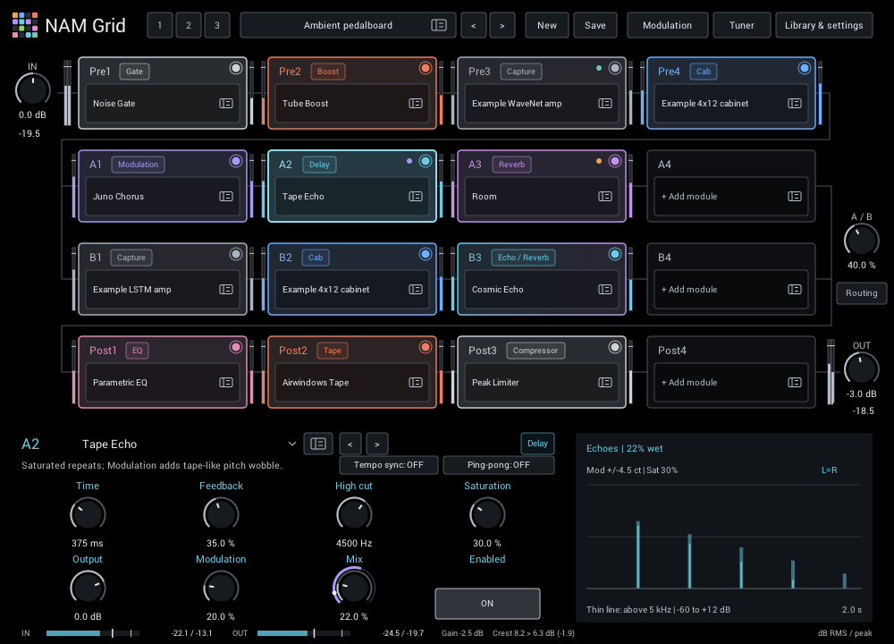

# Module guide

Choose any module in any grid slot: NAM captures, cabinet IRs, or 54 built-in effects. Pick a category for each module's controls and tips.

| Category | Modules |
| --- | --- |
| [Captures & cabinets](captures.md) | NAM captures (amps, pedals, full rigs), Cabinet IR |
| [Distortion](distortion.md) | Distortion, Boost, Tube Boost, Airwindows Tape, Console Colour, Bitcrusher |
| [Dynamics](dynamics.md) | Noise Gate, Noise Gate (Smart), Digital Black Gate, Smooth Compressor, Punch Compressor, Butter Comp, Outboard Channel, Peak Limiter |
| [EQ / Filter](eq-filter.md) | Guitar EQ, Cut EQ, Parametric EQ, Console EQ, Filter, Wah |
| [Modulation](modulation.md) | Chorus, Juno Chorus, Flanger, Phaser, Auto Tremolo, Vibrato, Rotary, Uni-Vibe, Ring Modulator |
| [Pitch / Frequency](pitch-frequency.md) | Mono Octaver, Stereo Doubler, Frequency Shifter |
| [Delay](delay.md) | Digital Delay, Analog Echo, Tape Echo, Multi-head Tape, Reverse Delay, Dual Delay, Diffused Delay |
| [Reverb](reverb.md) | Room, Dense Plate, Cloud, Hall, Spring Reverb, Shimmer, Airwindows Plate, Airwindows Guitar Hall, Galactic Space, Cosmic Echo |
| [Creative](creative.md) | Freeze / Hold, Stutter, LoFi Tape Machine |
| [Utility / Volume](utility-volume.md) | Utility, Auto Swell |

## Use the module editor

Select a grid card to open its module below the grid. Each category page shows the same focused parameter-pane view.

- **Name and navigation:** open the quick module menu, browse, or use previous/next within the category.
- **Options:** choose tempo sync and module-specific modes. Two-choice options toggle on click; longer lists open a menu.
- **Controls:** up to four controls share one row. Larger modules place **Output** at the start of the second row and **Mix** at the end; **Enabled** is always at the bottom right.
- **Knobs:** drag or click a value to type. Double-click restores the starting value. Right-click assigns [modulation](../performance.md).
- **Display:** see the effect's response, timing, or interaction with your playing.
- **Level strip:** compare input/output and match volume when judging a tone.

Every knob and Enabled can be automated by your DAW. Header options are saved with the rig but are not host-automatable.

When **Tempo sync** is on, **Division** replaces Time or Rate. Choose 1/32 to 1/1, including dotted notes and triplets. Your manual setting remains stored for when you turn sync off.

## Starting settings

New modules use electric-guitar starting settings that make the effect easy to hear without burying the dry sound. Each module page lists them next to every control.

- Adding or replacing a module applies its starting settings; double-click a knob to return to its starting value. Saved rigs, projects and Copy/Move/Swap keep your exact settings.
- Outputs start at unity unless a module page lists an offset, such as Distortion's -6 dB. Cabinet IRs start at -18 dB, the usual cabinet headroom; IRs vary, so match them with the level strip.
- NAM captures, Guitar EQ, Parametric EQ and Utility start neutral. Thresholds and makeup depend on your instrument and interface, so set them by ear.

**Acoustic guitar:** start with neutral EQ and a low Room or Dense Plate mix, and reduce or bypass gates if they trim finger noise or sustain. **Bass:** lower Cut EQ's Low cut to about 30–45 Hz or turn it off, keep delay and reverb mixes low, and give Mono Octaver less sub level.

## Common controls

| Control | What it does |
| --- | --- |
| **Mix** | Balances dry sound and effect. 0% is dry; 100% is fully processed. |
| **Output** | Sets final level after Mix. Match bypass volume for a fair tone comparison. |
| **Drive / Input** | Pushes a saturating stage harder for more distortion or colour. |
| **High cut / Low cut** | Removes treble or bass from the processed path. |
| **Damping** | Controls how quickly reverb treble fades; lower is darker. |
| **Modulation** | Adds delay-line or pitch movement. |
| **Feedback** | Sends sound around again for more repeats or resonance. |

Ranges and starting values are listed with every control. Native Airwindows controls sometimes use percentages rather than calibrated frequencies or times; the relevant guide calls this out.

## Read the display

Displays fall into three groups:

- **Live audio:** input/output histories, spectra, gain reduction, and measured responses.
- **Response curves:** EQ, filter, drive, and compressor shapes.
- **Timing guides:** repeats, reverb decay, and modulation shapes based on current settings—not a live LFO position.

The **level strip** shows RMS and peak at input and output. **Gain** near 0 dB makes bypass comparisons fair. A falling **Crest** value usually indicates compression or saturation; a rising value indicates sharper attacks or expansion. Red peak readings warn of levels above 0 dBFS.

Disable displays in **Library & settings > Visualizations** without changing the sound or saved controls.
