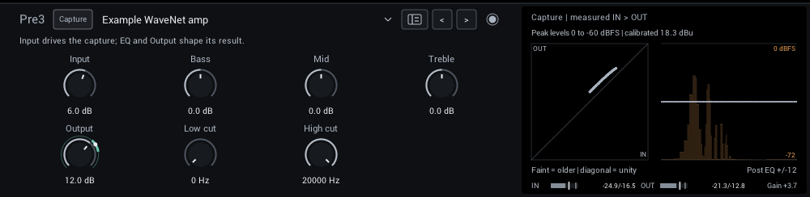
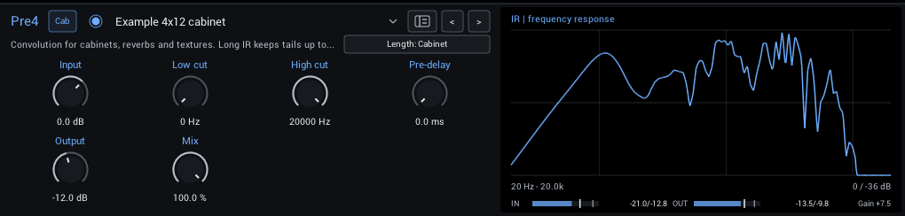

# Captures & cabinets

Load Neural Amp Modeler captures and impulse responses for cabinets, reverbs or sound design. The controls below shape their sound without changing the original files.

| Module | In short |
| --- | --- |
| [NAM](#nam) | Input drives the capture; EQ and Output shape its result. |
| [Cabinet IR](#cabinet-ir) | Convolution for cabinets, reverbs and textures, with a dry/wet blend. |

## NAM

Load a `.nam` capture of an amp, pedal, or full rig. Bass, Mid, and Treble are NAM Grid's post-capture EQ, not the captured amp's original controls. Compatible A2 captures offer **Quality: A2 / A2 Lite** in the header; A2 Lite uses less CPU.

| Control | Range | Start | What it does |
| --- | --- | --- | --- |
| **Input** | -40 to +40 dB | 0 dB | Drives the capture. |
| **Bass** | -12 to +12 dB | 0 dB | 150 Hz shelf after the capture. |
| **Mid** | -12 to +12 dB | 0 dB | Broad 800 Hz bell after the capture. |
| **Treble** | -12 to +12 dB | 0 dB | 3 kHz shelf after the capture. |
| **Output** | -40 to +40 dB | 0 dB | Level after the capture and its EQ. |
| **Low cut** | 0–300 Hz | 0 Hz | Removes low end after the capture; 0 is off. |
| **High cut** | 2000–20000 Hz | 20000 Hz | Removes highs after the capture; 20000 is open. |

**Display:** Left: the capture's measured input against output. Right: the post-capture EQ over the live output spectrum.

**Tips:**

- Set Input so the capture is driven as intended; its calibration in dBu shows in the display.

## Cabinet IR

Load a mono impulse response (`.wav`). Use **Length: Cabinet** for the original 8192-sample response, or **Length: Long IR** for reverb and experimental responses up to 30 seconds. IR levels vary, so match the wet volume with Input and Output. See [IR processing](ir-processing.md) for details.

| Control | Range | Start | What it does |
| --- | --- | --- | --- |
| **Input** | -36 to +18 dB | 0 dB | Gain into convolution; changes only the wet signal. |
| **Low cut** | 0–2000 Hz | 0 Hz | Wet high-pass, 12 dB/octave; 0 bypasses. |
| **High cut** | 200–20000 Hz | 20000 Hz | Wet low-pass, 12 dB/octave; 20000 bypasses. |
| **Pre-delay** | 0–500 ms | 0 ms | Delays the wet response, leaving dry timing unchanged. |
| **Output** | -36 to +18 dB | -18 dB | Wet level after convolution and cuts. Preserves the original cabinet gain. |
| **Mix** | 0–100% | 100% | Linear dry/wet blend; 0% passes the original signal unchanged. |

**Display:** Cabinet shows the loaded response's frequency curve; Long IR shows its peak envelope over time. Both show the retained IR before wet controls, relative to its peak. Hover for its duration.

**Tips:**

- Start at -18 dB Output and match the level with the strip below the editor.
- For a reverb insert, select Long IR, start at 10–25% Mix, add 15–40 ms Pre-delay and use the cuts to keep the tail clear. On a send, use 100% Mix.
- Input and Output change level, with no saturation. Input changes how strongly new audio excites the IR; Output also adjusts an already ringing tail.
- Blend unusual resonances or textures with the dry signal. Pre-delay changes the spacing of cancellations at intermediate Mix settings.
