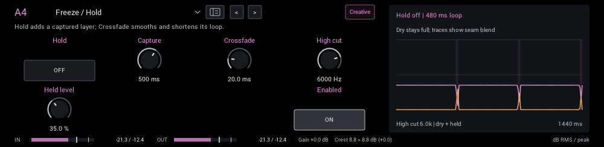
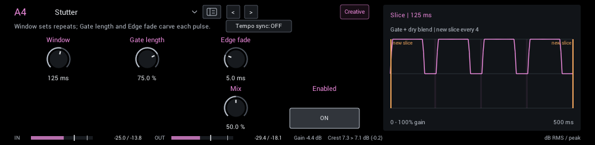
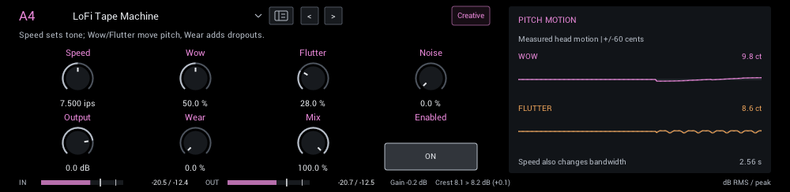

# Creative

Freeze, stutter and lo-fi tape. Each module shows its editor with the starting settings while guitar plays; see the
[module guide](README.md) for how the editor, its display and the level strip work.

| Module | In short |
| --- | --- |
| [Freeze / Hold](#freeze-hold) | Hold adds a captured layer; Crossfade smooths and shortens its loop. |
| [Stutter](#stutter) | Window sets repeats; Gate length and Edge fade carve each pulse. |
| [LoFi Tape Machine](#lofi-tape-machine) | Speed sets tone; Wow/Flutter move pitch, Wear adds dropouts. |

## Freeze / Hold

Captures a window of your playing and loops it underneath while you keep playing.

**Hold** (off / on; starts at off) Capture a fresh window and sustain it. Release to stop the held layer; dry guitar remains audible.

**Capture** (50 ms to 2000 ms; starts at 500 ms) Length of the held capture; short windows are more tonal, long windows retain more phrase texture.

**Crossfade** (1 ms to 100 ms; starts at 20 ms) Overlap at the loop seam; smooths joins and shortens the repeat period by the overlap length.

**High cut** (200 Hz to 16000 Hz; starts at 6000 Hz) High-cut frequency of the held layer; lower values soften repeated attacks.

**Held level** (0% to 100%; starts at 35%) Add the held layer to the dry signal. This is an additive level, not a dry/wet crossfade.

**Display:** The captured loop and its crossfaded seam.

**Tips:**

- Turn Hold on while a chord rings; Crossfade smooths the loop.

## Stutter

Gated slices of the signal at a set window, with soft edges.

**Window** (10 ms to 1000 ms; starts at 125 ms) Repeat period of the captured slice; tempo sync substitutes a musical division.

**Gate length** (5% to 100%; starts at 75%) Percentage of each slice that sounds; shorter gates leave more rhythmic silence.

**Edge fade** (0.1 ms to 20 ms; starts at 5 ms) Fade at each gate edge; smooths clicks and can soften very short gates.

**Mix** (0% to 100%; starts at 50%) Blend dry and processed sound; higher settings make the effect more prominent. Output, when present, follows the blend.

In the header:

- **Tempo sync** follows the host tempo. Use host tempo and a rhythmic division instead of manual time/rate. Falls back to 120 BPM without host tempo.
- **Division** (1/32 to 1/1, including triplets and dotted notes) replaces the time or rate knob while Tempo sync is on.

**Display:** The slice gate over time.

## LoFi Tape Machine

Tape transport character: speed-dependent bandwidth, wow, flutter, hiss, wear and dropouts. See [LoFi Tape Machine](../lofi-tape.md).

**Speed** (1.875 ips to 30 ips; starts at 7.5 ips) Tape speed in inches per second. Slower is darker and changes transport character without retuning the guitar.

**Wow** (0% to 100%; starts at 50%) Slow pitch drift; the green trace shows measured wow motion in cents.

**Flutter** (0% to 100%; starts at 28%) Fast pitch vibration; the amber trace uses the same cents scale as wow.

**Noise** (0% to 100%; starts at 0%) Independent stereo tape hiss, including between notes. Zero turns hiss off.

**Output** (-24 dB to 6 dB; starts at 0 dB) Final level after dry/wet blending. Match bypass loudness before judging the effect.

**Wear** (0% to 100%; starts at 0%) Darker tape and irregular level dropouts. This control does not add saturation.

**Mix** (0% to 100%; starts at 100%) Blend dry and processed sound; higher settings make the effect more prominent. Output, when present, follows the blend.

**Display:** The measured wow and flutter pitch motion of the transport.
