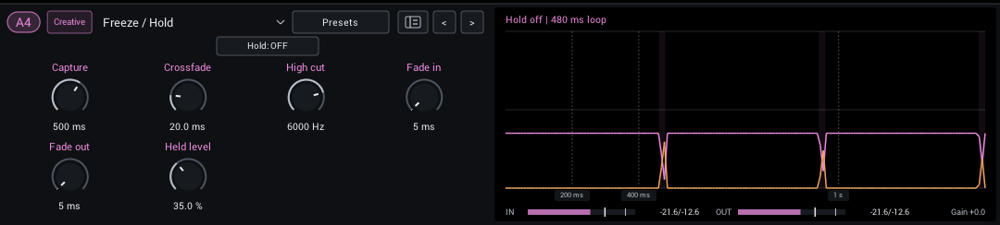
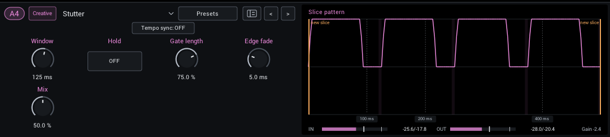
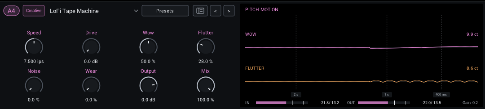

# Creative

Freeze, stutter, granular textures and lo-fi tape.

| Module | In short |
| --- | --- |
| [Freeze / Hold](#freeze--hold) | Hold adds a captured layer; Crossfade smooths and shortens its loop. |
| [Stutter](#stutter) | Window sets repeats; Gate length and Edge fade carve each pulse. |
| [Granulator](#granulator) | Grain textures from the last four seconds: Mode picks clouds, shimmer, drones, reverse, glitch or arpeggios; Activity, Shape and Filter play them. |
| [LoFi Tape Machine](#lofi-tape-machine) | Speed sets tone; Wow/Flutter move pitch, Wear adds dropouts. |

## Freeze / Hold

Captures a window of your playing and loops it underneath while you keep playing.

| Control | Range | Start | What it does |
| --- | --- | --- | --- |
| **Hold** | Off / On | Off | Capture a fresh window and sustain it. Release to stop the held layer; dry guitar remains audible. |
| **Capture** | 50–2000 ms | 500 ms | Length of the held capture; short windows are more tonal, long windows retain more phrase texture. |
| **Crossfade** | 1–100 ms | 20 ms | Overlap at the loop seam; smooths joins and shortens the repeat period by the overlap length. |
| **High cut** | 200–16000 Hz | 6000 Hz | High-cut frequency of the held layer; lower values soften repeated attacks. |
| **Fade in** | 1–2000 ms | 5 ms | Fade-in time for the held layer, independent of the loop-seam Crossfade. |
| **Fade out** | 1–4000 ms | 5 ms | Fade-out time when Hold is released; the dry guitar continues unchanged. |
| **Held level** | 0–100% | 35% | Add the held layer to the dry signal. This is an additive level, not a dry/wet crossfade. |

**Display:** The captured loop and its crossfaded seam.

**Tips:**

- Turn Hold on while a chord rings; Crossfade smooths the loop.

## Stutter

Gated slices of the signal at a set window, with soft edges.

| Control | Range | Start | What it does |
| --- | --- | --- | --- |
| **Window** | 10–1000 ms | 125 ms | Repeat period of the captured slice; tempo sync substitutes a musical division. |
| **Hold** | Off / On | Off | Keeps the current slice repeating instead of refreshing it every four windows. |
| **Gate length** | 5–100% | 75% | Percentage of each slice that sounds; shorter gates leave more rhythmic silence. |
| **Edge fade** | 0.1–20 ms | 5 ms | Fade at each gate edge; smooths clicks and can soften very short gates. |
| **Mix** | 0–100% | 50% | Balance between dry sound and effect. |

In the header:

- **Tempo sync** locks Window to your DAW tempo; **Division** then sets it in note values. See [tempo sync](README.md#tempo-sync).

**Display:** The slice gate over time.

## Granulator

Records the last four seconds of your playing and replays it as short, overlapping grains. **Mode** picks what the grains do; every mode is played with the same few knobs, so a sound is quick to dial in. The grain engine follows Mutable Instruments Clouds and its successor Beads; the modes and the Activity, Shape, Filter, Repeats and Space controls are inspired by the Hologram Microcosm pedal and the Grainbloom MPC plugin. Pitched modes use only octaves and fifths, so they suit any key.

| Mode | Timing | Sound and use |
| --- | --- | --- |
| **Cloud** | Random | Classic Clouds-style grain cloud, lightly scattered and detuned. Raise Activity until the grains join into a cloud. |
| **Haze** | Random | Many long, drifting grains from all over the buffer with occasional octaves, diffused into a wash. Ambient pads. |
| **Shimmer** | Random | Grains one and two octaves up over the original pitch, smooth and wide. Shape near 100% swells each grain in. |
| **Tunnel** | Random | Long grains an octave down with the original pitch, dark and diffused: a drone under your playing. |
| **Mosaic** | Even | Fragments at half, normal and double speed, some reversed, layered into a shifting pattern of your phrase. |
| **Reverse** | Random | Every grain plays backwards, so notes swell in. Long Size and some Repeats give reverse-delay washes. |
| **Blocks** | Even | Evenly timed repeats of the latest audio. Shape near 0% makes them percussive. |
| **Interrupt** | Even | Fragments jump around the last second and sometimes reverse or change octave: a controlled glitch. |
| **Arp** | Even | Grains step through root, fifth and octaves, up and down. Activity sets the step rate. |

| Control | Range | Start | What it does |
| --- | --- | --- | --- |
| **Position** | 0–100% | 15% | Where grains start in the last four seconds of your playing. 0% reads what you just played; higher settings reach further back. With Freeze on, move it to explore the held audio. |
| **Size** | 10–1000 ms | 180 ms | Length of each grain. Short grains buzz and stutter; long ones smear notes together. Haze, Tunnel and Reverse lengthen it further. |
| **Activity** | 0–100% | 50% | How many grains play, or in even modes how often they start: from sparse, separate grains to a dense cloud. |
| **Shape** | 0–100% | 50% | Grain envelope: 0% starts each grain hard and lets it fade, 50% is smooth, 100% swells in and stops, like a reversed note. |
| **Filter** | -100 to +100% | 0% | Tone of the grains. Left darkens them with a low-pass down to 200 Hz, right thins them with a high-pass up to 4 kHz; center is open. Repeats records the filtered sound, so it compounds. |
| **Repeats** | 0–100% | 20% | Record the grains back into the buffer, so the texture builds on itself. High settings sustain long; the loop never runs away. |
| **Space** | 0–100% | 30% | Plate reverb on the grains, longer and louder as you turn it up. The dry guitar stays dry. |
| **Mix** | 0–100% | 40% | Blend between your guitar and the grains. 100% plays only the grains. |

In the header:

- **Freeze** (Off / On; starts Off) Stops recording and keeps making grains from the last four seconds. Release to record again. Freeze is not saved with rigs or scenes.
- **Mode** (Cloud, Haze, Shimmer, Tunnel, Mosaic, Reverse, Blocks, Interrupt, Arp; starts at Cloud) Picks what the grains do. A change applies to new grains, so modes blend into each other as old grains end.

**Display:** The four-second buffer with the span grains read at Position and, fainter, how far the mode scatters them. Below, a sketch of the grains over time, panned from left (up) to right (down); amber grains play backwards and numbers give each pitched grain's interval. The sketch uses the module's own timing and choices, so it shows each mode as it plays.

**Latency:** none. Grains read only audio you have already played. Mix 0% returns the exact dry signal.

**Presets:** one per mode (Grain cloud, Ambient haze, Octave shimmer, Low drone tunnel, Phrase mosaic, Reverse swells, Rhythmic blocks, Glitch interrupt, Fifths arpeggio) and Dark frozen bed.

**Tips:**

- Start with Mix around 30–40% and raise Activity until the grains are as busy as you like.
- Play a chord, turn on Freeze, then move Position and Mode to play the frozen moment.
- Turn Filter left with high Repeats for dark, evolving washes; right for thin, airy shimmer.
- Bypassing with Trails on lets the grains play out. Without Trails, a bypassed Granulator clears its buffer, even while frozen.

## LoFi Tape Machine

Tape transport character: speed-dependent bandwidth, wow, flutter, hiss, wear and dropouts. See [LoFi Tape Machine](lofi-tape.md).

| Control | Range | Start | What it does |
| --- | --- | --- | --- |
| **Speed** | 1.875–30 ips | 7.5 ips | Tape speed in inches per second. Slower is darker and changes transport character without retuning the guitar. |
| **Drive** | 0–24 dB | 0 dB | Oversampled Spiral saturation before the tape transport; zero bypasses saturation exactly. |
| **Wow** | 0–100% | 50% | Slow pitch drift; the green trace shows measured wow motion in cents. |
| **Flutter** | 0–100% | 28% | Fast pitch vibration; the amber trace uses the same cents scale as wow. |
| **Noise** | 0–100% | 0% | Independent stereo tape hiss, including between notes. Zero turns hiss off. |
| **Wear** | 0–100% | 0% | Darker tape and irregular level dropouts. Drive adds saturation independently. |
| **Output** | -24 to +6 dB | 0 dB | Final level. Match bypass volume when comparing tones. |
| **Mix** | 0–100% | 100% | Balance between dry sound and effect. |

**Display:** The measured wow and flutter pitch motion of the transport.
