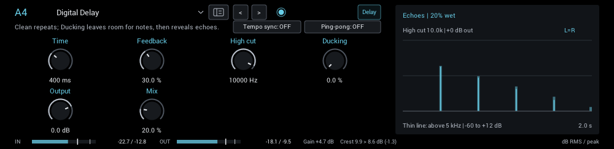
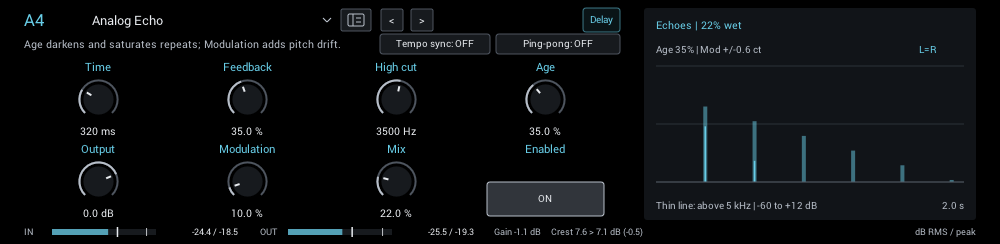
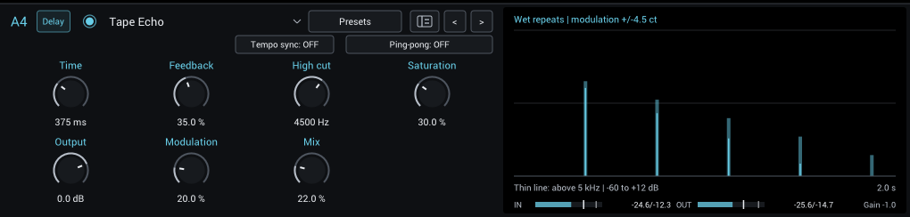
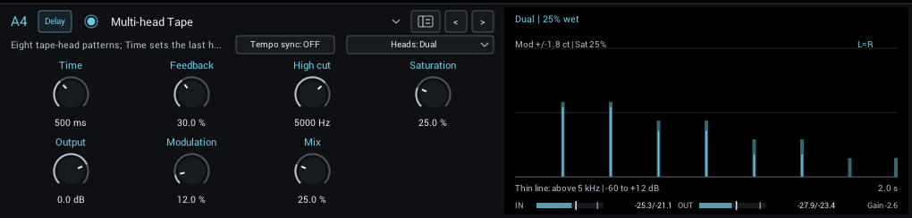
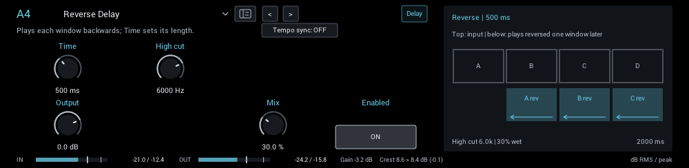
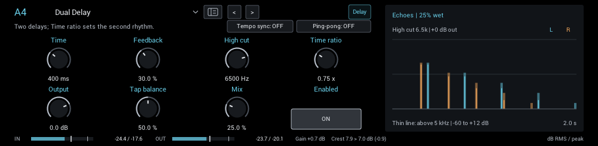
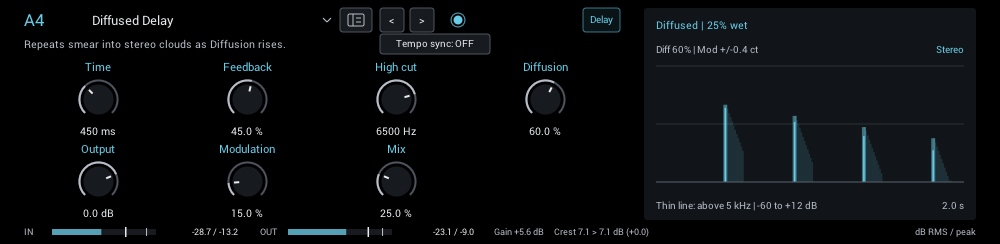

# Delay

Echoes from clean digital to tape and diffused. Screenshots show each parameter pane at its starting settings.

| Module | In short |
| --- | --- |
| [Digital Delay](#digital-delay) | Clean repeats; Ducking leaves room for notes, then reveals echoes. |
| [Analog Echo](#analog-echo) | Age darkens and saturates repeats; Modulation adds pitch drift. |
| [Tape Echo](#tape-echo) | Saturated repeats; Modulation adds tape-like pitch wobble. |
| [Multi-head Tape](#multi-head-tape) | Eight tape-head patterns; Time sets the last head. |
| [Reverse Delay](#reverse-delay) | Plays each window backwards; Time sets its length. |
| [Dual Delay](#dual-delay) | Two delays; Time ratio sets the second rhythm. |
| [Diffused Delay](#diffused-delay) | Repeats smear into stereo clouds as Diffusion rises. |

## Digital Delay

Clean repeats with a high cut. Ducking lowers the repeats while you play and brings them back in the gaps.

**Time** (5 ms to 4000 ms; starts at 400 ms) Time to the first repeat. Changing it while repeats sound bends their pitch, like tape.

**Feedback** (0% to 82%; starts at 30%) Amount returned for another repeat. Higher settings make more repeats and longer tails.

**High cut** (800 Hz to 12000 Hz; starts at 10000 Hz) High-cut frequency of the repeats. Lower values darken echoes without dulling the dry guitar.

**Ducking** (0% to 100%; starts at 0%) Ducks repeats while you play; echoes recover in the gaps.

**Output** (-18 dB to 6 dB; starts at 0 dB) Final level after the dry/effect blend. Match bypass volume when comparing tones.

**Mix** (0% to 100%; starts at 20%) Balance the dry sound and effect. Output, when present, is applied after this blend.

In the header:

- **Tempo sync** locks Time to your DAW tempo, or 120 BPM when no tempo is available.
- **Division** replaces Time while synced: 1/32 to 1/1, including triplets and dotted notes.
- **Ping-pong** (off / on; starts off) Feed the mono sum into the left tap and alternate repeats between left and right. Dry stereo stays unchanged.

**Display:** The repeats on a dB scale. A thin line inside each stem shows how much survives above 5 kHz; ticks show the ducked level.

## Analog Echo

Darker, softer repeats with gradually worn-in character. Age adds more darkening and saturation.

**Time** (5 ms to 4000 ms; starts at 320 ms) Time to the first repeat. Changing it while repeats sound bends their pitch, like tape.

**Feedback** (0% to 82%; starts at 35%) Amount returned for another repeat. Higher settings make more repeats and longer tails.

**High cut** (800 Hz to 12000 Hz; starts at 3500 Hz) High-cut frequency of the repeats. Lower values darken echoes without dulling the dry guitar.

**Age** (0% to 100%; starts at 35%) More darkening and soft saturation on each repeat.

**Output** (-18 dB to 6 dB; starts at 0 dB) Final level after the dry/effect blend. Match bypass volume when comparing tones.

**Modulation** (0% to 100%; starts at 10%) Pitch movement of repeats. Zero is stable; higher values add chorus-like wobble.

**Mix** (0% to 100%; starts at 22%) Balance the dry sound and effect. Output, when present, is applied after this blend.

In the header:

- **Tempo sync** locks Time to your DAW tempo, or 120 BPM when no tempo is available.
- **Division** replaces Time while synced: 1/32 to 1/1, including triplets and dotted notes.
- **Ping-pong** (off / on; starts off) Feed the mono sum into the left tap and alternate repeats between left and right. Dry stereo stays unchanged.

**Display:** The repeats on a dB scale; the thin line inside each stem shows the content above 5 kHz.

## Tape Echo

Filtered, saturated repeats with tape-style wow and flutter from Modulation.

**Time** (5 ms to 4000 ms; starts at 375 ms) Time to the first repeat. Changing it while repeats sound bends their pitch, like tape.

**Feedback** (0% to 82%; starts at 35%) Amount returned for another repeat. Higher settings make more repeats and longer tails.

**High cut** (800 Hz to 12000 Hz; starts at 4500 Hz) High-cut frequency of the repeats. Lower values darken echoes without dulling the dry guitar.

**Saturation** (0% to 100%; starts at 30%) Soft saturation on repeats. Modulation controls the tape wobble separately.

**Output** (-18 dB to 6 dB; starts at 0 dB) Final level after the dry/effect blend. Match bypass volume when comparing tones.

**Modulation** (0% to 100%; starts at 20%) Pitch movement of repeats. Zero is stable; higher values add chorus-like wobble.

**Mix** (0% to 100%; starts at 22%) Balance the dry sound and effect. Output, when present, is applied after this blend.

In the header:

- **Tempo sync** locks Time to your DAW tempo, or 120 BPM when no tempo is available.
- **Division** replaces Time while synced: 1/32 to 1/1, including triplets and dotted notes.
- **Ping-pong** (off / on; starts off) Feed the mono sum into the left tap and alternate repeats between left and right. Dry stereo stays unchanged.

**Display:** The repeats on a dB scale; the thin line inside each stem shows the content above 5 kHz.

## Multi-head Tape

Up to four playback heads in eight patterns, including stereo modes; only the last head feeds back. Time sets the last head.

**Time** (5 ms to 4000 ms; starts at 500 ms) Time of the last playback head. Other selected heads occur at one quarter, one half and three quarters of this interval.

**Feedback** (0% to 82%; starts at 30%) Amount returned for another repeat. Higher settings make more repeats and longer tails.

**High cut** (800 Hz to 12000 Hz; starts at 5000 Hz) High-cut frequency of the repeats. Lower values darken echoes without dulling the dry guitar.

**Saturation** (0% to 100%; starts at 25%) Soft saturation on repeats. Modulation controls the tape wobble separately.

**Output** (-18 dB to 6 dB; starts at 0 dB) Final level after the dry/effect blend. Match bypass volume when comparing tones.

**Modulation** (0% to 100%; starts at 12%) Pitch movement of repeats. Zero is stable; higher values add chorus-like wobble.

**Mix** (0% to 100%; starts at 25%) Balance the dry sound and effect. Output, when present, is applied after this blend.

In the header:

- **Tempo sync** locks Time to your DAW tempo, or 120 BPM when no tempo is available.
- **Division** replaces Time while synced: 1/32 to 1/1, including triplets and dotted notes.
- **Heads** (Single, Dual, Syncopated, All heads, Early pair, Late pair, Stereo dual, Stereo cascade; starts at Dual) Single: the last head, at full Time. Feedback always comes from the last head.

**Display:** Each head's repeats on a dB scale.

## Reverse Delay

Records a window and plays it backwards one window later.

**Time** (5 ms to 4000 ms; starts at 500 ms) Length of each reversed capture window; not a conventional first-echo delay.

**High cut** (800 Hz to 12000 Hz; starts at 6000 Hz) High-cut frequency of the repeats. Lower values darken echoes without dulling the dry guitar.

**Output** (-18 dB to 6 dB; starts at 0 dB) Final level after the dry/effect blend. Match bypass volume when comparing tones.

**Mix** (0% to 100%; starts at 30%) Balance the dry sound and effect. Output, when present, is applied after this blend.

In the header:

- **Tempo sync** locks Time to your DAW tempo, or 120 BPM when no tempo is available.
- **Division** replaces Time while synced: 1/32 to 1/1, including triplets and dotted notes.

**Display:** The captured windows and when each plays reversed.

## Dual Delay

Two delay taps; the right tap's time is Time multiplied by Time ratio. Ping-pong feeds them crosswise.

**Time** (5 ms to 4000 ms; starts at 400 ms) Time of the left tap. The right tap is this value multiplied by Time ratio.

**Feedback** (0% to 82%; starts at 30%) Amount returned for another repeat. Higher settings make more repeats and longer tails.

**High cut** (800 Hz to 12000 Hz; starts at 6500 Hz) High-cut frequency of the repeats. Lower values darken echoes without dulling the dry guitar.

**Time ratio** (0.25× to 2×; starts at 0.75×) Right delay time divided by left time. 0.75 gives a dotted-eighth partner to a quarter-note left delay.

**Output** (-18 dB to 6 dB; starts at 0 dB) Final level after the dry/effect blend. Match bypass volume when comparing tones.

**Tap balance** (0% to 100%; starts at 50%) Balance between the two wet taps; center keeps both at full level. Dry stereo stays unchanged.

**Mix** (0% to 100%; starts at 25%) Balance the dry sound and effect. Output, when present, is applied after this blend.

In the header:

- **Tempo sync** locks Time to your DAW tempo, or 120 BPM when no tempo is available.
- **Division** replaces Time while synced: 1/32 to 1/1, including triplets and dotted notes.
- **Ping-pong** (off / on; starts off) Cross-feedback mode: feed the mono sum into the left tap, then alternate through left and right delay times.

**Display:** Left and right repeats on a dB scale.

**Tips:**

- Time ratio 0.75 with a quarter-note Time gives the classic dotted-eighth pair.

## Diffused Delay

Repeats smear into stereo reflection clusters as Diffusion rises; zero is a plain echo.

**Time** (5 ms to 4000 ms; starts at 450 ms) Time to the first repeat. Changing it while repeats sound bends their pitch, like tape.

**Feedback** (0% to 82%; starts at 45%) Amount returned for another repeat. Higher settings make more repeats and longer tails.

**High cut** (800 Hz to 12000 Hz; starts at 6500 Hz) High-cut frequency of the repeats. Lower values darken echoes without dulling the dry guitar.

**Diffusion** (0% to 100%; starts at 60%) Smear each repeat through rotating allpass stages. Zero is a clear echo; higher values spread attacks into stereo clouds.

**Output** (-18 dB to 6 dB; starts at 0 dB) Final level after the dry/effect blend. Match bypass volume when comparing tones.

**Modulation** (0% to 100%; starts at 15%) Pitch movement of repeats. Zero is stable; higher values add chorus-like wobble.

**Mix** (0% to 100%; starts at 25%) Balance the dry sound and effect. Output, when present, is applied after this blend.

In the header:

- **Tempo sync** locks Time to your DAW tempo, or 120 BPM when no tempo is available.
- **Division** replaces Time while synced: 1/32 to 1/1, including triplets and dotted notes.

**Display:** The repeats with their diffusion clusters.
