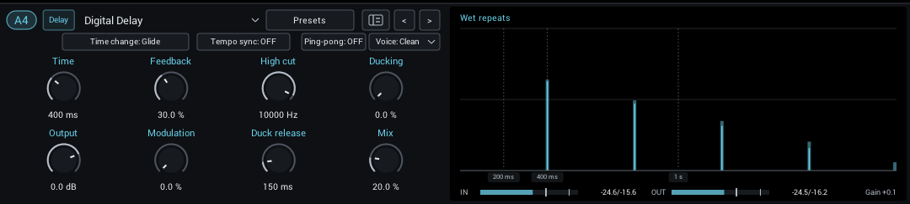
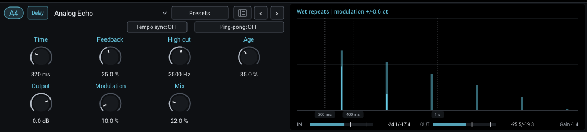
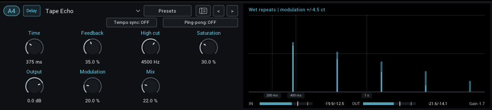
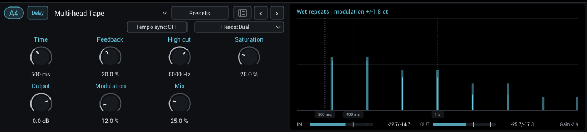
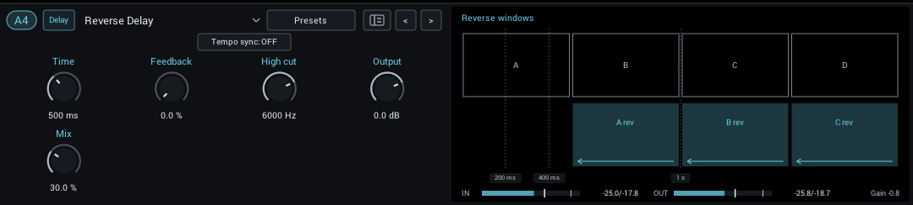
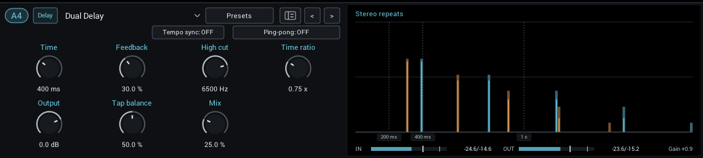
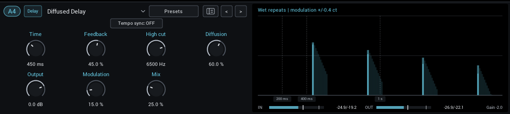

# Delay

Echoes from clean digital to tape and diffused.

Settings' **Trails** toggle lets every bypassed delay and reverb ring out: new playing stops reaching it, and its tail continues over the dry signal. It is off by default; see [rig behaviour in Settings](../ui.md#rig-behaviour).

Settings' **Keep dry level** toggle applies to every delay and reverb in the rig. Off (the default), Mix crossfades from dry to wet. On, the dry signal stays at unity and Mix sets the wet level: 100% gives full dry plus full wet. Whole-signal Output trims still affect both, so high Mix settings can raise the total level. Mix 0% stays dry in both laws.

| Module | In short |
| --- | --- |
| [Digital Delay](#digital-delay) | Clean repeats; Ducking leaves room for notes, then reveals echoes. |
| [Analog Echo](#analog-echo) | Age darkens and saturates repeats; Modulation adds pitch drift. |
| [Tape Echo](#tape-echo) | Saturated repeats; Modulation adds tape-like pitch wobble. |
| [Multi-head Tape](#multi-head-tape) | Eight tape-head patterns; Time sets the last head. |
| [Reverse Delay](#reverse-delay) | Plays each window backwards; Time sets its length. |
| [Dual Delay](#dual-delay) | Two delays; Time ratio sets the second rhythm. |
| [Diffused Delay](#diffused-delay) | Repeats smear into stereo clouds as Diffusion rises. |
| [Granular Delay](#granular-delay) | Overlapping fragments that spread, reverse or stutter around the echo time. |
| [Vintage Digital Delay](#vintage-digital-delay) | Rack-style modulation, clean repeats, ducking or reduced-resolution feedback. |
| [Pattern Delay](#pattern-delay) | Four timed and panned echo taps with selectable feedback routing. |
| [Feedback FX Delay](#feedback-fx-delay) | A filter, phaser, tremolo or ring modulator changes each repeat before it feeds back. |
| [Pitch Delay](#pitch-delay) | Blend ordinary echoes with repeats that climb or fall in musical intervals. |
| [Bucket Brigade](#bucket-brigade) | Companded analog repeats with bandwidth that narrows at slower clock speeds. |
| [Space Tape Echo](#space-tape-echo) | Three tape heads with parallel spring reverb. |

## Factory starting points

For ordinary support behind your guitar, the insertion sounds are deliberately
moderate; **Reset** restores them. Use **Presets** for a different playing role,
then adjust Mix in the rig. These recipes assume an insert after the amp.

| Module | Useful starting point | Why choose it |
| --- | --- | --- |
| Digital Delay | Clear quarter-note lead; Quiet ducked support | Choose a clear, unducked quarter-note echo or quiet support that recovers in the gaps. All synced Digital Delay recipes use Crossfade for tempo jumps. |
| Analog Echo | Warm lead repeats; Bright dotted echoes | Choose soft, dark lead support or a clearer dotted-eighth rhythm with restrained modulation. |
| Tape Echo | Rock lead echo; Clean dotted tape | A quiet, short lead repeat or a brighter synced rhythm with light saturation and wobble. |
| Multi-head Tape | Sparse stereo heads | Half-time on the left and full-time on the right; fewer taps than the rolling and cascade patterns. |
| Reverse Delay | Short reverse texture | A short capture window and modest mix under your dry attack; Reverse half notes gives longer reversed phrases. |
| Dual Delay | Tight stereo double | Two short taps with no feedback, for light width; Quarter and dotted eighth gives an interlocking rhythm instead. |
| Diffused Delay | Gentle pad echoes | Moderate feedback and diffusion soften sustained notes; Echo into cloud is the longer, more diffuse alternative. |
| Space Tape Echo | Short and long heads | Light spring behind triplet and quarter-note taps; try Worn twin-head trail for darker, less stable repeats. |
| Bucket Brigade | Short chorus double | Modulated doubling with almost no feedback; Compact slap leaves more room between the dry note and its repeat. |
| Pitch Delay | Descending fourths | Dotted-eighth echoes step down in fourths with each shifted pass. |
| Feedback FX Delay | Tremolo slap | A short repeat with amp-like volume modulation. |
| Pattern Delay | Dotted-eighth reply | A left dotted-eighth tap and a quieter quarter-note answer on the right. |
| Vintage Digital Delay | Telephone repeats | A pronounced low cut and high cut give the dotted-eighth repeats a narrow band of mids. |
| Granular Delay | Half-note reverse swells | Long reversed fragments follow the phrase at about half-note intervals; Subtle grain double adds a short texture. |

The banks also include beat-synced choices for rhythm, leads and ambient parts.
Shared divisions are intentional: choose a delay type for its character, then a
recipe for the part. These are starting settings, not exact artist or pedal models.

| Module | More synced choices | Character and use |
| --- | --- | --- |
| Digital Delay | Clear eighth-note rhythm; Quarter-note ping-pong; Half-note space | Clear articulation and alternating stereo echoes, from short rhythms to longer trails. These recipes use Crossfade for tempo jumps. |
| Analog Echo | Warm quarter notes; Soft eighth-note pulse; Dark dotted lead; Modulated half-note bed | Worn, progressively darker repeats; restrained motion for rhythms and more movement for sustained chords. |
| Tape Echo | Warm quarter-note tape; Eighth-note tape bounce; Dotted-quarter tape drift; Half-note tape haze | Saturation and wobble, from short rhythmic bounces to long drifting trails. |
| Multi-head Tape | Eighth and quarter heads; Dotted and quarter heads; Synced rolling heads; Half-note head cloud | Multiple taps per cycle, with sparse pairs, syncopated patterns or a dense all-head trail. |
| Reverse Delay | Eighth-note reverse flicker; Quarter-note reverse bloom; Dotted-quarter reverse wash | Short reversed fragments, phrase blooms or a darker wash. The division sets the capture window, rather than a conventional repeat interval. |
| Dual Delay | Eighth and dotted eighth; Quarter and eighth; Quarter and triplet; Synced dotted ping-pong; Half and dotted quarter | Independent stereo pulse trains, or alternating unequal delays with Ping-pong enabled. |
| Diffused Delay | Soft dotted-eighth rhythm; Quarter-note echo halo; Triplet echo clusters; Dotted-quarter dream; Half-note cloud | Low diffusion retains the pulse; higher diffusion turns longer divisions into clouds behind sustained notes. |

At 120 BPM, eighth notes are 250 ms, eighth-note triplets about 167 ms, and
dotted quarters 750 ms. **Quarter and triplet** uses a 500 ms left tap and a
333 ms right tap (quarter-note triplets). **Eighth and dotted eighth** uses
250/375 ms; **Half and dotted quarter** uses 1000/750 ms.
With **Synced dotted ping-pong**, the 500/375 ms taps alternate through
cross-feedback; each side does not repeat as an independent pulse train.

Multi-head Time sets the last head. With a quarter-note division at 120 BPM,
**Eighth and quarter heads** plays taps at 250/500 ms, **Dotted and quarter
heads** at 375/500 ms, and **Synced rolling heads** at 125/375/500 ms.
**Half-note head cloud** uses all heads at 250/500/750/1000 ms.

**Starting levels:** Clear quarter-note lead is the straightforward digital lead
choice; Quiet ducked support leaves more space during busy phrases. The reverse
wash keeps a clear dry attack with longer feedback, while Reversed solo is
deliberately wet enough to put the backwards phrase in front. The named washes
and clouds are ambient options; start with the quieter support recipes for
continuous rhythm playing. Free-time and synced versions intentionally coexist:
a fixed echo can suit a phrase even when it does not follow the host tempo.

**Timing:** at 120 BPM, a quarter note is 500 ms and a dotted eighth is 375 ms.
Sparse stereo heads puts the left head at half the quarter-note Time (250 ms)
and the right at full Time (500 ms). Tight stereo double instead uses fixed
80/100 ms left/right taps; it is not tempo-synced. Reverse Delay's Time is a
capture-window length, so do not treat it as the time of a conventional first echo.

**Use the differences:** Analog Echo darkens and saturates successive repeats;
Tape Echo has a different saturation and wobble character. The two dotted recipes
share a rhythm so you can compare their color. Multi-head Tape reads several
positions in one tape pattern; Dual Delay has two independently timed taps.
Diffused Delay smears attacks rather than merely turning down the high cut.

Start with modest Feedback, then raise Mix until the first repeats support the
part. Lower High cut if echoes compete with the pick attack; keep modulation low
for tight rhythm. Digital Delay's Ducking makes space while notes sound. A
longer Duck release keeps echoes down through short gaps; a shorter release lets
them return sooner. Check stereo recipes folded to mono as well as in stereo.

These choices draw on the author's own analog-style and tape-style delay settings
and on general delay-control practice. They adapt playing roles, not normalized preset values or exact sounds.
For example, NAM Grid's Analog Echo does not have ValhallaDelay's ducking, and
Tape Echo does not expose its diffusion controls. Quiet ducked support uses
Digital Delay, while Gentle pad echoes uses Diffused Delay.

The expanded rhythmic choices also draw on players' suggestions in the
[delay tips discussion](https://www.reddit.com/r/guitarpedals/comments/1k7acuc/)
and [Line 6 dotted-eighth discussion](https://line6.com/support/topic/1856-dotted-8th-settings/),
including dotted-eighth leads, quarter-note support and reverse dotted-quarter
textures. [Strymon's Volante guide](https://www.strymon.net/support/volante/)
explains the even head-spacing rhythms used as inspiration for the multi-head
pairs. NAM Grid has fixed head patterns and last-head feedback, so it does not
reproduce Volante's independent head-feedback switches.

## Digital Delay

Clean repeats with a high cut. Ducking lowers the repeats while you play and brings them back in the gaps.

| Control | Range | Start | What it does |
| --- | --- | --- | --- |
| **Time** | 5–4000 ms | 400 ms | Time to the first repeat. **Time change** chooses whether jumps bend pitch or crossfade. |
| **Feedback** | 0–82% | 30% | Amount returned for another repeat. Higher settings make more repeats and longer tails. |
| **High cut** | 800–12000 Hz | 10000 Hz | High-cut frequency of the repeats. Lower values darken echoes without dulling the dry guitar. |
| **Ducking** | 0–100% | 0% | Ducks repeats while you play; echoes recover in the gaps. |
| **Duck release** | 10–1000 ms | 150 ms | Time for ducked echoes to recover in gaps; 150 ms retains the original recovery. |
| **Output** | -18 to +6 dB | 0 dB | Final level. Match bypass volume when comparing tones. |
| **Mix** | 0–100% | 20% | Dry/wet balance, or wet level with Settings' **Keep dry level** on. |

In the header:

- **Time change** (Glide / Crossfade; starts on Glide) is saved per slot, without host automation. Glide keeps the tape-style pitch bend when Time moves. Crossfade blends the old and new taps over 30 ms when the target changes by more than 1 ms in one control update, including tempo-sync and Division jumps. Changes of 1 ms or less per update still glide, preserving gentle modulation; faster or deeper modulation can crossfade. Both stereo channels and feedback use the same blend. If another jump arrives during a fade, it waits until that fade ends, then fades to the latest target. New inserts and older saved rigs both start on Glide.
- **Tempo sync** locks Time to your DAW tempo; **Division** then sets it in note values. See [tempo sync](README.md#tempo-sync).
- **Ping-pong** (off / on; starts off) Feed the mono sum into the left tap and alternate repeats between left and right. Dry stereo stays unchanged.

**Display:** The repeats on a dB scale. A thin line inside each stem shows how much survives above 5 kHz; ticks show the ducked level.

## Analog Echo

Darker, softer repeats with gradually worn-in character. Age adds more darkening and saturation.

| Control | Range | Start | What it does |
| --- | --- | --- | --- |
| **Time** | 5–4000 ms | 320 ms | Time to the first repeat. Changing it while repeats sound bends their pitch, like tape. |
| **Feedback** | 0–82% | 35% | Amount returned for another repeat. Higher settings make more repeats and longer tails. |
| **High cut** | 800–12000 Hz | 3500 Hz | High-cut frequency of the repeats. Lower values darken echoes without dulling the dry guitar. |
| **Age** | 0–100% | 35% | More darkening and soft saturation on each repeat. |
| **Output** | -18 to +6 dB | 0 dB | Final level. Match bypass volume when comparing tones. |
| **Modulation** | 0–100% | 10% | Pitch movement of repeats. Zero is stable; higher values add chorus-like wobble. |
| **Mix** | 0–100% | 22% | Dry/wet balance, or wet level with Settings' **Keep dry level** on. |

In the header:

- **Tempo sync** locks Time to your DAW tempo; **Division** then sets it in note values. See [tempo sync](README.md#tempo-sync).
- **Ping-pong** (off / on; starts off) Feed the mono sum into the left tap and alternate repeats between left and right. Dry stereo stays unchanged.

**Display:** The repeats on a dB scale; the thin line inside each stem shows the content above 5 kHz.

## Tape Echo

Filtered, saturated repeats with tape-style wow and flutter from Modulation.

| Control | Range | Start | What it does |
| --- | --- | --- | --- |
| **Time** | 5–4000 ms | 375 ms | Time to the first repeat. Changing it while repeats sound bends their pitch, like tape. |
| **Feedback** | 0–82% | 35% | Amount returned for another repeat. Higher settings make more repeats and longer tails. |
| **High cut** | 800–12000 Hz | 4500 Hz | High-cut frequency of the repeats. Lower values darken echoes without dulling the dry guitar. |
| **Saturation** | 0–100% | 30% | Soft saturation on repeats. Modulation controls the tape wobble separately. |
| **Output** | -18 to +6 dB | 0 dB | Final level. Match bypass volume when comparing tones. |
| **Modulation** | 0–100% | 20% | Pitch movement of repeats. Zero is stable; higher values add chorus-like wobble. |
| **Mix** | 0–100% | 22% | Dry/wet balance, or wet level with Settings' **Keep dry level** on. |

In the header:

- **Tempo sync** locks Time to your DAW tempo; **Division** then sets it in note values. See [tempo sync](README.md#tempo-sync).
- **Ping-pong** (off / on; starts off) Feed the mono sum into the left tap and alternate repeats between left and right. Dry stereo stays unchanged.

**Display:** The repeats on a dB scale; the thin line inside each stem shows the content above 5 kHz.

## Multi-head Tape

Up to four playback heads in eight patterns, including stereo modes; only the last head feeds back. Time sets the last head.

| Control | Range | Start | What it does |
| --- | --- | --- | --- |
| **Time** | 5–4000 ms | 500 ms | Time of the last playback head. Other selected heads occur at one quarter, one half and three quarters of this interval. |
| **Feedback** | 0–82% | 30% | Amount returned for another repeat. Higher settings make more repeats and longer tails. |
| **High cut** | 800–12000 Hz | 5000 Hz | High-cut frequency of the repeats. Lower values darken echoes without dulling the dry guitar. |
| **Saturation** | 0–100% | 25% | Soft saturation on repeats. Modulation controls the tape wobble separately. |
| **Output** | -18 to +6 dB | 0 dB | Final level. Match bypass volume when comparing tones. |
| **Modulation** | 0–100% | 12% | Pitch movement of repeats. Zero is stable; higher values add chorus-like wobble. |
| **Mix** | 0–100% | 25% | Dry/wet balance, or wet level with Settings' **Keep dry level** on. |

In the header:

- **Tempo sync** locks Time to your DAW tempo; **Division** then sets it in note values. See [tempo sync](README.md#tempo-sync).
- **Heads** (Single, Dual, Syncopated, All heads, Early pair, Late pair, Stereo dual, Stereo cascade; starts at Dual) Which playback heads sound. Single is the last head alone, at the full Time; only the last head feeds back.

**Display:** Each head's repeats on a dB scale.

## Reverse Delay

Records a window and plays it backwards one window later.

| Control | Range | Start | What it does |
| --- | --- | --- | --- |
| **Time** | 5–4000 ms | 500 ms | Length of each reversed capture window; not a conventional first-echo delay. |
| **Feedback** | 0–75% | 0% | Returns reversed playback into the next capture, creating repeating reversed phrases. |
| **High cut** | 800–12000 Hz | 6000 Hz | High-cut frequency of the repeats. Lower values darken echoes without dulling the dry guitar. |
| **Output** | -18 to +6 dB | 0 dB | Final level. Match bypass volume when comparing tones. |
| **Mix** | 0–100% | 30% | Dry/wet balance, or wet level with Settings' **Keep dry level** on. |

In the header:

- **Tempo sync** locks Time to your DAW tempo; **Division** then sets it in note values. See [tempo sync](README.md#tempo-sync).

**Display:** The captured windows and when each plays reversed.

## Dual Delay

Two delay taps; the right tap's time is Time multiplied by Time ratio. Ping-pong feeds them crosswise.

| Control | Range | Start | What it does |
| --- | --- | --- | --- |
| **Time** | 5–4000 ms | 400 ms | Time of the left tap. The right tap is this value multiplied by Time ratio. |
| **Feedback** | 0–82% | 30% | Amount returned for another repeat. Higher settings make more repeats and longer tails. |
| **High cut** | 800–12000 Hz | 6500 Hz | High-cut frequency of the repeats. Lower values darken echoes without dulling the dry guitar. |
| **Time ratio** | 0.25–2× | 0.75× | Right delay time divided by left time. 0.75 gives a dotted-eighth partner to a quarter-note left delay. |
| **Output** | -18 to +6 dB | 0 dB | Final level. Match bypass volume when comparing tones. |
| **Tap balance** | 0–100% | 50% | Balance between the two wet taps; center keeps both at full level. Dry stereo stays unchanged. |
| **Mix** | 0–100% | 25% | Dry/wet balance, or wet level with Settings' **Keep dry level** on. |

In the header:

- **Tempo sync** locks Time to your DAW tempo; **Division** then sets it in note values. See [tempo sync](README.md#tempo-sync).
- **Ping-pong** (off / on; starts off) Cross-feedback mode: feed the mono sum into the left tap, then alternate through left and right delay times.

**Display:** Left and right repeats on a dB scale.

**Tips:**

- Time ratio 0.75 with a quarter-note Time gives the classic dotted-eighth pair.

## Diffused Delay

Repeats smear into stereo reflection clusters as Diffusion rises; zero is a plain echo.

| Control | Range | Start | What it does |
| --- | --- | --- | --- |
| **Time** | 5–4000 ms | 450 ms | Time to the first repeat. Changing it while repeats sound bends their pitch, like tape. |
| **Feedback** | 0–82% | 45% | Amount returned for another repeat. Higher settings make more repeats and longer tails. |
| **High cut** | 800–12000 Hz | 6500 Hz | High-cut frequency of the repeats. Lower values darken echoes without dulling the dry guitar. |
| **Diffusion** | 0–100% | 60% | Smear each repeat through rotating allpass stages. Zero is a clear echo; higher values spread attacks into stereo clouds. |
| **Output** | -18 to +6 dB | 0 dB | Final level. Match bypass volume when comparing tones. |
| **Modulation** | 0–100% | 15% | Pitch movement of repeats. Zero is stable; higher values add chorus-like wobble. |
| **Mix** | 0–100% | 25% | Dry/wet balance, or wet level with Settings' **Keep dry level** on. |

In the header:

- **Tempo sync** locks Time to your DAW tempo; **Division** then sets it in note values. See [tempo sync](README.md#tempo-sync).

**Display:** The repeats with their diffusion clusters.

The seven delays below share **Tempo sync**, **Division**, **Trails** and the
rig’s **Keep dry level** setting. Their presets are available in the module header.
The displays preview the settings and the meters show live signal levels.

## Space Tape Echo

Three tape heads with parallel spring reverb.

| Control | Range | Start | What it does |
| --- | --- | --- | --- |
| **Time** | 5–4000 ms | 420 ms | Set the nominal time between echoes, or the reference time for taps. |
| **Feedback** | 0–82% | 32% | Return more of the echo for longer tails. |
| **High cut** | 800–12000 Hz | 5500 Hz | Reduce treble in the repeats. |
| **Saturation** | 0–100% | 22% | Push the tape recorder into soft compression. |
| **Modulation** | 0–100% | 25% | Control shared wow and flutter. |
| **Spring** | 0–100% | 20% | Add a spring fed from the playing in parallel with the echo. |
| **Output** | -18 to +6 dB | 0 dB | Trim the whole signal. |
| **Mix** | 0–100% | 25% | Set the dry/wet balance or wet level with Keep dry level on. |

**Time** sets the last head. The three tape heads play at one third, two
thirds and full Time. The **Mode** selector picks one head, a pair, all three,
or a darker two-tap **Oil Can** voice. The starting pair is Heads 1 + 3. The
enabled heads feed the tape together. Try **Three-head dub** for rhythmic
feedback, or **Slap and spring** for a short echo and more spring.

**Display:** Head arrivals and feedback in cyan, with a purple spring decay guide. The title estimates the full-speed tape head’s maximum pitch motion.

## Bucket Brigade

Companded analog repeats with bandwidth that narrows at slower clock speeds.

| Control | Range | Start | What it does |
| --- | --- | --- | --- |
| **Time** | 5–4000 ms | 300 ms | Set the nominal time between echoes, or the reference time for taps. |
| **Feedback** | 0–82% | 35% | Return more of the echo for longer tails. |
| **High cut** | 800–12000 Hz | 5500 Hz | Reduce treble in the repeats. |
| **Drive** | 0–100% | 22% | Increase saturation in the bucket-brigade path. |
| **Rate** | 0.05–20 Hz | 0.8 Hz | Base speed of pitch modulation. Vibrato multiplies it by four. |
| **Modulation** | 0–100% | 26% | Pitch movement on the repeats. |
| **Output** | -18 to +6 dB | 0 dB | Trim the whole signal. |
| **Mix** | 0–100% | 24% | Set the dry/wet balance or wet level with Keep dry level on. |

**Mode** offers dark **Compact**, modulated **Chorus** and **Vibrato**,
brighter **Clear**, and grittier **Driven**. Chorus is the starting mode.
Try **Compact slap** for short, soft support or **Chorused dotted eighth**
for a moving rhythmic echo.

**Display:** The filter response on the first and third repeats. The cutoff changes with Time. The footer shows modulation rate and approximate pitch motion.

## Pitch Delay

Blend ordinary echoes with repeats that climb or fall in musical intervals.

| Control | Range | Start | What it does |
| --- | --- | --- | --- |
| **Time** | 5–4000 ms | 420 ms | Set the nominal time between echoes, or the reference time for taps. |
| **Feedback** | 0–82% | 35% | Return more of the echo for longer tails. |
| **High cut** | 800–12000 Hz | 7500 Hz | Reduce treble in the repeats. |
| **Interval** | -12 to +12 st | 12 st | How far each shifted pass moves. |
| **Detune** | 0–25 cent | 0 cent | Slow pitch motion in opposite directions in stereo. The scale sets the approximate depth. |
| **Shift blend** | 0–100% | 35% | Blend the shifted voice into the repeats and the feedback loop. |
| **Output** | -18 to +6 dB | 0 dB | Trim the whole signal. |
| **Mix** | 0–100% | 25% | Set the dry/wet balance or wet level with Keep dry level on. |

**Mode** starts in **Forward**. **Reverse** plays shifted fragments
backwards. **Stereo Octaves** applies opposite intervals to left and right.
Forward shifting adds up to roughly 50 ms to the shifted voice, and reversed
fragments spread around the nominal delay. Dry starts immediately.
Try **Octave halo** for subtle shimmer or **Climbing fifths** for a stronger effect.

**Display:** A ladder of possible pitches on four nominal repeats. Dot size shows relative weight. Stereo Octaves uses cyan for left and amber for right.

## Feedback FX Delay

A filter, phaser, tremolo or ring modulator changes each repeat before it feeds back.

| Control | Range | Start | What it does |
| --- | --- | --- | --- |
| **Time** | 5–4000 ms | 375 ms | Set the nominal time between echoes, or the reference time for taps. |
| **Feedback** | 0–82% | 38% | Return more of the echo for longer tails. |
| **High cut** | 800–12000 Hz | 7500 Hz | Reduce treble in the repeats. |
| **Rate** | 0.05–20 Hz | 0.8 Hz | Modulation speed, or cycles per beat with Rate sync enabled. |
| **Depth** | 0–100% | 30% | How much the selected effect changes repeats. |
| **Resonance** | 0–100% | 25% | Sweep peak emphasis or blend into the phaser notches. |
| **Output** | -18 to +6 dB | 0 dB | Trim the whole signal. |
| **Mix** | 0–100% | 26% | Set the dry/wet balance or wet level with Keep dry level on. |

The header starts at **Sweep**. Choose **Phaser** for moving notches,
**Tremolo** for pulsing repeats, or **Ring** for metallic tones. **Rate sync**
sets the non-ring modulation rate in cycles per beat, independently of the
echo division. Ring switches Rate to **Carrier** (10–2000 Hz, starts at
110 Hz) and removes Resonance. Try **Swept dotted echoes** or **Slow phaser
trail** to hear how the sound changes on successive passes.

**Display:** Three response curves show where Sweep or Phaser is headed. Tremolo shows both channels’ gain over two cycles. Ring shows how quickly the feedback multiplier changes and where it can invert.

## Pattern Delay

Four timed and panned echo taps with selectable feedback routing.

| Control | Range | Start | What it does |
| --- | --- | --- | --- |
| **Time** | 5–4000 ms | 500 ms | Set the nominal time between echoes, or the reference time for taps. |
| **Feedback** | 0–82% | 33% | Return more of the echo for longer tails. |
| **High cut** | 800–12000 Hz | 8000 Hz | Reduce treble in the repeats. |
| **Width** | 0–100% | 80% | Scale tap panning. At zero the taps preserve the input stereo image. |
| **Output** | -18 to +6 dB | 0 dB | Trim the whole signal. |
| **Mix** | 0–100% | 28% | Set the dry/wet balance or wet level with Keep dry level on. |

Click **Main** to cycle through **Timing / Level** and **Pan**. Tap times
are 5–100% of the main Time (start: 25%, 50%, 75%, 100%). Each tap has a
0–100% level (all start at 100%) and a pan from −100% left to 100% right
(start: −80%, 80%, −50%, 50%). Pan biases each wet tap in stereo and is
ignored in mono.

**Repeat** feeds back from tap 4, even when it is muted. **Swell** feeds
back a normalized mix of the audible taps. **Matrix** sends the four
taps back through each other, building echo density. **Drum** uses summed
feedback with darker, slightly unstable coloration. Try **Drum echo**,
**Accelerating taps** and **Four-line halo**.

**Display:** Drag a numbered tap left or right to change its time and up or down to change its level. Choose a tap by number and drag its pan track towards L or R. Double-click a tap or the pan track to reset it. The lower plot estimates later repeats as you adjust feedback and routing.

## Vintage Digital Delay

Rack-style modulation, clean repeats, ducking or reduced-resolution feedback.

| Control | Range | Start | What it does |
| --- | --- | --- | --- |
| **Time** | 5–4000 ms | 400 ms | Set the nominal time between echoes, or the reference time for taps. |
| **Feedback** | 0–82% | 35% | Return more of the echo for longer tails. |
| **High cut** | 800–12000 Hz | 9000 Hz | Reduce treble in the repeats. |
| **Rate** | 0.05–20 Hz | 0.8 Hz | Sets the speed of echo modulation. |
| **Depth** | 0–100% | 30% | Sets how far echo modulation moves the read heads. |
| **Low cut** | 20–2000 Hz | 100 Hz | Thin out the low end of repeats and feedback. |
| **Output** | -18 to +6 dB | 0 dB | Trim the whole signal. |
| **Mix** | 0–100% | 23% | Set the dry/wet balance or wet level with Keep dry level on. |

**Rack** starts with a 12-bit, 24 kHz converter voice. **Clean** keeps
full resolution. **Ducked** makes room for incoming notes, and **Crushed**
makes the converter resolution adjustable. Click **Main** to open
**Ducking / Crush**. Ducked uses **Ducking** (0–100%, starts at 35%),
**Sensitivity** (0–100%, starts at 50%) and **Duck release** (10–1000 ms,
starts at 150 ms). Crushed uses **Bits** (4–16, starts at 12) and
**Sample rate** (1000–48000 Hz, starts at 24000 Hz).
Try **Modulated rack lead**, **Ducked quarter notes** or **Crushed echoes**.

**Display:** Rack and Crushed show sample steps and quantization. Ducked shows how repeats return after an example note. Clean compares the first and third pass through the tone filters.

## Granular Delay

Overlapping fragments that spread, reverse or stutter around the echo time.

| Control | Range | Start | What it does |
| --- | --- | --- | --- |
| **Time** | 5–4000 ms | 420 ms | Set the nominal time between echoes, or the reference time for taps. |
| **Feedback** | 0–82% | 35% | Return more of the echo for longer tails. |
| **High cut** | 800–12000 Hz | 7000 Hz | Reduce treble in the repeats. |
| **Grain** | 12–250 ms | 80 ms | Base length of a fragment. |
| **Scatter** | 0–100% | 35% | Spread starts around Time. In Glitch it also increases the probability and duration of a latch. |
| **Density** | 0–100% | 50% | Shorten the grain windows and launch more fragments per second. |
| **Output** | -18 to +6 dB | 0 dB | Trim the whole signal. |
| **Mix** | 0–100% | 29% | Set the dry/wet balance or wet level with Keep dry level on. |

**Mode** starts in **Scatter**. Choose **Reverse** for backwards
fragments or **Glitch** for short repeated fragments. Click **Main** to
open **Pitch**, where **Interval** shifts fragments by −12 to +12
semitones (starts at 0). **Time** sets the nominal echo position.
The fragment windows, pitch and scatter determine the actual timing.
Try **Scattered chords**, **Reverse shards** and **Broken repeats**.

**Display:** Overlapping windows show grain size and scatter. Arrows show the playback direction. In Glitch, amber illustrates a repeated fragment.
