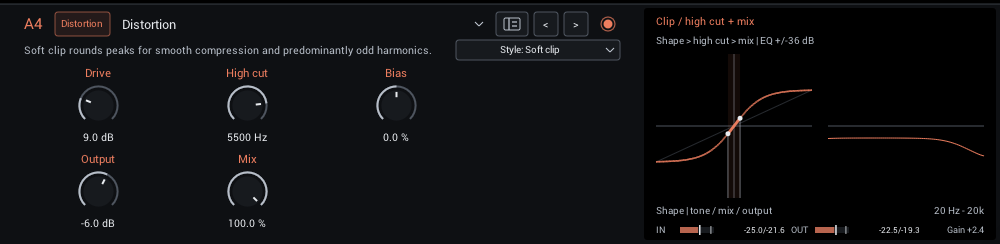
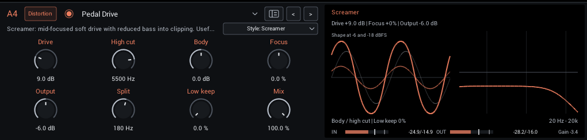
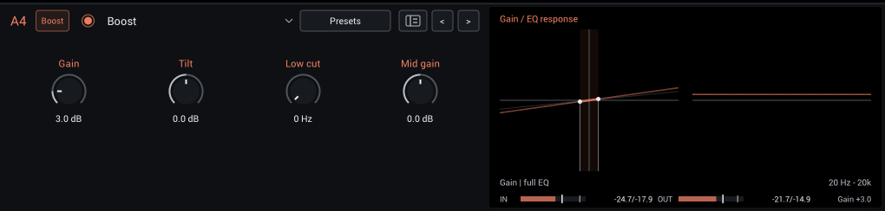
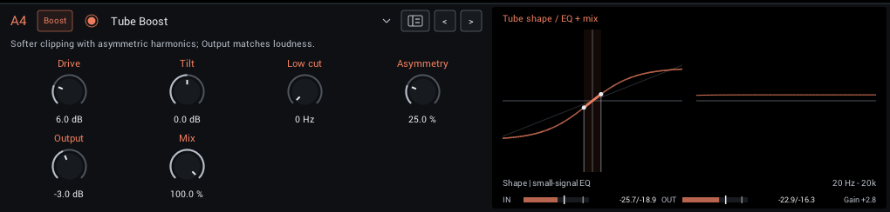
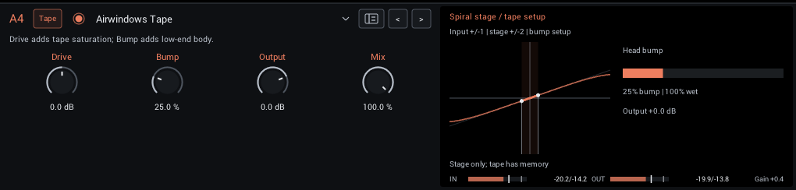
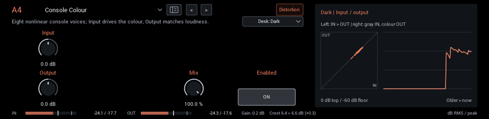
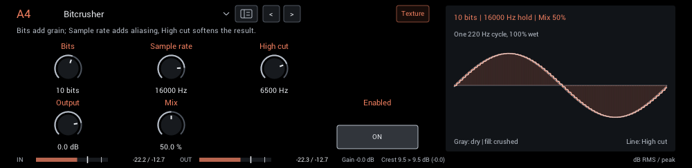

# Distortion

Drives, boosts and saturation.

| Module | In short |
| --- | --- |
| [Distortion](#distortion) | Style changes harmonics; High cut softens edges, Mix restores dry attack. |
| [Pedal Drive](#pedal-drive) | Ten voiced guitar/bass drives; Low keep restores clean lows within the slot. |
| [Boost](#boost) | Clean boost into the next module; Tilt balances body and bite. |
| [Tube Boost](#tube-boost) | Softer clipping with asymmetric harmonics; Output matches loudness. |
| [Airwindows Tape](#airwindows-tape) | Drive adds tape saturation; Bump adds low-end body. |
| [Console Colour](#console-colour) | Eight nonlinear console voices; Input drives the colour, Output matches loudness. |
| [Bitcrusher](#bitcrusher) | Bits add grain; Sample rate adds aliasing, High cut softens the result. |

## Distortion

Six distortion voices, from smooth clipping to octave-like buzz. Bias shifts the symmetry for different harmonics and attack textures. Bright, high-drive settings can introduce aliasing.

| Control | Range | Start | What it does |
| --- | --- | --- | --- |
| **Drive** | 0–36 dB | 9 dB | Gain into the shaper; more drive compresses and adds harmonics. Match loudness with Output. |
| **High cut** | 200–12000 Hz | 5500 Hz | High-cut frequency of the processed signal. Lower values tame brightness and harshness. |
| **Bias** | -100 to +100% | 0% | Asymmetric clipping adds even harmonics and changes attack texture. The processor removes DC. |
| **Output** | -24 to +6 dB | -6 dB | Final level. Match bypass volume when comparing tones. |
| **Mix** | 0–100% | 100% | Balance between dry sound and effect. |

In the header:

- **Style** (Soft clip, Hard clip, Fuzz, Foldback, Diode, Rectify; starts at Soft clip) Choose soft or hard clipping, dense fuzz, wavefolding, asymmetric diode clipping or octave-like rectification.

**Display:** Left: the static shaper curve before tone and mix; the highlighted span shows how much of the curve your playing reaches. Right: the High cut, Mix and Output response.

**Tips:**

- Drive into a following NAM capture for a pedal-into-amp sound, with Output lowered to keep the capture's input sensible.
- Fuzz and Rectify respond strongly to Bias; small moves change the character more than Drive.

## Pedal Drive

Voiced overdrive, distortion, fuzz and colored boost, with **Style** in the header:
Screamer, Rodent, Bass Edge, Parallel OD, Sustain Fuzz, Cascaded Preamp, Treble Drive,
Blues OD, Transparent OD and Vintage Fuzz.
Each voice has its own filtering and gain structure. These are original interpretations
inspired by pedal families, rather than calibrated replicas.

| Control | Range | Start | What it does |
| --- | --- | --- | --- |
| **Drive** | 0–36 dB | 9 dB | Gain into the drive stages. |
| **High cut** | 200–12000 Hz | 5500 Hz | Darkens the driven path after its style-specific filters; restored clean lows are unaffected. |
| **Body** | -6 to +6 dB | 0 dB | Broad bass shelf before drive: positive adds body; negative tightens clipping. Restored clean lows are unaffected. |
| **Character** | -100 to +100% | 0% | Changes label and function with Style: Focus, Bite, Attack, Blend, Mids, Asymmetry, Clipping or Bias. Center is the base voice. |
| **Split** | 50–500 Hz | 180 Hz | Local low-band frequency for Low keep. Inactive at Low keep 0%; independent of grid routing. |
| **Output** | -24 to +12 dB | -6 dB | Final gain after Mix, including clean lows. |
| **Low keep** | 0–100% | 0% | Diverts this share of the low band around the drive and restores it clean. The gentle split has overlapping bands. |
| **Mix** | 0–100% | 100% | Blends the complete pedal result with aligned dry input. Parallel OD also has an internal clean path linked to Drive. |

In the header:

- **Style** (starts at Screamer) Selects the voice and its filtering and gain structure.
- **Enable/bypass circle** Matches the grid node and leaves all eight dial positions free.

**Display:** The Body/drive/High cut path and the clean low return.

**Latency:** none. The antialiasing filters are minimum phase, so your DAW needs no
extra delay compensation and stacking pedals does not add up. Dry Mix, bypass and
parallel lanes stay aligned.

Use Screamer or Treble Drive before a crunchy amp capture, Rodent for heavier rhythm,
and Sustain Fuzz for dense leads or bass fuzz. Try Bass Edge with Low keep raised for
one-slot bass drive. [Pedal Drive](pedal-drive.md) explains all voices, example rigs,
latency and how the local split interacts with the grid.

## Boost

A clean level boost with opposing shelves around 800 Hz (Tilt) and a low cut. It adds no saturation; use it to push the next module harder.

| Control | Range | Start | What it does |
| --- | --- | --- | --- |
| **Gain** | 0–18 dB | 3 dB | Clean level boost before the next module. Drive a following NAM or distortion harder. |
| **Tilt** | -6 to +6 dB | 0 dB | Tilt around 800 Hz: positive is brighter/thinner, negative is darker/fuller. |
| **Low cut** | 0–300 Hz | 0 Hz | Removes low end before the boost; 0 is off. |
| **Mid gain** | -12–12 dB | 0 dB | Broad mid boost or cut before the next module; zero leaves the original boost unchanged. |
| **Mid freq** | 100–4000 Hz | 800 Hz | Center frequency of the boost mid bell, for focused solos or shaping amp drive. |

**Display:** The gain stage's transfer line and the Tilt/Low cut response.

**Tips:**

- Raise Gain and Low cut together before a high-gain capture to tighten palm mutes.

## Tube Boost

Tube-inspired soft saturation with adjustable asymmetry, plus Tilt and Low cut for shaping the drive. Strong settings can introduce aliasing.

| Control | Range | Start | What it does |
| --- | --- | --- | --- |
| **Drive** | 0–24 dB | 6 dB | Gain into the shaper; more drive compresses and adds harmonics. Match loudness with Output. |
| **Tilt** | -6 to +6 dB | 0 dB | Tilt around 800 Hz: positive is brighter/thinner, negative is darker/fuller. |
| **Low cut** | 0–300 Hz | 0 Hz | Removes low end before the boost; 0 is off. |
| **Asymmetry** | 0–100% | 25% | Asymmetric clipping adds even harmonics and changes attack texture. The processor removes DC. |
| **High cut** | 1000–20000 Hz | 20000 Hz | Filters the saturated path after clipping; maximum bypasses this added filter. |
| **Output** | -18 to +18 dB | -3 dB | Final level. Match bypass volume when comparing tones. |
| **Mix** | 0–100% | 100% | Balance between dry sound and effect. |

**Display:** The saturation curve with the input span you reach, and the small-signal EQ.

**Tips:**

- Use Output to match bypass loudness before judging the tone.

## Airwindows Tape

A port of Airwindows Tape: tape saturation and head bump, with no wow or flutter (that lives in Tape Echo and LoFi Tape Machine).

| Control | Range | Start | What it does |
| --- | --- | --- | --- |
| **Drive** | -12 to +12 dB | 0 dB | Drive the Airwindows tape saturation harder. Use Output to match loudness. |
| **Bump** | 0–100% | 25% | Low-frequency tape head emphasis; more adds body and bass resonance. |
| **Output** | -18 to +6 dB | 0 dB | Final level. Match bypass volume when comparing tones. |
| **Mix** | 0–100% | 100% | Balance between dry sound and effect. |

**Display:** The saturation curve and the head-bump amount.

**Tips:**

- Small Drive settings add density without obvious distortion; Bump adds body on thin captures.

## Console Colour

Eight Airwindows console voices, from subtle density to stronger colour. Each desk has its own level match, and changes fade smoothly.

| Control | Range | Start | What it does |
| --- | --- | --- | --- |
| **Input** | -18 to +18 dB | 0 dB | Level into the console. More level gives stronger colour and saturation. |
| **Output** | -18 to +18 dB | 0 dB | Level of the coloured sound. Match bypass volume when comparing desks. |
| **Mix** | 0–100% | 100% | Balance between dry sound and console colour. Input and Output affect only the coloured sound. |

In the header:

- **Desk** (Dark, Rock, Lush, Vibe, Holo, Punch, Steel, Tube; starts at Dark) Eight console voices, from subtle density to strong colour. Switching fades smoothly.

**Display:** Measured input against output, and the output history.

**Tips:**

- Try it last in Post for glue; drive Input harder for more colour, then match with Output.

## Bitcrusher

Bit-depth and sample-rate reduction with a high cut after the crush.

| Control | Range | Start | What it does |
| --- | --- | --- | --- |
| **Bits** | 2–16 bits | 10 bits | Bit depth of the quantizer; fewer bits add stronger grain and distortion. |
| **Sample rate** | 100–48000 Hz | 16000 Hz | Sample-and-hold rate, capped at the host rate. Lower settings add aliasing and stepped texture. |
| **High cut** | 200–20000 Hz | 6500 Hz | High-cut frequency of the processed signal. Lower values tame brightness and harshness. |
| **Output** | -24 to +6 dB | 0 dB | Final level. Match bypass volume when comparing tones. |
| **Mix** | 0–100% | 50% | Balance between dry sound and effect. |

**Display:** One cycle of a test tone, dry against crushed, with the high cut applied.

**Tips:**

- Lower Sample rate first for aliasing tones; lower Bits for grain.
