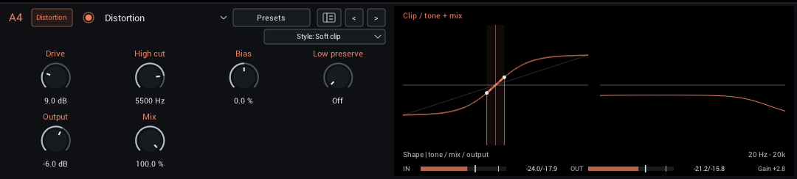
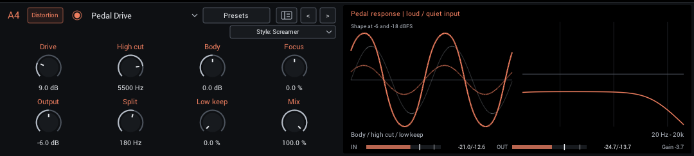
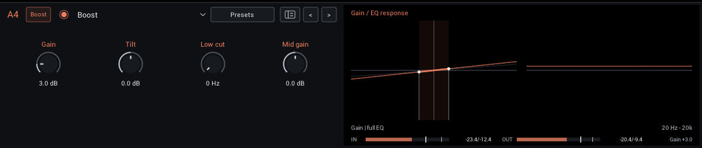
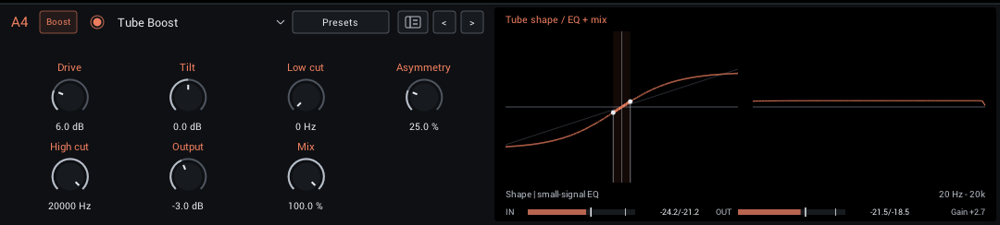
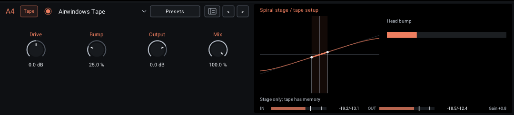
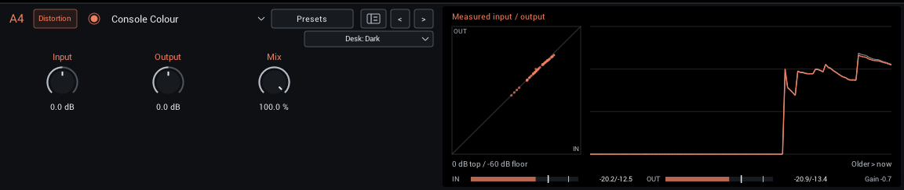
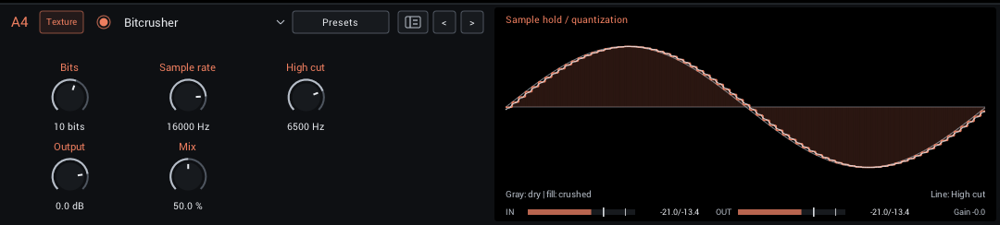

# Distortion

Drives, boosts and saturation.

| Module | In short |
| --- | --- |
| [Distortion](#distortion) | Style changes harmonics; High cut softens edges, Mix restores dry attack. |
| [Pedal Drive](#pedal-drive) | Fourteen voiced guitar/bass drives and fuzzes; Low keep restores clean lows within the slot. |
| [Pedal Distortion](#pedal-distortion) | Six distortion-pedal voices, from classic to metal; Bass, Mid and Treble shape the result. |
| [Boost](#boost) | Clean boost into the next module; Tilt balances body and bite. |
| [Tube Boost](#tube-boost) | Softer clipping with asymmetric harmonics; Output matches loudness. |
| [Airwindows Tape](#airwindows-tape) | Drive adds tape saturation; Bump adds low-end body. |
| [Console Colour](#console-colour) | Eight nonlinear console voices; Input drives the colour, Output matches loudness. |
| [Bitcrusher](#bitcrusher) | Bits add grain; Sample rate adds aliasing, High cut softens the result. |

## Distortion

Nine distortion voices, from smooth clipping to octave-like buzz and synth-like folding. Bias shifts the symmetry for different harmonics and attack textures. Antiderivative antialiasing and oversampling reduce aliasing: 4x at 44.1/48 kHz, 2x at 88.2/96 kHz, and 1x from 176.4 kHz upward. Extreme Foldback and bright, high-drive settings can still alias.

**Latency:** zero added reported latency and no lookahead. The wet path has frequency-dependent phase and group delay, so partial Mix blends can change the attack and tone. Mix 0% keeps the dry signal unshifted. The same controls and saved presets continue to load; this 0.x sound-quality improvement changes existing Distortion rigs.

| Control | Range | Start | What it does |
| --- | --- | --- | --- |
| **Drive** | 0–36 dB | 9 dB | Gain into the shaper; more drive compresses and adds harmonics. Match loudness with Output. |
| **High cut** | 200–12000 Hz | 5500 Hz | High-cut frequency of the processed signal. Lower values tame brightness and harshness. |
| **Bias** | -100 to +100% | 0% | Asymmetric clipping adds even harmonics and changes attack texture. The processor removes DC. |
| **Low preserve** | 0–1000 Hz | 0 Hz | Routes lows around distortion and High cut, then restores them clean; zero is Off. The split is gentle, with overlapping bands. |
| **Output** | -24 to +6 dB | -6 dB | Final level. Match bypass volume when comparing tones. |
| **Mix** | 0–100% | 100% | Balance between dry sound and effect. |

In the header:

- **Style** (Soft clip, Hard clip, Fuzz, Foldback, Diode, Rectify, Overdrive, Half-wave, Sine fold; starts at Soft clip) Choose soft or hard clipping, dense fuzz, wavefolding, asymmetric diode clipping or octave-like rectification. **Overdrive** sounds like Soft clip at low Drive but never fully flattens, so at high Drive it keeps more picking dynamics. **Half-wave** mutes the negative half-cycles for a gated, buzzing fuzz. **Sine fold** folds peaks smoothly for synth-like harmonics that sweep as Drive rises.

**Display:** Left: the static shaper curve before tone and mix; the highlighted span shows how much of the full-band input reaches the module. Right: the Low preserve, High cut, Mix and Output response.

**Presets:** Clean lows, warm grit, Hard rhythm, Octave-up fuzz and Sputtering gated fuzz.

**Tips:**

- Drive into a following NAM capture for a pedal-into-amp sound, with Output lowered to keep the capture's input sensible.
- Fuzz and Rectify respond strongly to Bias; small moves change the character more than Drive.
- For even-harmonic warmth, use Diode or raise Bias on Soft clip. Sine fold is a sound-design tool: automate Drive for sweeping harmonics.
- Try Low preserve around 150–300 Hz to keep bass weight while adding grit above it. High cut only darkens the distorted path; the restored lows remain clean. This is a gentle separation, so high Drive can still distort some bass. Off retains the original sound exactly; no lookahead or compensation delay is added.

## Pedal Drive

Voiced overdrive, distortion, fuzz and colored boost, with **Style** in the header:
Screamer, Rodent, Bass Edge, Parallel OD, Sustain Fuzz, Cascaded Preamp, Treble Drive,
Blues OD, Transparent OD, Vintage Fuzz, Bender Fuzz, Octave Fuzz, Gated Fuzz and Sub Fuzz.
Every voice antialiases its clipping on top of the 4x rate, so high notes at high Drive
stay free of the inharmonic fizz that folded harmonics add. Rodent also integrates its
slew/clip stage over sample intervals.
Each voice has its own filtering and gain structure. These are original interpretations
inspired by pedal families, rather than calibrated replicas.

| Control | Range | Start | What it does |
| --- | --- | --- | --- |
| **Drive** | 0–36 dB | 9 dB | Gain into the drive stages. |
| **High cut** | 200–12000 Hz | 5500 Hz | Darkens the driven path after its style-specific filters; restored clean lows are unaffected. |
| **Body** | -6 to +6 dB | 0 dB | Broad bass shelf before drive: positive adds body; negative tightens clipping. Restored clean lows are unaffected. |
| **Character** | -100 to +100% | 0% | Changes label and function with Style: Focus, Bite, Attack, Blend, Mids, Asymmetry, Clipping, Bias, Octave, Gate or Sub. Center is the base voice. |
| **Split** | 50–500 Hz | 180 Hz | Local low-band frequency for Low keep. Inactive at Low keep 0%; independent of grid routing. |
| **Output** | -24 to +12 dB | -6 dB | Final gain after Mix, including clean lows. |
| **Low keep** | 0–100% | 0% | Diverts this share of the low band around the drive and restores it clean. The gentle split has overlapping bands. |
| **Mix** | 0–100% | 100% | Blends the complete pedal result with aligned dry input. Parallel OD also has an internal clean path linked to Drive. |

In the header:

- **Style** (starts at Screamer) Selects the voice and its filtering and gain structure.
- **Enable/bypass circle** Matches the grid node and leaves all eight dial positions free.

**Display:** The Body/drive/High cut path and the clean low return.

**Latency:** none. The antialiasing filters need no lookahead, so your DAW needs no
extra delay compensation and stacking pedals does not add up. Dry Mix, bypass and
parallel lanes stay aligned.

Use Screamer or Treble Drive before a crunchy amp capture, Rodent for heavier rhythm,
and Sustain Fuzz for dense leads or bass fuzz. Bender Fuzz is a raspier, more cutting fuzz
for riffs; Octave Fuzz adds a ringing octave up to single-note leads. Gated Fuzz sputters
and cuts off as notes decay, and Sub Fuzz adds a synth-like octave below single notes.
Try Bass Edge with Low keep raised for
one-slot bass drive. [Pedal Drive](pedal-drive.md) explains all voices, example rigs,
latency and how the local split interacts with the grid.

## Pedal Distortion

Distortion pedals with more gain than Pedal Drive's overdrives and a real tone section after the clipping. Choose **Style** in the header; each voice has its own gain range, input coupling, clipping stages and post-clip voicing. **Bass**, **Mid** and **Treble** then shape the result, like the EQ on a distortion pedal. These are original voices informed by classic pedal families and voiced against measurements of NAM pedal captures, not calibrated replicas.

| Style | Inspired by | Sound and use |
| --- | --- | --- |
| **Classic Dist** | The orange-box distortion of the late '70s (DS-1 family) | Bright, scooped, gritty. Punk, grunge and classic rock into a clean or edge-of-breakup amp. |
| **Raw Dist** | Simple op-amp and germanium-diode pedals (Distortion+ and 250 family) | Raspy and fizzy, with soft clipping. It keeps its bass at low Gain and thins out as Gain rises. Pushes a crunchy amp; '80s rock rhythm. |
| **British Crunch** | Amp-in-a-box pedals voiced like a cranked plexi (Guv'nor, Plextortion and Crunch Box family) | Mid-forward and darker, two preamp-like stages. Classic rock rhythm into a clean amp. |
| **Hot Lead** | Hot-rodded British lead boxes (Shredmaster, Riot and similar) | Tighter bass, more gain and a smooth top for modern rock rhythm and solos. |
| **Metal Stack** | High-gain metal pedals with active EQ (Metal Zone family) | Pre-clip mid hump and a scooped, aggressive post voicing. Carve it with Mid and Mid freq. |
| **Chainsaw** | The Swedish death-metal pedal with every knob at maximum (HM-2 family) | Dense, raspy distortion with huge peaks at 87 Hz and around 1 kHz. Old-school death metal and crust. |

| Control | Range | Start | What it does |
| --- | --- | --- | --- |
| **Gain** | 0–100% | 50% | Distortion amount. Each style maps the knob to its own gain range. |
| **Bass** | -12 to +12 dB | 0 dB | Low shelf around 100 Hz after the distortion. Changes weight without changing how hard the bass clips. |
| **Mid** | -12 to +12 dB | 0 dB | Mid bell after the distortion, at Mid freq. Cut for scooped rhythm, boost to cut through a band. |
| **Treble** | -12 to +12 dB | 0 dB | High shelf around 3 kHz after the distortion. Lower it to tame fizz into an amp capture. |
| **Level** | -24 to +12 dB | 0 dB | Final level after Mix. Gain 50% stays near bypass loudness on a typical guitar DI. |
| **Tight** | -100 to +100% | 0% | Moves the style's bass cut before clipping. Positive tightens palm mutes; negative lets more bass into the distortion. Center is the base voice. |
| **Mid freq** | 200–5000 Hz | 800 Hz | Center of the Mid control. 500–800 Hz shapes body; 1.5–3 kHz shapes bite and presence. |
| **Mix** | 0–100% | 100% | Blend with the dry input. Lower settings restore attack and note definition under heavy gain. |

In the header:

- **Style** (Classic Dist, Raw Dist, British Crunch, Hot Lead, Metal Stack, Chainsaw; starts at Classic Dist) Selects the voice. Changes crossfade over 20 ms.

**Display:** Left: a 220 Hz test tone at -12 and -30 dBFS through the selected voice, showing how far it cleans up with playing level. Right: the Bass, Mid and Treble response with Mix and Level.

**Latency:** none. Each voice clips at four times the host rate through filters that need no lookahead, so no compensation delay is added and Mix 0% returns the exact dry signal. The wet path has frequency-dependent phase, so partial Mix blends can change the attack.

**Presets:** Classic rock distortion, British crunch, Scooped metal rhythm and Chainsaw death metal.

**Tips:**

- Classic Dist, Raw Dist, British Crunch and Chainsaw clip unevenly, and the unevenness follows your playing level: loud notes keep the even harmonics that make these pedals sound raspy instead of hollow. Hot Lead and Metal Stack stay symmetric and smoother.
- Put it before an amp capture set clean or just breaking up; most of these pedals were designed to drive a clean amp. Into a high-gain amp, lower Gain and use it as a tight boost.
- For metal, raise Tight to 30–50% and put a gate before the pedal. The classic Chainsaw sound keeps the EQ flat: the style already has every tone knob at maximum.
- Lower Treble before raising Gain if the result fizzes; a cabinet IR or amp capture after the pedal also rounds off the top end.

Design references (no circuit-model code was copied): the BOSS DS-1, MT-2 and HM-2 owner's manuals; Electric Druid's [Metal Zone analysis](https://electricdruid.net/boss-mt-2-metal-zone-pedal-analysis/); the PedalPCB forum's [HM-2 tone-stack analysis](https://forum.pedalpcb.com/threads/tone-stacks-part-3-tube-screamer-hm-2-gyrators.8557); and the published MXR Distortion+ and DOD 250 schematics. Product and company names identify design references and belong to their owners; NAM Grid is not affiliated with or endorsed by them.

## Boost

A clean level boost with opposing shelves around 800 Hz (Tilt) and a low cut. It adds no saturation; use it to push the next module harder.

| Control | Range | Start | What it does |
| --- | --- | --- | --- |
| **Gain** | 0–18 dB | 3 dB | Clean level boost before the next module. Drive a following NAM or distortion harder. |
| **Tilt** | -6 to +6 dB | 0 dB | Tilt around 800 Hz: positive is brighter/thinner, negative is darker/fuller. |
| **Low cut** | 0–300 Hz | 0 Hz | Removes low end before the boost; 0 is off. |
| **Mid gain** | -12–12 dB | 0 dB | Broad 800 Hz mid boost or cut before the next module; zero leaves the original boost unchanged. |

**Display:** The gain stage's transfer line and the Tilt/Low cut response.

**Tips:**

- Raise Gain and Low cut together before a high-gain capture to tighten palm mutes.

## Tube Boost

Tube-inspired soft saturation with adjustable asymmetry, plus Tilt and Low cut for shaping the drive. Minimum-phase oversampling reduces aliasing: 4x at 44.1/48 kHz, 2x at 88.2/96 kHz and native processing from 176.4 kHz. Strong settings can still alias. The wet filters add no reported latency but change high-frequency phase, are flat to about 18 kHz and roll off slightly above (about -2.3 dB at 20 kHz at 48 kHz). A partial Mix shares the resampler phase with its dry reference. Crossing Mix zero uses a short 20 ms bypass fade; settled Mix 0% is exact dry. The wet high cut and DC blocker retain their host-rate response.

| Control | Range | Start | What it does |
| --- | --- | --- | --- |
| **Drive** | 0–24 dB | 6 dB | Gain into the shaper; more drive compresses and adds harmonics. Match loudness with Output. |
| **Tilt** | -6 to +6 dB | 0 dB | Tilt around 800 Hz: positive is brighter/thinner, negative is darker/fuller. |
| **Low cut** | 0–300 Hz | 0 Hz | Removes low end before the boost; 0 is off. |
| **Asymmetry** | 0–100% | 25% | Asymmetric clipping adds even harmonics and changes attack texture. The processor removes DC. |
| **High cut** | 1000–20000 Hz | 20000 Hz | Filters the saturated path after clipping; maximum bypasses this added filter. |
| **Output** | -18 to +18 dB | -3 dB | Final level. Match bypass volume when comparing tones. |
| **Mix** | 0–100% | 100% | Balance between dry sound and effect. |

**Display:** The saturation curve with the input span you reach, and the small-signal EQ.

**Tips:**

- Use Output to match bypass loudness before judging the tone.

## Airwindows Tape

A port of Airwindows Tape: tape saturation and head bump, with no wow or flutter (that lives in Tape Echo and LoFi Tape Machine). The core runs at 2x below 88.2 kHz and natively at higher host rates. Minimum-phase filters reduce aliasing without reported latency; wet-path phase and transient response can change. A partial Mix uses a dry reference aligned with the resampler phase. Crossing Mix zero uses a 20 ms bypass fade; settled Mix 0% returns exact dry audio. Running the core at 2x moves the upstream head bump up: with Bump at 50% expect about +0.5 to +0.8 dB from 20-160 Hz at typical levels, and larger changes in the sub-bass at low levels.

| Control | Range | Start | What it does |
| --- | --- | --- | --- |
| **Drive** | -12 to +12 dB | 0 dB | Drive the Airwindows tape saturation harder. Use Output to match loudness. |
| **Bump** | 0–100% | 25% | Low-frequency tape head emphasis; more adds body and bass resonance. |
| **Output** | -18 to +6 dB | 0 dB | Final level. Match bypass volume when comparing tones. |
| **Mix** | 0–100% | 100% | Balance between dry sound and effect. |

**Display:** The saturation curve and the head-bump amount.

**Tips:**

- Small Drive settings add density without obvious distortion; Bump adds body on thin captures.

## Console Colour

Eight Airwindows console voices, from subtle density to stronger colour. Each desk has its own level match, and changes fade smoothly. Local 2x minimum-phase oversampling below 88.2 kHz reduces aliasing; higher host rates process natively. It adds no reported latency, but wet-path phase and transients can differ from older beta versions. A partial Mix uses a dry reference aligned with the resampler phase. Crossing Mix zero uses a 20 ms bypass fade; settled Mix 0% remains exact dry. At 88.2 kHz and above the core runs natively, so no filter-induced group delay remains.

| Control | Range | Start | What it does |
| --- | --- | --- | --- |
| **Input** | -18 to +18 dB | 0 dB | Level into the console. More level gives stronger colour and saturation. |
| **Output** | -18 to +18 dB | 0 dB | Level of the coloured sound. Match bypass volume when comparing desks. |
| **Mix** | 0–100% | 100% | Balance between dry sound and console colour. Input and Output affect only the coloured sound. |

In the header:

- **Desk** (Dark, Rock, Lush, Vibe, Holo, Punch, Steel, Tube; starts at Dark) Eight console voices, from subtle density to strong colour. Switching fades smoothly.

**Display:** Measured input against output, and the output history.

**Tips:**

- Try it last in Post for glue; drive Input harder for more colour, then match with Output.

## Bitcrusher

Bit-depth and sample-rate reduction with a high cut after the crush.

| Control | Range | Start | What it does |
| --- | --- | --- | --- |
| **Bits** | 2–16 bits | 10 bits | Bit depth of the quantizer; fewer bits add stronger grain and distortion. |
| **Sample rate** | 100–48000 Hz | 16000 Hz | Sample-and-hold rate, capped at the host rate. Lower settings add aliasing and stepped texture. |
| **High cut** | 200–20000 Hz | 6500 Hz | High-cut frequency of the processed signal. Lower values tame brightness and harshness. |
| **Output** | -24 to +6 dB | 0 dB | Final level. Match bypass volume when comparing tones. |
| **Mix** | 0–100% | 50% | Balance between dry sound and effect. |

**Display:** One cycle of a test tone, dry against crushed, with the high cut applied.

**Tips:**

- Lower Sample rate first for aliasing tones; lower Bits for grain.
