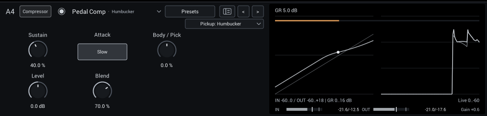
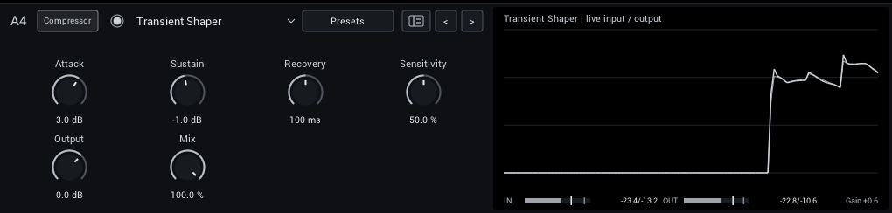
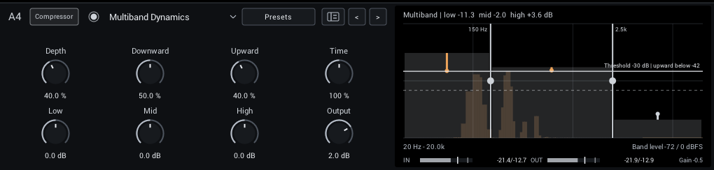

# Dynamics

Gates, compressors and limiting.

| Module | In short |
| --- | --- |
| [Noise Gate](#noise-gate) | Threshold opens the gate; Release and Reduction shape the gaps. |
| [Noise Gate (Smart)](#noise-gate-smart) | Learn the noise alone; Sensitivity and Reduction protect sustain. |
| [Digital Black Gate](#digital-black-gate) | Zero-crossing gate darkens quiet tails; Hysteresis adds the strip's re-arming behaviour. |
| [Pedal Comp](#pedal-comp) | Guitar sustain pedal: Sustain evens out notes, Blend keeps the pick, Pickup suits your guitar. |
| [Smooth Compressor](#smooth-compressor) | Gentle leveling; Attack preserves pick, Makeup restores level. |
| [Punch Compressor](#punch-compressor) | Firmer compression; slow Attack and parallel Mix retain punch. |
| [Butter Comp](#butter-comp) | Gentle polarity-sensitive glue with output-dependent recovery; Mix retains dry attack. |
| [Outboard Channel](#outboard-channel) | Channel strip: cuts, compression and saturation in one module. |
| [Transient Shaper](#transient-shaper) | Attack shapes the pick, Sustain the decay; works at any input level. |
| [Multiband Dynamics](#multiband-dynamics) | Three-band upward and downward compression; drag the display to set splits and Threshold. |
| [Peak Limiter](#peak-limiter) | Fast peak control; Ceiling and Release set grip and recovery. |

## Noise Gate

A gate with Natural (gentle 2:1 expansion, 1.5 ms opening, 40 ms hold) and Tight (deep closure, 0.3 ms opening, 15 ms hold) modes.

| Control | Range | Start | What it does |
| --- | --- | --- | --- |
| **Threshold** | -90 to -10 dB | -55 dB | Input level that opens the gate; set it above the noise and below your quietest notes. |
| **Release** | 20–500 ms | 150 ms | Gate closing time; longer values preserve note tails. |
| **Reduction** | 0–80 dB | 60 dB | Attenuation when the gate is closed; less keeps natural room tone. |
| **Attack** | 0–20 ms | 0 ms | Gate opening time; zero follows the original Natural or Tight mode timing. |
| **Hold** | 0–300 ms | 0 ms | Time before closure; zero follows the original Natural or Tight mode hold. |
| **Hysteresis** | 0–12 dB | 3 dB | Closing threshold below the opening threshold; higher values reduce chatter. |

In the header:

- **Mode** (Natural, Tight; starts at Natural) Natural closes gently; Tight clamps gaps more firmly. Threshold, Release and Reduction remain independent.

**Display:** The static gate curve with a dot at the live input, and the input/output history.

**Tips:**

- Set Threshold with the guitar's volume up and strings muted, just above the noise.

## Noise Gate (Smart)

Learns your rig's noise profile and reduces it frequency by frequency, with an optional final gate. See [Noise Gate (Smart)](noise-gate-smart.md) for setup and tips.

| Control | Range | Start | What it does |
| --- | --- | --- | --- |
| **Learn** | Off / On | Off | Learn while playing only the unwanted noise, then turn Learn off before playing guitar. |
| **Sensitivity** | -6 to +12 dB | 1.5 dB | Raise the learned noise threshold; too much can reduce quiet sustain. |
| **Reduction** | 0–48 dB | 24 dB | Maximum reduction in noisy bands. Less can retain more natural room tone and note tails. |
| **Attack** | 0.2–20 ms | 2 ms | Speed at which the denoiser lets new signal through; short settings preserve pick attacks. |
| **Release** | 20–500 ms | 120 ms | Recovery toward noise reduction after notes; longer settings preserve sustain. |
| **Gate threshold** | -100 to 0 dB | -100 dB | Optional final gate after denoising. Minimum is Off; raise carefully to avoid cutting sustain. |
| **Mix** | 0–100% | 100% | Balance between dry sound and effect. |

**Display:** Gain reduction, input and output over time, and the gate threshold.

**Tips:**

- Learn with the guitar connected and strings muted, for a few seconds, then turn Learn off.

## Digital Black Gate

A gate after Airwindows DigitalBlack that darkens notes as they close, or the firmer gate from Airwindows CStrip in Hysteresis mode.

| Control | Range | Start | What it does |
| --- | --- | --- | --- |
| **Threshold** | -74 to -10 dB | -55 dB | Level that opens the gate. |
| **Hold** | 0–200 ms | 0 ms | Keeps the gate open this long after the signal last crossed Threshold, so noise near Threshold does not make it chatter. 0 ms is the original Airwindows gate. |
| **Output** | -18 to +6 dB | 0 dB | Final level. Match bypass volume before judging the effect. |
| **Mix** | 0–100% | 100% | Balance between dry sound and the gate with its darkened closing texture. |

In the header:

- **Mode** (Zero crossing, Hysteresis; starts at Zero crossing) Zero crossing darkens notes as they close; Hysteresis is a firmer gate that re-arms cleanly. Switching fades smoothly.

**Display:** Input against output with the threshold, and the attenuation history.

**Tips:**

- If noise near Threshold makes the gate chatter, raise Hold to 30 to 80 ms or set Threshold a few dB higher.

## Pedal Comp

A guitar compressor in the spirit of sustain pedals, for electric and acoustic guitar. One
**Sustain** knob sets how much it evens out your playing; the level follows automatically, so
a typical note stays about as loud as bypass while quiet notes and decaying tails come up.
Its Sustain range and timing were calibrated against recordings of a Ross-type compressor pedal.

| Control | Range | Start | What it does |
| --- | --- | --- | --- |
| **Sustain** | 0–100% | 40% | Amount of compression, over the range of a classic sustain pedal's knob. 0% only catches the hardest picks; at 100% loud notes come down by about 7 dB more than quiet ones. |
| **Attack** | Fast / Slow | Slow | **Fast** clamps the pick for the classic snappy, squashed pedal sound. **Slow** lets about 20 ms of pick through first, which sounds more natural. |
| **Body / Pick** | -100 to +100% | 0% | What the compressor reacts to; the tone itself never changes. Toward **Pick** it smooths bright pick attacks and lets low notes bloom; toward **Body** it keeps the pick snap and evens out loud low strings. |
| **Level** | -12 to +12 dB | 0 dB | Final level. |
| **Blend** | 0–100% | 70% | Mixes dry guitar back in for a natural attack with compressed sustain underneath. |

In the header:

- **Pickup** (Single coil, Humbucker, Acoustic; starts at Humbucker) tells the detector what to expect. It never changes the tone. Single coil is about 5 dB more sensitive than Humbucker. **Acoustic** is for piezo, transducer and other acoustic pickups: it follows the body of each note rather than every pick spike and ignores body boom and piezo quack, so strumming does not pump.

**Display:** The settled compression curve for steady notes, with a dot at the live input, the gain reduction bar and the input/output history.

**Presets:** Light always-on, Snappy clean picking, Long lead notes and Acoustic strumming. Presets keep your Pickup choice, except Acoustic strumming, which selects Acoustic.

**Tips:**

- Start with the default and listen to note tails. If the pick sounds choked, switch Attack to Slow, lower Blend or turn Body / Pick toward Body.
- Sustain is calibrated for ordinary interface gain staging, with normal playing peaking around -9 dBFS on a DAW meter. Keep your input set for your captures; if Sustain barely does anything, choose Single coil or raise Sustain, and if it squashes even at low Sustain, choose Humbucker.
- Release follows your playing: after a short pick it recovers quickly, after a long held note it eases back over about a second.
- Like any sustainer, it raises the noise between notes along with the tails. If that bothers you, add a gate after it; a gate before it would cut the tails it is sustaining.

## Smooth Compressor

Starts with gentle 2.5:1 compression and a soft 9 dB knee for leveling and sustain.

| Control | Range | Start | What it does |
| --- | --- | --- | --- |
| **Threshold** | -48 to 0 dB | -24 dB | Level above which compression starts. |
| **Release** | 40–600 ms | 150 ms | How quickly compression lets go after a loud note. |
| **Makeup** | 0–18 dB | 3 dB | Level compensation after compression; compare with bypass at similar loudness. |
| **Attack** | 0.5–50 ms | 10 ms | How quickly compression catches a note. Slower attack lets more pick transient through. |
| **Ratio** | 1–20:1 | 2.5:1 | Compression ratio above the fixed 9 dB knee; 2.5:1 retains the original Smooth response. |
| **Detector cut** | 0–500 Hz | 0 Hz | Removes bass only from the compressor detector, preserving audible lows; zero is off. |
| **Mix** | 0–100% | 100% | Balance between dry sound and effect. |

**Display:** The compression curve with a dot at the live input, and the history before makeup.

**Presets:** Clean guitar leveling and Even bass notes.

**Tips:**

- Lower Threshold until the gain reduction reads 3 to 6 dB on normal playing, then match loudness with Makeup.

## Punch Compressor

Starts with firmer 4:1 compression and a 3 dB knee and a slower default attack, so the pick transient passes. Mix gives parallel compression.

| Control | Range | Start | What it does |
| --- | --- | --- | --- |
| **Threshold** | -48 to 0 dB | -18 dB | Level above which compression starts. |
| **Release** | 40–600 ms | 100 ms | How quickly compression lets go after a loud note. |
| **Makeup** | 0–18 dB | 2 dB | Level compensation after compression; compare with bypass at similar loudness. |
| **Attack** | 0.5–50 ms | 25 ms | How quickly compression catches a note. Slower attack lets more pick transient through. |
| **Ratio** | 1–20:1 | 4:1 | Compression ratio above the fixed 3 dB knee; 4:1 retains the original Punch response. |
| **Detector cut** | 0–500 Hz | 0 Hz | Removes bass only from the compressor detector, preserving audible lows; zero is off. |
| **Mix** | 0–100% | 80% | Balance between dry sound and effect. |

**Display:** The compression curve with a dot at the live input, and the history before makeup.

**Presets:** Tight picking and Parallel punch.

**Tips:**

- Keep Attack around 20 to 30 ms to let the pick through, and use Mix to bring back dynamics.

## Butter Comp

Airwindows ButterComp2 glue compression with automatic level recovery, set up for guitar levels. Its slow, polarity-sensitive recovery suits gentle cohesion after an amp or across a full rig.

| Control | Range | Start | What it does |
| --- | --- | --- | --- |
| **Compress** | 0–100% | 35% | Compression amount, with automatic level recovery. The default lowers typical guitar notes by about 1 dB, 70% by 2–3.5 dB and 100% by 5–8 dB. |
| **Output** | -18 to +6 dB | -1 dB | Final level. Match bypass volume before judging compression. |
| **Mix** | 0–100% | 100% | Parallel blend of dry and compressed sound. |

**Display:** Gain reduction, input and output over time.

**Presets:** Thick parallel.

## Outboard Channel

A channel strip after Airwindows CStrip2: low and high cuts into a compressor and output saturation. The cuts and compressor use relative amounts rather than Hz or milliseconds.

| Control | Range | Start | What it does |
| --- | --- | --- | --- |
| **Input** | -18–18 dB | 0 dB | Level into the complete strip, independent of final Output and the parallel dry path. |
| **Low cut** | 0–100% | 0% | Removes low end; 0% is off. A relative amount, not a frequency. |
| **High cut** | 0–100% | 100% | Removes highs; 100% is open, lower is darker. A relative amount, not a frequency. |
| **Compress** | 0–100% | 20% | Compression amount; a relative intensity rather than a threshold or ratio. |
| **Comp speed** | 0–100% | 25% | Recovery speed; higher recovers faster. A relative amount, not a time. |
| **Saturate** | 0–100% | 15% | Adds output saturation. Use Output to match loudness. |
| **Output** | -18 to +6 dB | 0 dB | Final level. Match bypass volume before judging compression. |
| **Mix** | 0–100% | 100% | Parallel blend of dry and compressed sound. |

**Display:** The cuts over the output spectrum and gain-reduction history on a 0–16 dB scale. The title shows the live gain reduction; hover over the graph for its explanation.

## Transient Shaper

Shapes the start and the decay of each note independently. Attack boosts or softens the first milliseconds after you pick; Sustain raises or shortens the note as it fades. Unlike a compressor, it has no threshold: it follows changes in level, so the same settings work on a DI, after an amp or on bass. It adds no latency, so it reacts to a pick rather than anticipating it.

| Control | Range | Start | What it does |
| --- | --- | --- | --- |
| **Attack** | -12 to +12 dB | 3 dB | Boost or soften the first milliseconds of each picked note. |
| **Sustain** | -12 to +12 dB | -1 dB | Raise or reduce each note as it decays. Raising it also raises noise between notes. |
| **Recovery** | 20–500 ms | 100 ms | How long a note's peak is remembered. Longer values let Sustain act more strongly on slow decays. |
| **Sensitivity** | 0–100% | 50% | How small a change in level counts as a full attack or decay. |
| **Output** | -24 to +12 dB | 0 dB | Final level after Mix. Attack boosts raise peaks, so leave headroom. |
| **Mix** | 0–100% | 100% | Balance between dry and shaped sound; zero is exactly dry at 0 dB Output. |

**Display:** Input and output level over time. Attack boosts show as output peaks above the input; Sustain cuts as tails below it. The footer meter shows cuts only.

**Presets:** Defined picking, Soft acoustic, Tight palm mutes and Gentle note sustain.
Gentle note sustain leaves Attack neutral and blends a restrained decay lift with
the dry sound; use it on held guitar or bass notes rather than to emphasize the pick.

**Tips:**

- Place it before a drive or amp capture to change how hard each pick hits the gain stage, or after the amp to change the finished sound.
- Sustain shapes decays that already exist; for more sustain at the amp, use a compressor before it.

## Multiband Dynamics

Splits the sound into low, mid and high bands and compresses each one on its own, in both directions: loud passages are pushed down, quiet ones brought up. At full settings this is the dense, "over the top" multiband sound; with Upward at zero it is a regular multiband compressor that evens out boomy lows or spiky highs without pumping the rest. Depth blends the result with the dry sound for parallel compression.

| Control | Range | Start | What it does |
| --- | --- | --- | --- |
| **Depth** | 0–100% | 40% | Blend of the processed bands with the dry sound. 100% is fully processed. |
| **Downward** | 0–100% | 50% | How hard each band is pushed down above its threshold, from 1:1 to 20:1. |
| **Upward** | 0–100% | 40% | How much quiet passages in each band are raised, from 1:1 to 4:1. Zero gives a regular multiband compressor. |
| **Time** | 10–1000% | 100% | Scales every band's attack and release; lower values react faster and pump more. |
| **Low** | -12 to +12 dB | 0 dB | Level of the low band after its compression. |
| **Mid** | -12 to +12 dB | 0 dB | Level of the mid band after its compression. |
| **High** | -12 to +12 dB | 0 dB | Level of the high band after its compression. |
| **Output** | -24 to +12 dB | 2 dB | Final level after Depth. Match bypass loudness when comparing. |

In the display:

- **Low split** (40–1000 Hz; starts at 150 Hz) and **High split** (1000–12000 Hz; starts at 2500 Hz): drag the vertical lines to move where the bands divide.
- **Threshold** (-60 to 0 dB; starts at -30 dB): drag up or down anywhere else. It is the mid band's threshold; the low and high bands sit 3 and 10 dB lower, following a guitar's typical spectrum. Upward compression starts 12 dB below each band's threshold.
- Double-click resets the nearest split, or Threshold. All three are saved with the rig and can be automated in your DAW.

Downward and Upward map to ratios exponentially: Downward 50% is about 4.5:1, Upward 50% is 2:1. Upward gain is limited to +18 dB and fades out below -60 dBFS, so silence and hiss between notes are not raised. The detectors have no lookahead, so the start of a sudden note passes before a band's gain changes; heavy upward settings can raise peaks.

**Display:** Each band's live level as a shaded column, with an arrow to where compression moves it: up for upward, down for downward. The solid line is Threshold, the dashed line where upward compression starts. The live output spectrum sits behind.

**Presets:** Start with Gentle glue for downward-only leveling. Fast and tight reacts sooner; Clean sparkle lifts quieter detail. Over the top is the deliberately extreme choice. Presets keep your Threshold and splits, except Fast and tight, which narrows the mid band.

**Tips:**

- Set Threshold first: play your loudest part and drag until the mid band's arrow moves a few dB.
- Like any zero-latency crossover, the bands shift phase around the splits. Depth blends with a matching dry signal, so partial Depth never comb filters, but a parallel lane without this module can.

## Peak Limiter

A fast peak limiter for catching transients at the end of the rig. Clip rounds peaks before limiting, so fast notes need less gain reduction.

| Control | Range | Start | What it does |
| --- | --- | --- | --- |
| **Input** | 0–24 dB | 0 dB | Gain before clipping and limiting; pushes the signal into the selected ceiling. |
| **Ceiling** | -24 to 0 dB | -1 dB | Peak target. With no lookahead, it is not a guaranteed true-peak ceiling. |
| **Release** | 10–500 ms | 75 ms | How quickly gain recovers after a loud peak; short settings can sound more aggressive. |
| **Clip** | 0–100% | 0% | Soft-clips peaks from 3 dB below the ceiling before limiting, so the gain moves less on fast transients. Adds harmonics; 0% is off. |

**Display:** The limiter curve with a dot at the live input, and the history.

**Presets:** Louder, controlled. The insertion default is already a transparent safety limiter.

**Tips:**

- Use it last in Post to protect your DAW from peaks; keep Clip low for clean tones.
