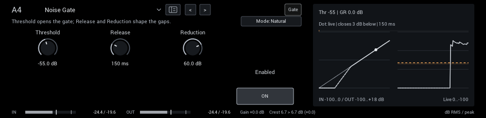
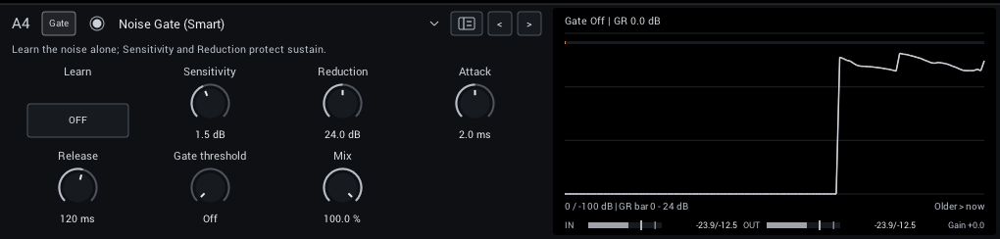
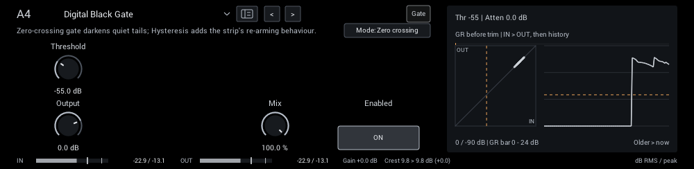
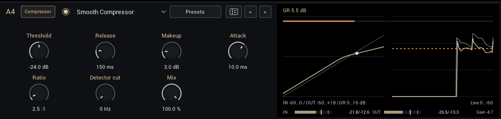
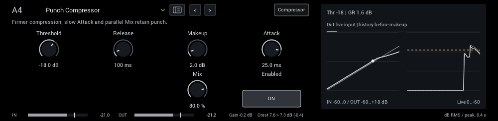
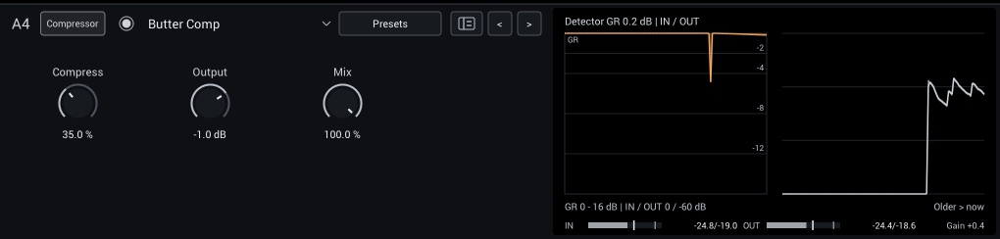
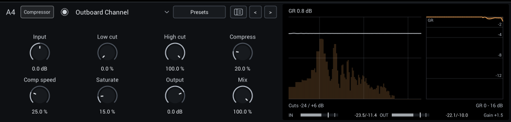
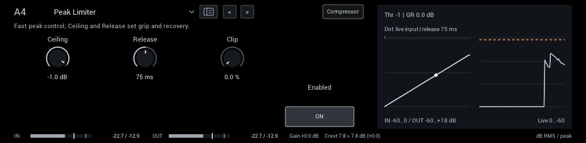

# Dynamics

Gates, compressors and limiting.

| Module | In short |
| --- | --- |
| [Noise Gate](#noise-gate) | Threshold opens the gate; Release and Reduction shape the gaps. |
| [Noise Gate (Smart)](#noise-gate-smart) | Learn the noise alone; Sensitivity and Reduction protect sustain. |
| [Digital Black Gate](#digital-black-gate) | Zero-crossing gate darkens quiet tails; Hysteresis adds the strip's re-arming behaviour. |
| [Smooth Compressor](#smooth-compressor) | Gentle leveling; Attack preserves pick, Makeup restores level. |
| [Punch Compressor](#punch-compressor) | Firmer compression; slow Attack and parallel Mix retain punch. |
| [Butter Comp](#butter-comp) | Gentle polarity-sensitive glue with output-dependent recovery; Mix retains dry attack. |
| [Outboard Channel](#outboard-channel) | Channel strip: cuts, compression and saturation in one module. |
| [Peak Limiter](#peak-limiter) | Fast peak control; Ceiling and Release set grip and recovery. |

## Noise Gate

A gate with Natural (gentle 2:1 expansion, 1.5 ms opening, 40 ms hold) and Tight (deep closure, 0.3 ms opening, 15 ms hold) modes.

| Control | Range | Start | What it does |
| --- | --- | --- | --- |
| **Threshold** | -90 to -10 dB | -55 dB | Input level that opens the gate; set it above the noise and below your quietest notes. |
| **Release** | 20–500 ms | 150 ms | Gate closing time; longer values preserve note tails. |
| **Reduction** | 0–80 dB | 60 dB | Attenuation when the gate is closed; less keeps natural room tone. |
| **Attack** | 0–20 ms | 0 ms | Gate opening time; zero follows the original Natural or Tight mode timing. |
| **Hold** | 0–300 ms | 0 ms | Time before closure; zero follows the original Natural or Tight mode hold. |
| **Hysteresis** | 0–12 dB | 3 dB | Closing threshold below the opening threshold; higher values reduce chatter. |

In the header:

- **Mode** (Natural, Tight; starts at Natural) Natural closes gently; Tight clamps gaps more firmly. Threshold, Release and Reduction remain independent.

**Display:** The static gate curve with a dot at the live input, and the input/output history.

**Tips:**

- Set Threshold with the guitar's volume up and strings muted, just above the noise.

## Noise Gate (Smart)

Learns your rig's noise profile and reduces it frequency by frequency, with an optional final gate. See [Noise Gate (Smart)](noise-gate-smart.md) for setup and tips.

| Control | Range | Start | What it does |
| --- | --- | --- | --- |
| **Learn** | Off / On | Off | Learn while playing only the unwanted noise, then turn Learn off before playing guitar. |
| **Sensitivity** | -6 to +12 dB | 1.5 dB | Raise the learned noise threshold; too much can reduce quiet sustain. |
| **Reduction** | 0–48 dB | 24 dB | Maximum reduction in noisy bands. Less can retain more natural room tone and note tails. |
| **Attack** | 0.2–20 ms | 2 ms | Speed at which the denoiser lets new signal through; short settings preserve pick attacks. |
| **Release** | 20–500 ms | 120 ms | Recovery toward noise reduction after notes; longer settings preserve sustain. |
| **Gate threshold** | -100 to 0 dB | -100 dB | Optional final gate after denoising. Minimum is Off; raise carefully to avoid cutting sustain. |
| **Mix** | 0–100% | 100% | Balance between dry sound and effect. |

**Display:** Gain reduction, input and output over time, and the gate threshold.

**Tips:**

- Learn with the guitar connected and strings muted, for a few seconds, then turn Learn off.

## Digital Black Gate

A gate after Airwindows DigitalBlack that darkens notes as they close, or the firmer gate from Airwindows CStrip in Hysteresis mode.

| Control | Range | Start | What it does |
| --- | --- | --- | --- |
| **Threshold** | -74 to -10 dB | -55 dB | Level that opens the gate. |
| **Hold** | 0–200 ms | 0 ms | Keeps the gate open this long after the signal last crossed Threshold, so noise near Threshold does not make it chatter. 0 ms is the original Airwindows gate. |
| **Output** | -18 to +6 dB | 0 dB | Final level. Match bypass volume before judging the effect. |
| **Mix** | 0–100% | 100% | Balance between dry sound and the gate with its darkened closing texture. |

In the header:

- **Mode** (Zero crossing, Hysteresis; starts at Zero crossing) Zero crossing darkens notes as they close; Hysteresis is a firmer gate that re-arms cleanly. Switching fades smoothly.

**Display:** Input against output with the threshold, and the attenuation history.

**Tips:**

- If noise near Threshold makes the gate chatter, raise Hold to 30 to 80 ms or set Threshold a few dB higher.

## Smooth Compressor

Starts with gentle 2.5:1 compression and a soft 9 dB knee for leveling and sustain.

| Control | Range | Start | What it does |
| --- | --- | --- | --- |
| **Threshold** | -48 to 0 dB | -24 dB | Level above which compression starts. |
| **Release** | 40–600 ms | 150 ms | How quickly compression lets go after a loud note. |
| **Makeup** | 0–18 dB | 3 dB | Level compensation after compression; compare with bypass at similar loudness. |
| **Attack** | 0.5–50 ms | 10 ms | How quickly compression catches a note. Slower attack lets more pick transient through. |
| **Ratio** | 1–20:1 | 2.5:1 | Compression ratio above the fixed 9 dB knee; 2.5:1 retains the original Smooth response. |
| **Detector cut** | 0–500 Hz | 0 Hz | Removes bass only from the compressor detector, preserving audible lows; zero is off. |
| **Mix** | 0–100% | 100% | Balance between dry sound and effect. |

**Display:** The compression curve with a dot at the live input, and the history before makeup.

**Tips:**

- Lower Threshold until the gain reduction reads 3 to 6 dB on normal playing, then match loudness with Makeup.

## Punch Compressor

Starts with firmer 4:1 compression and a 3 dB knee and a slower default attack, so the pick transient passes. Mix gives parallel compression.

| Control | Range | Start | What it does |
| --- | --- | --- | --- |
| **Threshold** | -48 to 0 dB | -18 dB | Level above which compression starts. |
| **Release** | 40–600 ms | 100 ms | How quickly compression lets go after a loud note. |
| **Makeup** | 0–18 dB | 2 dB | Level compensation after compression; compare with bypass at similar loudness. |
| **Attack** | 0.5–50 ms | 25 ms | How quickly compression catches a note. Slower attack lets more pick transient through. |
| **Ratio** | 1–20:1 | 4:1 | Compression ratio above the fixed 3 dB knee; 4:1 retains the original Punch response. |
| **Detector cut** | 0–500 Hz | 0 Hz | Removes bass only from the compressor detector, preserving audible lows; zero is off. |
| **Mix** | 0–100% | 80% | Balance between dry sound and effect. |

**Display:** The compression curve with a dot at the live input, and the history before makeup.

**Tips:**

- Keep Attack around 20 to 30 ms to let the pick through, and use Mix to bring back dynamics.

## Butter Comp

Airwindows ButterComp2 glue compression with automatic level recovery. Try it across a full rig for subtle cohesion.

| Control | Range | Start | What it does |
| --- | --- | --- | --- |
| **Compress** | 0–100% | 35% | Compression amount, with automatic level recovery. |
| **Output** | -18 to +6 dB | -1 dB | Final level. Match bypass volume before judging compression. |
| **Mix** | 0–100% | 100% | Parallel blend of dry and compressed sound. |

**Display:** Gain reduction, input and output over time.

## Outboard Channel

A channel strip after Airwindows CStrip2: low and high cuts into a compressor and output saturation. The cuts and compressor use relative amounts rather than Hz or milliseconds.

| Control | Range | Start | What it does |
| --- | --- | --- | --- |
| **Input** | -18–18 dB | 0 dB | Level into the complete strip, independent of final Output and the parallel dry path. |
| **Low cut** | 0–100% | 0% | Removes low end; 0% is off. A relative amount, not a frequency. |
| **High cut** | 0–100% | 100% | Removes highs; 100% is open, lower is darker. A relative amount, not a frequency. |
| **Compress** | 0–100% | 20% | Compression amount; a relative intensity rather than a threshold or ratio. |
| **Comp speed** | 0–100% | 25% | Recovery speed; higher recovers faster. A relative amount, not a time. |
| **Saturate** | 0–100% | 15% | Adds output saturation. Use Output to match loudness. |
| **Output** | -18 to +6 dB | 0 dB | Final level. Match bypass volume before judging compression. |
| **Mix** | 0–100% | 100% | Parallel blend of dry and compressed sound. |

**Display:** The cuts over the output spectrum and gain-reduction history on a 0–16 dB scale. The title shows the live gain reduction; hover over the graph for its explanation.

## Peak Limiter

A fast peak limiter for catching transients at the end of the rig. Clip rounds peaks before limiting, so fast notes need less gain reduction.

| Control | Range | Start | What it does |
| --- | --- | --- | --- |
| **Input** | 0–24 dB | 0 dB | Gain before clipping and limiting; pushes the signal into the selected ceiling. |
| **Ceiling** | -24 to 0 dB | -1 dB | Peak target. With no lookahead, it is not a guaranteed true-peak ceiling. |
| **Release** | 10–500 ms | 75 ms | How quickly gain recovers after a loud peak; short settings can sound more aggressive. |
| **Clip** | 0–100% | 0% | Soft-clips peaks from 3 dB below the ceiling before limiting, so the gain moves less on fast transients. Adds harmonics; 0% is off. |

**Display:** The limiter curve with a dot at the live input, and the history.

**Tips:**

- Use it last in Post to protect your DAW from peaks; keep Clip low for clean tones.
