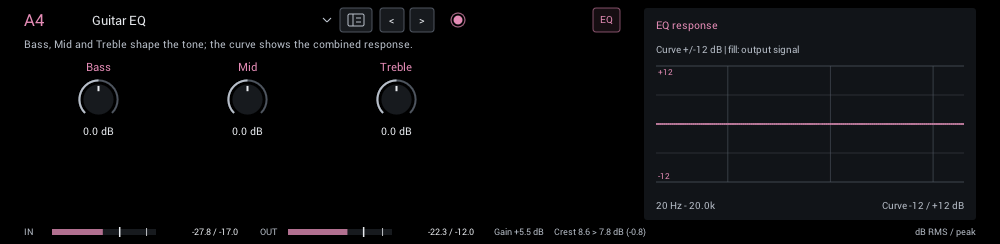
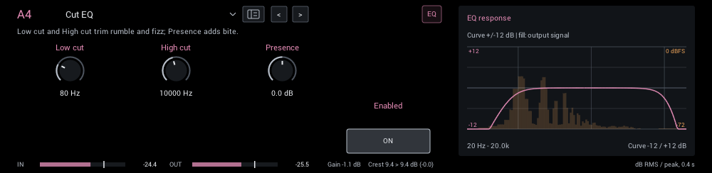
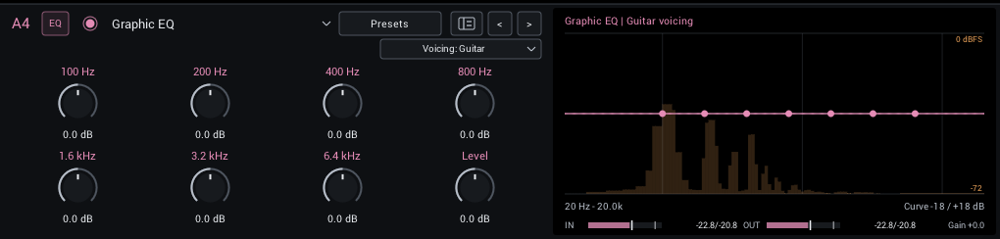
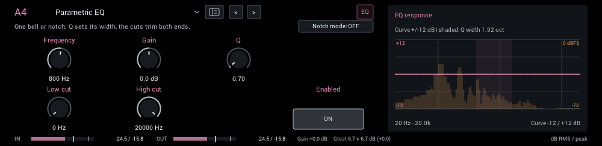
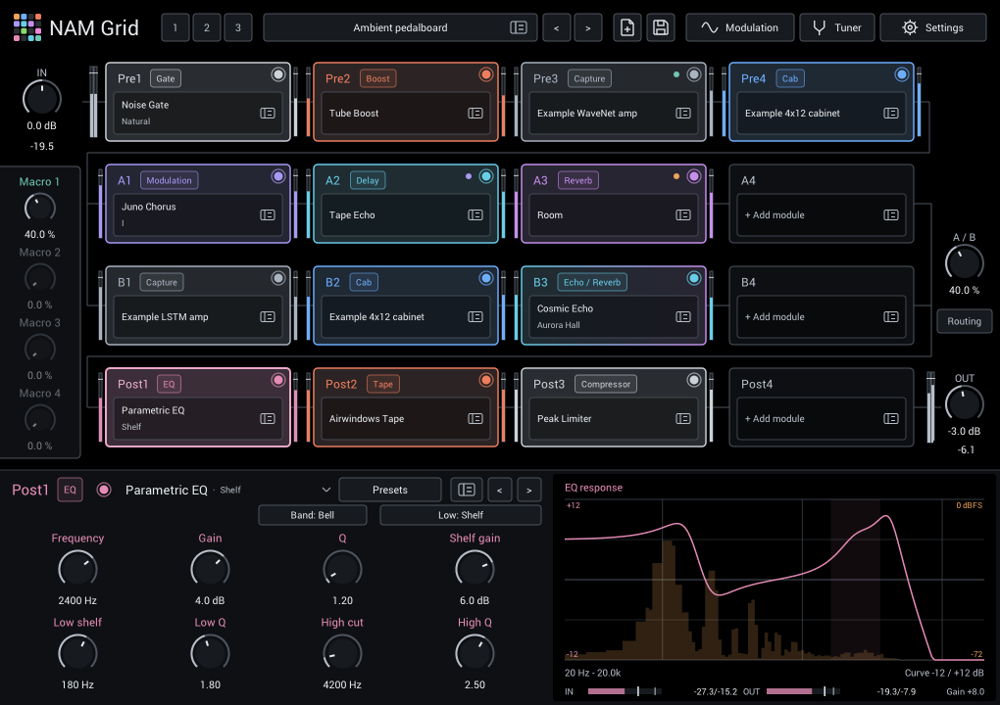
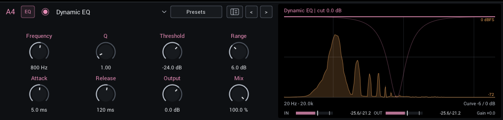
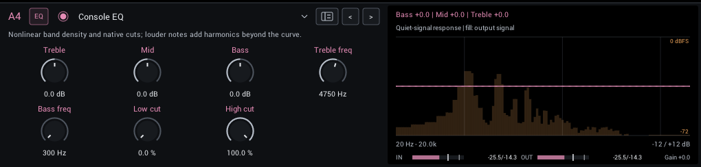
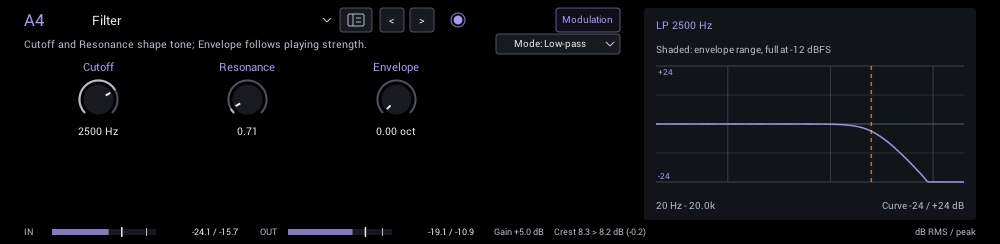
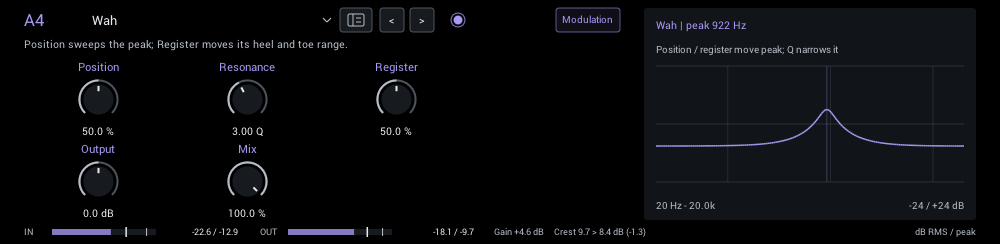

# EQ / Filter

Tone shaping, filters and wah.

| Module | In short |
| --- | --- |
| [Guitar EQ](#guitar-eq) | Bass, Mid and Treble shape the tone; the curve shows the combined response. |
| [Cut EQ](#cut-eq) | Low cut and High cut trim rumble and fizz; Presence adds bite. |
| [Graphic EQ](#graphic-eq) | Seven fixed bands and Level, voiced for guitar, bass or full range. |
| [Parametric EQ](#parametric-eq) | Bell or notch, resonant cuts, and an optional low shelf. |
| [Dynamic EQ](#dynamic-eq) | Cuts one band only while it is loud: palm-mute boom, harsh picking, bass boom. |
| [Console EQ](#console-eq) | Broad console bands with harmonic colour on louder notes. |
| [Filter](#filter) | Cutoff and Resonance shape tone; Envelope follows playing strength. |
| [Wah](#wah) | Position sweeps the peak; Register moves its heel and toe range. |

## Guitar EQ

Three broad bands for everyday tone shaping: a 150 Hz shelf, a broad 800 Hz bell and a 3 kHz shelf.

| Control | Range | Start | What it does |
| --- | --- | --- | --- |
| **Bass** | -12 to +12 dB | 0 dB | 150 Hz shelf. |
| **Mid** | -12 to +12 dB | 0 dB | Broad 800 Hz bell. |
| **Treble** | -12 to +12 dB | 0 dB | 3 kHz shelf. |
| **Mid freq** | 100–4000 Hz | 800 Hz | Moves the Guitar EQ mid bell; 800 Hz retains the original response. |
| **Output** | -24–12 dB | 0 dB | Final EQ level for matching bypass loudness after boosts and cuts. |

**Display:** The combined EQ curve over the live output spectrum.

## Cut EQ

Low cut and high cut for rumble and fizz, plus a 3.5 kHz presence shelf.

| Control | Range | Start | What it does |
| --- | --- | --- | --- |
| **Low cut** | 0–300 Hz | 80 Hz | Removes rumble and boom below this frequency; 0 is off. |
| **High cut** | 2000–20000 Hz | 10000 Hz | Removes fizz above this frequency; 20000 is open. |
| **Presence** | -6 to +6 dB | 0 dB | 3.5 kHz shelf for bite or smoothness. |
| **Output** | -24–12 dB | 0 dB | Final EQ level for matching bypass loudness after boosts and cuts. |

**Display:** The combined EQ curve over the live output spectrum.

**Tips:**

- For bass, lower Low cut to 30 to 45 Hz or turn it off; 80 Hz is an electric-guitar choice.

## Graphic EQ

Seven fixed bands with a boost or cut each, plus Level: the stompbox graphic EQ. Use it to shape the tone before an amp capture, as a mid boost for solos, or to fit a guitar, bass or acoustic into a mix. **Voicing** chooses band frequencies for the instrument, so each slider sits where it is most useful.

| Control | Range | Start | What it does |
| --- | --- | --- | --- |
| **100 Hz / 40 Hz / 63 Hz** | -15 to +15 dB | 0 dB | First band: low end, sub-bass or rumble, for the Guitar, Bass and Full range voicings. |
| **200 Hz / 80 Hz / 160 Hz** | -15 to +15 dB | 0 dB | Second band: body, bass fundamentals or warmth. |
| **400 Hz / 160 Hz / 400 Hz** | -15 to +15 dB | 0 dB | Third band: low mids and mud. |
| **800 Hz / 320 Hz / 1 kHz** | -15 to +15 dB | 0 dB | Fourth band: the guitar's mid hump, or bass growl. |
| **1.6 kHz / 800 Hz / 2.5 kHz** | -15 to +15 dB | 0 dB | Fifth band: cut-through and presence. |
| **3.2 kHz / 2.5 kHz / 6.3 kHz** | -15 to +15 dB | 0 dB | Sixth band: pick attack and bite. |
| **6.4 kHz / 6 kHz / 16 kHz** | -15 to +15 dB | 0 dB | Seventh band: fizz, string noise or air. |
| **Level** | -15 to +15 dB | 0 dB | Overall level after the bands. Boost into an amp, or match bypass loudness. |

In the header:

- **Voicing** (Guitar, Bass, Full range; starts at Guitar) sets the band frequencies; the knob labels follow it. Guitar uses octave bands from 100 Hz to 6.4 kHz. Bass spans 40 Hz to 6 kHz, weighted to fundamentals and growl. Full range spans 63 Hz to 16 kHz for acoustic guitar or a mix. Changing it keeps the slider positions and glides the bands to their new frequencies. It is saved with the rig, without host automation.

All bands at 0 dB and Level at 0 dB leave the sound exactly unchanged. Each band is about an octave wide on the Guitar voicing, so neighbouring sliders blend into smooth curves.

**Display:** The combined EQ curve with a dot at each band centre, over the live output spectrum.

**Presets:** Lead mid boost, Tight into amp (both Guitar), Bass clarity (Bass) and Acoustic air (Full range). Each preset selects its voicing. Lead mid boost is about 2–3 dB louder for solos; Tight into amp boosts Level to drive the next stage.

**Tips:**

- Before a high-gain capture, cutting 100 and 200 Hz tightens palm mutes; a lift around 800 Hz to 1.6 kHz adds cut-through.
- On bass, Bass clarity's dip at 160–320 Hz clears mud while 2.5 kHz brings out the attack.

## Parametric EQ

One bell or notch from 20 Hz to 20 kHz with ±12 dB and Q 0.1 to 20, plus independent resonant low and high cuts. Switch the low cut to a shelf for a low-frequency boost or reduction. Notch mode hides Gain because the notch depth is fixed.

The top row groups the bell/notch controls and optional Shelf gain. The bottom row pairs each end-band frequency with its Q: Low cut (or Low shelf), Low Q, High cut, High Q.

| Control | Range | Start | What it does |
| --- | --- | --- | --- |
| **Frequency** | 20–20000 Hz | 800 Hz | Center frequency of the bell or notch; Q sets how narrow the affected band is. |
| **Gain** | -12 to +12 dB | 0 dB | Boost or cut the selected band. Notch mode removes this control because notch depth is fixed. |
| **Q** | 0.1–20 | 0.7 | Higher Q narrows the bell or notch; lower Q changes a broader part of the guitar tone. |
| **Shelf gain** | -12 to +12 dB | 0 dB | Low-frequency boost or reduction; visible in Shelf mode. |
| **Low cut / Low shelf** | 0–300 Hz | 0 Hz | Low-band frequency; 0 bypasses the low band in either mode. |
| **Low Q** | 0.1–4 | 0.71 | Shapes the low cut or shelf transition; higher values add resonance. |
| **High cut** | 2000–20000 Hz | 20000 Hz | Removes highs above this frequency; 20000 is open. |
| **High Q** | 0.1–4 | 0.71 | Shapes the high-cut transition; higher values add resonance. |

In the header:

- **Band: Bell / Notch** (starts at Bell): Notch rejects a narrow band without a Gain control; Bell boosts or cuts using Gain.
- **Low: Cut / Shelf** (starts at Cut): Choose a resonant low cut or a low shelf with its own gain. Both use Low Q.

**Display:** The combined EQ curve includes both end-band frequencies, Q values and the shelf gain over the live output spectrum; the shaded band is the bell's width. The curve scale expands when boosts or resonant peaks need more room. Existing presets retain their original cut response at the default end-band Q values.

**Tips:**

- Find a harsh frequency with a narrow boost, then turn Gain negative.

## Dynamic EQ

One band that cuts only while it is loud, then recovers. Use it where a static cut would thin out the rest of your playing: boom on palm mutes, harsh pick attacks after a bright amp, or loud low notes on bass. It adds no latency, so the first few milliseconds of a sudden burst pass before the cut builds.

| Control | Range | Start | What it does |
| --- | --- | --- | --- |
| **Frequency** | 20–20000 Hz | 800 Hz | Center of the band that is detected and cut. |
| **Q** | 0.2–12 | 1 | Width of the band; higher values focus on a narrower resonance. |
| **Threshold** | -72 to 0 dB | -24 dB | Band level, in dBFS, above which the cut begins. Set it by ear for your instrument, input level and position in the rig. |
| **Range** | 0–18 dB | 6 dB | Largest cut at the band center; zero leaves the sound unchanged. |
| **Attack** | 0.2–100 ms | 5 ms | How quickly the cut builds once the band exceeds Threshold. |
| **Release** | 10–1000 ms | 120 ms | How quickly the cut recovers after the band gets quieter. |
| **Output** | -24 to +12 dB | 0 dB | Final level after Mix. Match bypass loudness when comparing. |
| **Mix** | 0–100% | 100% | Balance between dry and processed sound; zero is exactly dry at 0 dB Output. |

The cut follows a 4:1 ratio above Threshold, up to Range. Thresholds are absolute levels, so a setting that rests on a DI can cut constantly after an amp capture. Watch the live cut in the display while you play: it should move with your loudest notes and return to zero between them.

**Display:** The faint curve is the cut at full Range; the bright curve is the cut right now. Both sit over the live output spectrum.

**Presets:** Palm-mute control (after amp), Tight into amp, Harsh pick tamer (after amp) and Bass boom control. Thresholds suit a guitar or bass DI peaking near -6 dBFS and the output of a clean capture; adjust Threshold first if your levels differ.

**Tips:**

- Tight into amp, before a high-gain capture, cuts 120 Hz only on loud palm mutes and keeps open low strings full.
- For an acoustic guitar's body boom, try about 220 Hz with Q 2 and a threshold where the cut moves only on strong strums.

## Console EQ

Airwindows-style console EQ with broad, overlapping bands and extra harmonic colour on louder notes. Its cuts use relative amounts rather than frequencies.

| Control | Range | Start | What it does |
| --- | --- | --- | --- |
| **Output** | -24–12 dB | 0 dB | Final EQ level for matching bypass loudness after boosts and cuts. |
| **Treble** | -6 to +6 dB | 0 dB | Boost or cut the band. It also adds harmonics, so the actual change depends on how hard you play. |
| **Mid** | -6 to +6 dB | 0 dB | Boost or cut the band. It also adds harmonics, so the actual change depends on how hard you play. |
| **Bass** | -6 to +6 dB | 0 dB | Boost or cut the band. It also adds harmonics, so the actual change depends on how hard you play. |
| **Treble freq** | 1000–16000 Hz | 4750 Hz | Moves the band. An approximate frequency; the broad bands overlap. |
| **Bass freq** | 300–16000 Hz | 300 Hz | Moves the band. An approximate frequency; the broad bands overlap. |
| **Low cut** | 0–100% | 0% | Removes low end; 0% is off. A relative amount, not a frequency. |
| **High cut** | 0–100% | 100% | Removes highs; 100% is open, lower is darker. A relative amount, not a frequency. |

**Display:** The quiet-signal response over the live output spectrum. Louder notes add harmonics the curve cannot show.

## Filter

A resonant low-pass, high-pass or band-pass filter. Envelope opens the cutoff up to four octaves as you play harder.

| Control | Range | Start | What it does |
| --- | --- | --- | --- |
| **Cutoff** | 40–12000 Hz | 2500 Hz | Resting filter frequency. Envelope opens it upward; resonance emphasizes its edge. |
| **Resonance** | 0.5–4 | 0.71 | Emphasis around the cutoff. Higher values create a more vocal, peaky response. |
| **Envelope** | 0–4 oct | 0 oct | Maximum upward sweep in octaves as you play harder. Zero makes the filter static. |

In the header:

- **Mode** (Low-pass, High-pass, Band-pass; starts at Low-pass) Low-pass darkens, high-pass thins, band-pass isolates a vocal band.

**Display:** The filter response over the live output spectrum; the shaded range shows the envelope's reach at -12 dBFS.

**Tips:**

- Set Envelope to 2 octaves and Resonance to about 2 for an auto-wah.

## Wah

An automatable wah sweep: a resonant band-pass with body. Map Position to an expression pedal through your DAW.

| Control | Range | Start | What it does |
| --- | --- | --- | --- |
| **Position** | 0–100% | 50% | Heel-to-toe sweep. Automate it or map it to an expression controller in the host. |
| **Resonance** | 1–6 Q | 3 Q | Higher Q makes a narrower, more pronounced wah peak. |
| **Register** | 0–100% | 50% | Raises both heel and toe endpoints; it changes the register, not the sweep width. |
| **Output** | -12 to +12 dB | 0 dB | Final level. Match bypass volume when comparing tones. |
| **Mix** | 0–100% | 100% | Balance between dry sound and effect. |

**Display:** The wah peak over the live output spectrum.

**Tips:**

- Draw automation for Position, or map it to a MIDI controller in your DAW.
- **Auto** in the module header turns the wah into an auto-wah with one click: it creates the
  modulation row that follows your playing with Env 1 and sweeps Position by +25%. Play with the
  envelope's **Threshold**, **Sensitivity** and **Release** on the Modulation page; the wah opens
  later in the sweep when you lower Threshold or raise Sensitivity. Remove the assignment with
  **Remove modulation** on Position, or clear its row on the Modulation page, to park the wah again.
