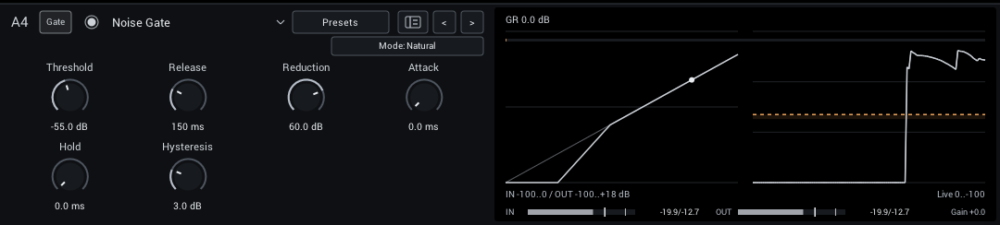
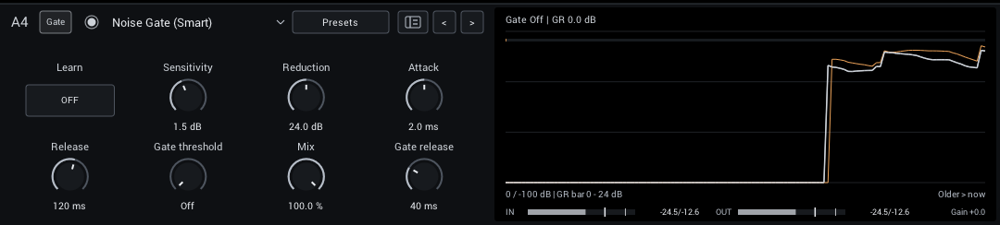
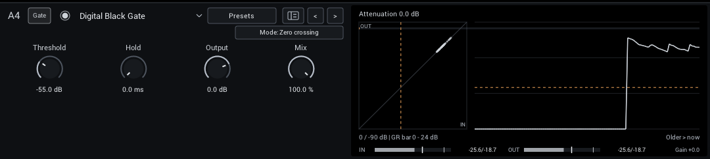

# Gate

Noise gating, learned noise reduction and an automatic gate.

| Module | In short |
| --- | --- |
| [Noise Gate](#noise-gate) | Threshold opens the gate; Release and Reduction shape the gaps. |
| [Noise Gate (Smart)](#noise-gate-smart) | Learn the noise alone; Sensitivity and Reduction protect sustain. |
| [Noise Gate (AI)](#noise-gate-ai) | Experimental automatic hum and hiss reduction; no Learn step. Balance cleanup with quiet notes. |
| [Digital Black Gate](#digital-black-gate) | Simple, fast gate: low notes hold open longer than high ones. Hysteresis mode is steadier. |

## Noise Gate

A gate with Natural (gentle 2:1 expansion, 1.5 ms opening, 40 ms hold) and Tight (deep closure, 0.3 ms opening, 15 ms hold) modes.

| Control | Range | Start | What it does |
| --- | --- | --- | --- |
| **Threshold** | -90 to -10 dB | -55 dB | Input level that opens the gate; set it above the noise and below your quietest notes. |
| **Release** | 20–500 ms | 150 ms | Gate closing time; longer values preserve note tails. |
| **Reduction** | 0–80 dB | 60 dB | Attenuation when the gate is closed; less keeps natural room tone. |
| **Attack** | 0–20 ms | 0 ms | Gate opening time; zero follows the original Natural or Tight mode timing. |
| **Hold** | 0–300 ms | 0 ms | Time before closure; zero follows the original Natural or Tight mode hold. |
| **Hysteresis** | 0–12 dB | 3 dB | Closing threshold below the opening threshold; higher values reduce chatter. |

In the header:

- **Mode** (Natural, Tight; starts at Natural) Natural closes gently; Tight clamps gaps more firmly. Threshold, Release and Reduction remain independent.

**Display:** The static gate curve with a dot at the live input, and the input/output history. The shade from the top of the history shows the measured drop from input to output.

**Tips:**

- Set Threshold with the guitar's volume up and strings muted, just above the noise.

## Noise Gate (Smart)

Learns your rig's noise profile and reduces it frequency by frequency, with an optional final gate. See [Noise Gate (Smart)](noise-gate-smart.md) for setup and tips.

| Control | Range | Start | What it does |
| --- | --- | --- | --- |
| **Protect attack** | 0–100% | 100% | Briefly speed opening on detected attacks. Higher settings preserve pick starts but can pass more noise bursts; zero retains the original response. |
| **Sensitivity** | -6 to +12 dB | 1.5 dB | Raise the learned noise threshold; too much can reduce quiet sustain. |
| **Reduction** | 0–48 dB | 24 dB | Maximum reduction in noisy bands. Less can retain more natural room tone and note tails. |
| **Attack** | 0.2–20 ms | 2 ms | Speed at which the denoiser lets new signal through; short settings preserve pick attacks. |
| **Release** | 20–500 ms | 120 ms | Recovery toward noise reduction after notes; longer settings preserve sustain. |
| **Gate threshold** | -100 to 0 dB | -100 dB | Final gate detects the cleaned signal after Mix. Minimum is Off; raise carefully to avoid cutting sustain. |
| **Mix** | 0–100% | 100% | Balance between dry sound and effect. |
| **Gate release** | 1–500 ms | 40 ms | Closing time of the final gate after its hold, independent of spectral Release. Short times tighten gaps; longer times fade more gently. |

The final gate starts **Off**. Gate release always controls its closing time separately from spectral Release.

The header's **Learn** switch captures the unwanted noise; turn it off before playing. Brief capture outliers have less influence on the print. Protect attack starts at 100%, also in existing projects; 0% restores the previous opening response.

The header's **Tracking** selector starts at **Follow** for a newly added Smart Gate; projects and module presets from before Tracking existed load as **Fixed**. Follow slowly raises the temporary noise estimate by up to 6 dB after a stable match to the learned noise. Attacks, coherent decays and tonal profiles inhibit upward tracking. Allow a few seconds of idle noise; learn again when its character changes. See [tracking tips](noise-gate-smart.md#follow-a-changing-noise-level).

**Display:** Gray shows input, amber shows the cleaned signal before the final gate, and the module colour shows output. The dashed threshold applies to the amber trace. The GR bar estimates combined attenuation; the shade from the top shows the measured drop from input to output on the same scale. When the final gate is fully closed the readout says **closed**: the output is silent.

**Tips:**

- Learn with the guitar connected and strings muted, for a few seconds, then turn Learn off.

## Noise Gate (AI)

An experimental gate with no threshold or Learn step. A small neural network estimates noise reduction in each frequency band. It can follow changing hum, buzz and hiss automatically, but quiet picking and sustained decays can be attenuated. Smart Gate remains the recommended choice for gentle note preservation.

| Control | Range | Start | What it does |
| --- | --- | --- | --- |
| **Reduction** | 0–60 dB | 24 dB | Maximum reduction in bands the gate judges to be noise. Less leaves a little room tone in pauses. |
| **Sensitivity** | -100 to +100% | 0% | Higher closes sooner and cleans more between notes; lower protects quiet picking and long ring-outs. |
| **Protect attack** | 0–100% | 50% | Preserve clear pick attacks while the network catches up. Higher values also let more sudden noise bursts through; zero leaves all decisions to the network. |
| **Gate threshold** | -100 to 0 dB | -100 dB | Final gate detects the cleaned signal after Mix. Minimum is Off; raise carefully to avoid cutting sustain. |
| **Mix** | 0–100% | 100% | Blend between the untreated input and the gated signal. |
| **Gate release** | 1–500 ms | 40 ms | Closing time of the final gate after its hold. Short times tighten gaps; longer times fade more gently. |

The final gate is the same as Smart Gate's and starts **Off**. It listens to the AI Gate's cleaned output, so leftover hum, buzz or bursts the network lets through can be cut in pauses without setting the threshold against the raw noise.

**Display:** As Smart Gate: gray input, amber cleaned signal before the final gate, module-colour output and the dashed threshold on the amber trace. The GR bar estimates combined attenuation, the shade from the top shows the measured drop from input to output, and the readout says **closed** when the final gate silences the output.

**Tips:**

- Put it in a Pre slot, before drives and captures, like the other gates.
- Start with the defaults. If long ring-outs fade too early, lower Sensitivity; if noise lingers after notes, raise it.
- It adds no latency. Protect attack helps clear onsets, but some attenuation at the beginning of a note remains. Compare quiet picking and abrupt noise bursts when adjusting it.
- If some noise remains in pauses, raise Gate threshold until the amber trace's idle noise sits just below the dashed line.
- Lower Protect attack if changing interference opens the gate too easily. Its detector favours clear, stronger attacks rather than faint picking.
- It was trained on guitar. Other sources can be gated in unexpected ways.
- [Noise Gate (Smart)](#noise-gate-smart) remains the better choice when the noise is steady and you want the gentlest handling of ring-outs: its learned profile knows your exact noise.

## Digital Black Gate

A simple, fast gate based on Airwindows DigitalBlack, with no attack or release knobs to set. It closes quickly once a note falls below Threshold, and how long it waits first follows the pitch: low notes stay open longer than high ones. Hysteresis mode, from Airwindows CStrip, is a steadier gate for noise that hovers around Threshold.

| Control | Range | Start | What it does |
| --- | --- | --- | --- |
| **Threshold** | -74 to -10 dB | -55 dB | Level that opens the gate. |
| **Hold** | 0–200 ms | 0 ms | Keeps the gate open a little longer after the signal drops below Threshold. Raise it if the gate flutters on noise; 0 ms is the original behaviour. |
| **Output** | -18 to +6 dB | 0 dB | Final level. Match bypass volume before judging the effect. |
| **Mix** | 0–100% | 100% | Blend with the ungated signal. Lower values keep some noise and room tone in pauses. |

In the header:

- **Mode** (Zero crossing, Hysteresis; starts at Zero crossing) Zero crossing closes fast and lets low notes ring longer; Hysteresis is steadier and flutters less around Threshold. Switching fades smoothly.

**Display:** Input against output with the threshold, and the attenuation history. The shade from the top of the history shows the measured drop from input to output, before Output.

**Tips:**

- If noise near Threshold makes the gate chatter, raise Hold to 30 to 80 ms or set Threshold a few dB higher.
