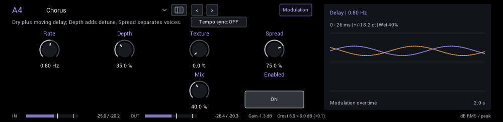
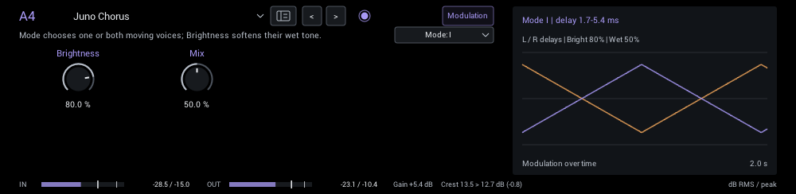
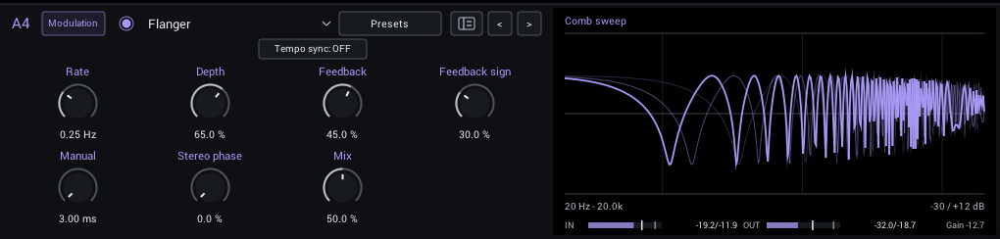
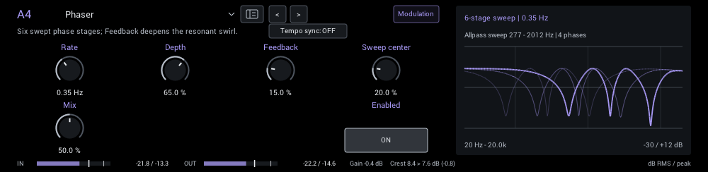
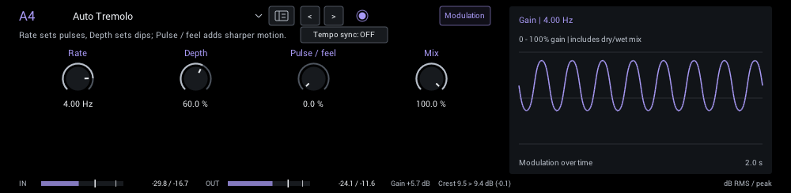
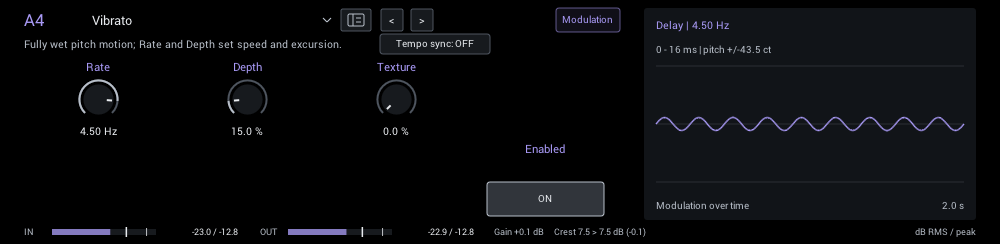
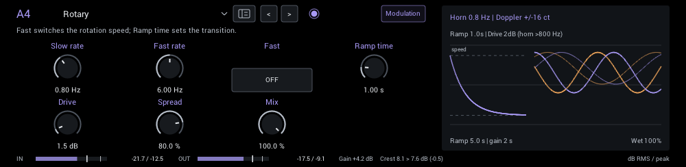
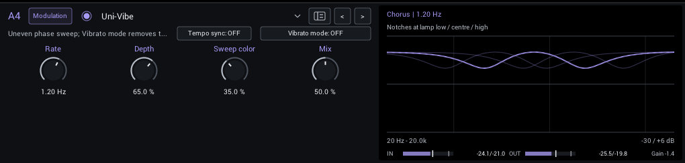
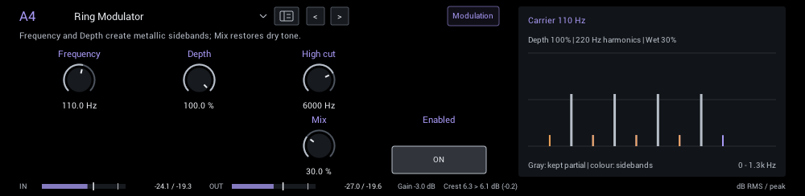

# Modulation

Chorus, flanger, phaser, tremolo, rotary and ring modulation. Screenshots show each parameter pane at its starting settings.

| Module | In short |
| --- | --- |
| [Chorus](#chorus) | Dry plus moving delay; Depth adds detune, Spread separates voices. |
| [Juno Chorus](#juno-chorus) | Mode chooses one or both moving voices; Brightness softens their wet tone. |
| [Flanger](#flanger) | Swept comb notches; Feedback sharpens them. |
| [Phaser](#phaser) | Six swept phase stages; Feedback deepens the resonant swirl. |
| [Auto Tremolo](#auto-tremolo) | Rate sets pulses, Depth sets dips; Pulse / feel adds sharper motion. |
| [Vibrato](#vibrato) | Fully wet pitch motion; Rate and Depth set speed and excursion. |
| [Rotary](#rotary) | Fast switches the rotation speed; Ramp time sets the transition. |
| [Uni-Vibe](#uni-vibe) | Uneven phase sweep; Vibrato mode removes the dry blend. |
| [Ring Modulator](#ring-modulator) | Frequency and Depth create metallic sidebands; Mix restores dry tone. |

## Chorus

A wide, moving chorus. Texture adds warmth and less regular motion; Spread separates the left and right voices.

**Rate** (0.05 Hz to 10 Hz; starts at 0.8 Hz) Speed of the modulation cycle. Tempo sync substitutes a rhythmic division.

**Depth** (0% to 100%; starts at 35%) Width of the pitch, delay or filter sweep.

**Texture** (0% to 100%; starts at 0%) Warmer tone and more uneven pitch movement; zero keeps a smooth sine sweep.

**Spread** (0% to 100%; starts at 75%) Phase offset between left and right chorus voices; zero is centered, 100 is opposite motion.

**Mix** (0% to 100%; starts at 40%) Balance the dry sound and effect. Output, when present, is applied after this blend.

In the header:

- **Tempo sync** locks Rate to your DAW tempo, or 120 BPM when no tempo is available.
- **Division** replaces Rate while synced: 1/32 to 1/1, including triplets and dotted notes.

**Display:** The left and right delay times over two seconds.

## Juno Chorus

Classic Juno-style chorus with I, I+II and II modes, from a subtle single voice to the familiar combined shimmer.

**Brightness** (0% to 100%; starts at 80%) Treble retained in the wet voices; lower values soften the chorus.

**Mix** (0% to 100%; starts at 50%) Balance the dry sound and effect. Output, when present, is applied after this blend.

In the header:

- **Mode** (I, I+II, II; starts at I) I is the slower voice, II the faster voice, I+II combines both.

**Display:** The left and right delay times over two seconds.

## Flanger

A sweeping jet-like flanger. Feedback adds intensity; Feedback sign changes its character and darkness.

**Rate** (0.05 Hz to 10 Hz; starts at 0.25 Hz) Speed of the modulation cycle. Tempo sync substitutes a rhythmic division.

**Depth** (0% to 100%; starts at 65%) Width of the pitch, delay or filter sweep.

**Feedback** (0% to 75%; starts at 45%) Return the swept signal into itself for a more resonant, pronounced effect.

**Feedback sign** (0% to 100%; starts at 30%) Moves feedback from positive through zero to negative. Turning it toward negative also darkens the wet path (12k to 3k) and changes the sweep shape.

**Mix** (0% to 100%; starts at 50%) Balance the dry sound and effect. Output, when present, is applied after this blend.

In the header:

- **Tempo sync** locks Rate to your DAW tempo, or 120 BPM when no tempo is available.
- **Division** replaces Rate while synced: 1/32 to 1/1, including triplets and dotted notes.

**Display:** The comb response at several points of the sweep.

## Phaser

A smooth, swirling phase effect. Sweep center moves the sweep into a different part of the guitar's tone.

**Rate** (0.05 Hz to 10 Hz; starts at 0.35 Hz) Speed of the modulation cycle. Tempo sync substitutes a rhythmic division.

**Depth** (0% to 100%; starts at 65%) Width of the pitch, delay or filter sweep.

**Feedback** (0% to 75%; starts at 15%) Return the swept signal into itself for a more resonant, pronounced effect.

**Sweep center** (0% to 100%; starts at 20%) Raises the center of the six-stage phase sweep.

**Mix** (0% to 100%; starts at 50%) Balance the dry sound and effect. Output, when present, is applied after this blend.

In the header:

- **Tempo sync** locks Rate to your DAW tempo, or 120 BPM when no tempo is available.
- **Division** replaces Rate while synced: 1/32 to 1/1, including triplets and dotted notes.

**Display:** The phaser response at several points of the sweep.

## Auto Tremolo

Rounded volume pulses. Pulse / feel sharpens them and, without tempo sync, speeds them up as you play harder.

**Rate** (0.05 Hz to 10 Hz; starts at 4 Hz) Speed of the modulation cycle. Tempo sync substitutes a rhythmic division.

**Depth** (0% to 100%; starts at 60%) How far the volume dips on each pulse.

**Pulse / feel** (0% to 100%; starts at 0%) Sharpens pulses; stronger playing also speeds them up when tempo sync is off.

**Mix** (0% to 100%; starts at 100%) Balance the dry sound and effect. Output, when present, is applied after this blend.

In the header:

- **Tempo sync** locks Rate to your DAW tempo, or 120 BPM when no tempo is available.
- **Division** replaces Rate while synced: 1/32 to 1/1, including triplets and dotted notes.

**Display:** The gain over two seconds, including the dry blend.

## Vibrato

Fully wet pitch modulation; Texture adds drift and darkening.

**Rate** (0.05 Hz to 10 Hz; starts at 4.5 Hz) Speed of the modulation cycle. Tempo sync substitutes a rhythmic division.

**Depth** (0% to 100%; starts at 15%) Width of the pitch, delay or filter sweep.

**Texture** (0% to 100%; starts at 0%) Warmer tone and more uneven pitch movement; zero keeps a smooth sine sweep.

In the header:

- **Tempo sync** locks Rate to your DAW tempo, or 120 BPM when no tempo is available.
- **Division** replaces Rate while synced: 1/32 to 1/1, including triplets and dotted notes.

**Display:** The delay sweep and its pitch excursion in cents.

## Rotary

A rotating-speaker simulation with separate slow and fast rates, a ramp between them, drive and stereo spread.

**Slow rate** (0.1 Hz to 2 Hz; starts at 0.8 Hz) Target rotation speed; the drum turns at 73 percent of the horn speed.

**Fast rate** (2 Hz to 10 Hz; starts at 6 Hz) Target rotation speed; the drum turns at 73 percent of the horn speed.

**Fast** (off / on; starts at off) Choose slow or fast target speed. Ramp time controls the transition.

**Ramp time** (0.1 s to 5 s; starts at 1 s) Time constant for speed changes; larger values accelerate and slow down more gradually.

**Drive** (0 dB to 18 dB; starts at 1.5 dB) Soft saturation before the rotating-speaker modulation.

**Spread** (0% to 100%; starts at 80%) Stereo separation of horn/drum motion; zero centers the wet signal.

**Mix** (0% to 100%; starts at 100%) Balance the dry sound and effect. Output, when present, is applied after this blend.

**Display:** The speed ramp and the horn and rotor motion.

**Tips:**

- Automate Fast to switch speeds; Ramp time sets how long the speaker takes to change.

## Uni-Vibe

A pulsing, uneven photocell-vibe sweep. Vibrato mode removes the dry sound for pitch movement.

**Rate** (0.05 Hz to 10 Hz; starts at 1.2 Hz) Speed of the modulation cycle. Tempo sync substitutes a rhythmic division.

**Depth** (0% to 100%; starts at 65%) Width of the pitch, delay or filter sweep.

**Sweep color** (0% to 100%; starts at 35%) Expands the uneven four-stage sweep for a deeper, more vocal swirl.

**Mix** (0% to 100%; starts at 50%) Balance the dry sound and effect. Output, when present, is applied after this blend.

In the header:

- **Tempo sync** locks Rate to your DAW tempo, or 120 BPM when no tempo is available.
- **Division** replaces Rate while synced: 1/32 to 1/1, including triplets and dotted notes.
- **Vibrato mode** (off / on; starts off) Vibrato uses only the phase-shifted signal; chorus mode retains the selected dry/wet blend.

**Display:** The notches at three lamp positions.

## Ring Modulator

Multiplies the guitar with a sine carrier for metallic, inharmonic sidebands.

**Frequency** (1 Hz to 5000 Hz; starts at 110 Hz) Carrier frequency; adds sum/difference sidebands and metallic, often inharmonic tones.

**Depth** (0% to 100%; starts at 100%) Move from the original amplitude toward full bipolar ring modulation.

**High cut** (200 Hz to 20000 Hz; starts at 6000 Hz) High-cut frequency of the processed signal. Lower values tame brightness and harshness.

**Mix** (0% to 100%; starts at 30%) Balance the dry sound and effect. Output, when present, is applied after this blend.

**Display:** The partials of a 110 Hz note and the sidebands the carrier creates.
