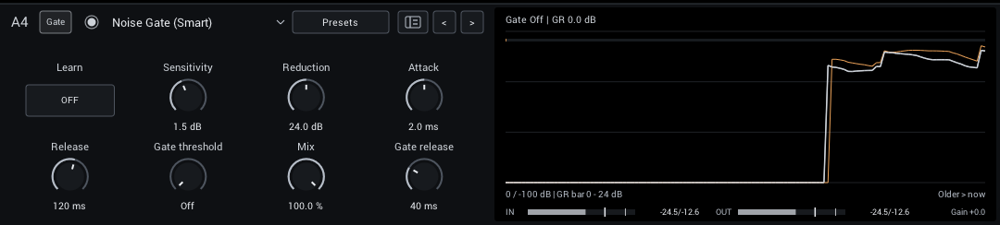

# Noise Gate (Smart)

A noise gate that learns your rig's noise. Play nothing, switch on **Learn**, and it reduces that noise frequency by frequency while you play, instead of only opening and closing. Quiet picking and decaying chords stay more natural than with an ordinary gate.

## Set it up

1. Add **Gate > Noise Gate (Smart)** in a Pre slot, before drives and captures.
2. Keep your guitar and interface at normal playing settings. Mute the strings with your hand, without turning the guitar's volume down.
3. Switch **Learn** on for one to three seconds, then off. Audio keeps playing while it learns.
4. Play with the starting settings first, and compare against bypass on low notes, quiet picking and decaying chords.

Learning ignores digital silence and captures shorter than about 300 ms; the previous noise profile stays in place. Captures with enough history also limit the influence of brief loud outliers, such as handling clicks or an accidental pluck. This does not make it safe to play throughout Learn: keep the strings muted and allow one to three seconds. If only near-silence remains after rejecting outliers, the previous profile stays in place. Existing saved profiles are unchanged until you learn again.

## Fine-tune

Change one control at a time; the [control table](gate.md#noise-gate-smart) lists them all.

1. Raise **Sensitivity** until the remaining noise is gone, and back off if sustain loses detail.
2. Lower **Reduction** if pauses sound unnaturally dead; a little room tone often sounds better than silence.
3. Only if you want completely silent pauses, raise **Gate threshold** from **Off** to just above the cleaned noise floor. Its detector listens after reduction and Mix, before its own gain. **Gate release** always sets its closing time separately from spectral Release. It starts at **40 ms**, after a short hold; raise it for a gentler fade. Check quiet picking again after adjusting the threshold: a cleaned note below it cannot open the gate.

**Protect attack** adds a brief opening boost when the input rises sharply, helping note starts pass before the slower band detector catches up. It starts at 100%, also in existing projects and presets. Reduce it if clicks or noise bursts become too prominent; 0% restores the original opening response. Learn is in the module header, beside the controls for the learned profile.

Bands open faster when their energy clearly exceeds the learned noise. This can preserve more of short picked notes without changing the quiet-level gain curve or spectral Release. Attack still adjusts opening speed: lower it for more transient preservation, at the cost of letting more changing noise through. Abrupt noise bursts can also trigger faster opening, so this does not replace a representative learned profile or the final gate.

The final gate is disabled by default. Spectral Release controls recovery toward frequency-dependent noise reduction; Gate release controls only the final broadband gate. Older projects with the final gate enabled now use the independent Gate release time, so their gap timing can change.

The history shows gray input, amber cleaned audio before the final gate, and coloured final output. The dashed gate threshold applies to the amber trace. Increasing reduction or changing Mix therefore changes when the final gate closes.

The **GR** readout estimates the current reduction. It is a guide, not a measurement of how much quieter the noise sounds.

## When to learn again

Learn again after changing pickups, guitar volume or input gain, moving to a different room or interface, or changing the sample rate.

The learned profile is saved with your project, rig preset and user module presets, and travels with Copy, Move and Swap. Learn itself is never saved switched on, and scenes do not change the profile.

## Follow a changing noise level

The **Tracking** selector in the module header starts at **Follow** for a newly added Smart Gate. **Fixed** uses the learned profile as before; choose it if quiet playing loses detail. Follow helps when the same background noise gradually gets louder. Leave a few seconds of idle noise for it to respond, then check quiet picking and sustain again.

Follow temporarily raises the noise estimate by up to **6 dB** when a broad part of the spectrum matches the learned noise. It waits for a stable match, pauses upward changes around attacks and coherent decays, and ignores strongly tonal profiles. It returns toward the learned level when the noise falls. The learned profile itself stays unchanged; the temporary adjustment restarts on reset or recall.

This is deliberately conservative: short pauses, changing noise and continuous playing may give it too little evidence to help. It cannot reliably distinguish every quiet note from noise, so use Fixed if quiet playing loses detail. A different noise character still needs Learn again. Tracking is saved with the module and scenes; projects and module presets from before Tracking existed load as Fixed. The final gate remains a separate manual setting.

## Good to know

- Keep it before delays and reverbs, so their tails are not reduced.
- Noise that overlaps a note cannot be removed completely, and strong settings can slightly change the tone.
- It adds no latency.
- When only the silence between notes matters, the standard [Noise Gate](gate.md#noise-gate) does the job with less CPU.
