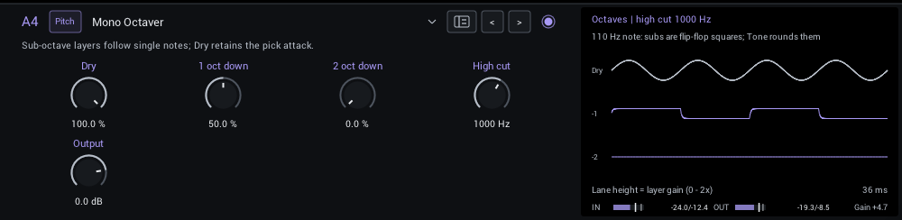
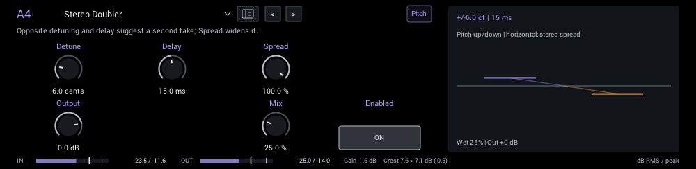
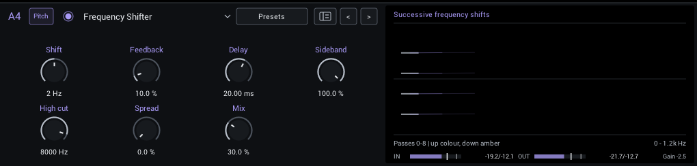

# Pitch / Frequency

Octaves, doubling and frequency shifting.

| Module | In short |
| --- | --- |
| [Mono Octaver](#mono-octaver) | Sub-octave layers follow single notes; Dry retains the pick attack. |
| [Stereo Doubler](#stereo-doubler) | Opposite detuning and delay suggest a second take; Spread widens it. |
| [Frequency Shifter](#frequency-shifter) | Hertz offsets make metallic sidebands; Feedback shifts each repeat. |

## Mono Octaver

Add one or two octaves below single notes. High cut rounds the generated tone. Play cleanly: chords and weak fundamentals confuse tracking.

| Control | Range | Start | What it does |
| --- | --- | --- | --- |
| **Dry** | 0–100% | 100% | Level of the original guitar alongside the generated sub-octaves. |
| **1 oct down** | 0–100% | 50% | Level of this generated sub-octave. Best tracking comes from clean, single-note playing. |
| **2 oct down** | 0–100% | 0% | Level of this generated sub-octave. Best tracking comes from clean, single-note playing. |
| **High cut** | 80–5000 Hz | 1000 Hz | High-cut frequency for the generated sub-octaves; the dry guitar keeps its original tone. |
| **Tracking filter** | 80–1200 Hz | 450 Hz | Low-pass frequency in the tracking detector only; does not filter the dry or generated tone. |
| **Tracking stability** | 0.1–15% | 3% | Detector hysteresis relative to the note envelope; higher rejects more spurious crossings. |
| **Output** | -24 to +6 dB | 0 dB | Final level. Match bypass volume when comparing tones. |

**Display:** A 110 Hz note and the two sub-octave square waves.

## Stereo Doubler

Opposite pitch detuning and short delays on the left and right suggest a second take.

| Control | Range | Start | What it does |
| --- | --- | --- | --- |
| **Detune** | 1–25 cents | 6 cents | Opposite pitch offsets in cents; higher settings make a wider, more obvious double. |
| **Delay** | 1–30 ms | 15 ms | Base separation before each detuned voice; increases the double-tracked feel. |
| **Spread** | 0–100% | 100% | Spread of detuned voices; zero centers the wet pair, 100 keeps them on opposite sides. |
| **Humanize** | 0–100% | 0% | Adds slow, independent timing and pitch variation to the double; zero retains fixed offsets. |
| **High cut** | 1000–20000 Hz | 20000 Hz | Softens only the doubled voices; maximum bypasses this added filter. |
| **Output** | -24 to +6 dB | 0 dB | Final level. Match bypass volume when comparing tones. |
| **Mix** | 0–100% | 25% | Balance between dry sound and effect. |

**Display:** Pitch up and down against the stereo spread.

## Frequency Shifter

Move every partial by the same number of hertz for metallic, shifting, and continuously rising or falling textures. This is not a musical pitch shifter.

| Control | Range | Start | What it does |
| --- | --- | --- | --- |
| **Shift** | -2000 to +2000 Hz | 2 Hz | Fixed hertz offset per pass; unlike a pitch shifter, every partial moves by the same number of hertz. |
| **Feedback** | 0–100% | 10% | Return shifted audio into the delay for progressively changing repeats. |
| **Delay** | 0.05–1000 ms | 20 ms | Time between shifted feedback passes; short settings smear, long settings make distinct echoes. |
| **Sideband** | -100 to +100% | 100% | Lower sideband at -100, ring modulation at zero, upper sideband at +100. |
| **High cut** | 200–12000 Hz | 8000 Hz | High-cut frequency of the processed signal. Lower values tame brightness and harshness. |
| **Spread** | 0–100% | 0% | Carrier phase difference between channels; widens the shifted texture. |
| **Mix** | 0–100% | 30% | Balance between dry sound and effect. |

**Display:** How each pass through the feedback moves the partials.
