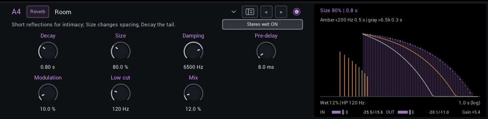
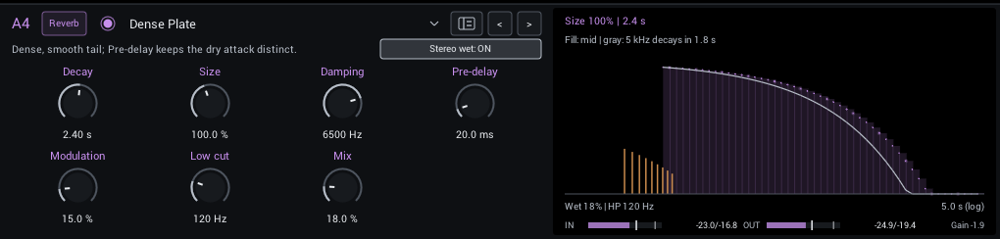
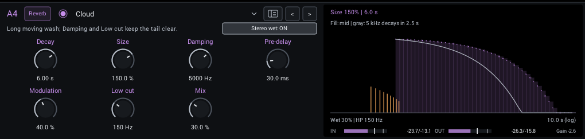
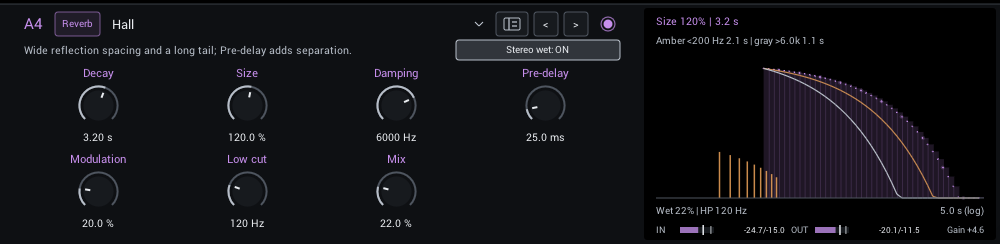
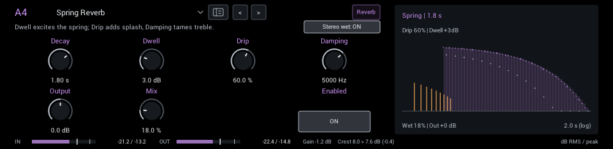
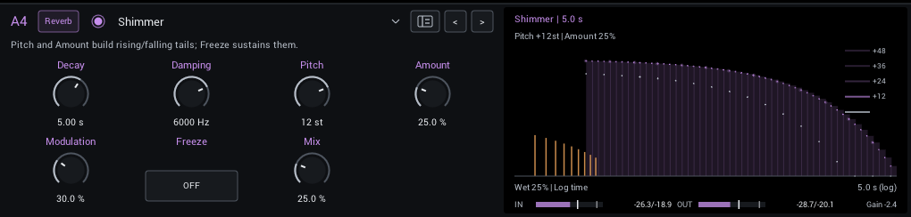
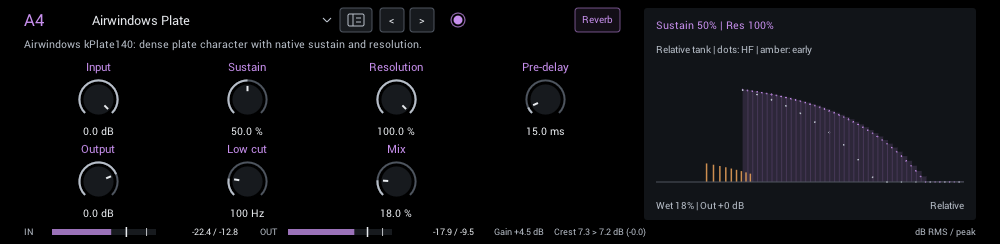
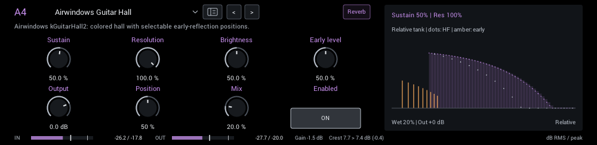
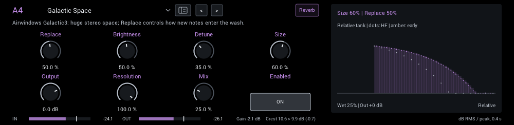
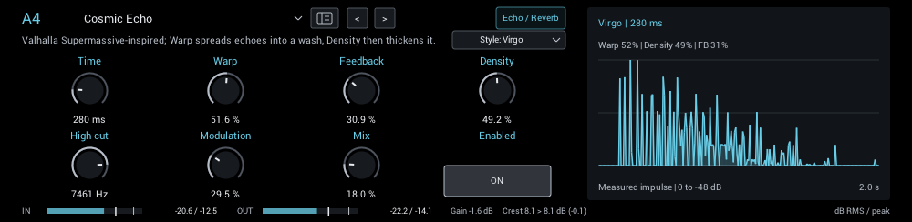

# Reverb

Rooms, plates, halls, springs, shimmer and ambient echoes.

| Module | In short |
| --- | --- |
| [Room](#room) | Short reflections for intimacy; Size changes spacing, Decay the tail. |
| [Dense Plate](#dense-plate) | Dense, smooth tail; Pre-delay keeps the dry attack distinct. |
| [Cloud](#cloud) | Long moving wash; Damping and Low cut keep the tail clear. |
| [Hall](#hall) | Wide reflection spacing and a long tail; Pre-delay adds separation. |
| [Spring Reverb](#spring-reverb) | Dwell excites the spring; Drip adds splash, Damping tames treble. |
| [Shimmer](#shimmer) | Pitch and Amount build rising/falling tails; Freeze sustains them. |
| [Airwindows Plate](#airwindows-plate) | Airwindows kPlate140: dense plate character; Sustain sets the length. |
| [Airwindows Guitar Hall](#airwindows-guitar-hall) | Airwindows kGuitarHall2: colored hall with selectable early-reflection positions. |
| [Galactic Space](#galactic-space) | Airwindows Galactic3: huge stereo space; Replace controls how new notes enter the wash. |
| [Cosmic Echo](#cosmic-echo) | Valhalla Supermassive-inspired; Warp spreads echoes into a wash, Density then thickens it. |

## Room

A close, supportive room that adds depth without pushing the guitar far back.

| Control | Range | Start | What it does |
| --- | --- | --- | --- |
| **Decay** | 0.15–30 s | 0.8 s | Tail decay time. Higher values let notes overlap into a larger ambient wash. |
| **Size** | 25–200% | 80% | Tank scale and reflection spacing. Larger settings sound more open; Decay controls how long they last. |
| **Damping** | 800–12000 Hz | 6500 Hz | Treble damping in the reverb. Lower settings make the tail darker than the dry signal. |
| **Pre-delay** | 0–200 ms | 8 ms | Gap before the reverb starts; separates the pick attack from the tail. |
| **Modulation** | 0–100% | 10% | Movement of the reverb delay lines; adds a gently shifting tail. |
| **Low cut** | 0–500 Hz | 120 Hz | Remove bass from the reverb send to keep the tail from getting boomy. |
| **Mix** | 0–100% | 12% | Balance between dry sound and effect. |

In the header:

- **Stereo wet** (off / on; starts on) Stereo wet spread; off folds the reverb to center while preserving dry stereo.

**Display:** Pre-delay, early reflections and the decay to -60 dB on a logarithmic time axis, with the low (amber) and high (gray) bands' decay.

**Tips:**

- Raise Pre-delay to keep the pick attack in front of the tail.

## Dense Plate

A smooth, dense plate that sits easily behind picked notes and chords.

| Control | Range | Start | What it does |
| --- | --- | --- | --- |
| **Decay** | 0.15–30 s | 2.4 s | Tail decay time. Higher values let notes overlap into a larger ambient wash. |
| **Size** | 25–200% | 100% | Tank scale and reflection spacing. Larger settings sound more open; Decay controls how long they last. |
| **Damping** | 800–12000 Hz | 6500 Hz | Treble damping in the reverb. Lower settings make the tail darker than the dry signal. |
| **Pre-delay** | 0–200 ms | 20 ms | Gap before the reverb starts; separates the pick attack from the tail. |
| **Modulation** | 0–100% | 15% | Movement of the reverb delay lines; adds a gently shifting tail. |
| **Low cut** | 0–500 Hz | 120 Hz | Remove bass from the reverb send to keep the tail from getting boomy. |
| **Mix** | 0–100% | 18% | Balance between dry sound and effect. |

In the header:

- **Stereo wet** (off / on; starts on) Stereo wet spread; off folds the reverb to center while preserving dry stereo.

**Display:** Pre-delay, early reflections and the decay to -60 dB on a logarithmic time axis, with the low (amber) and high (gray) bands' decay.

**Tips:**

- Raise Pre-delay to keep the pick attack in front of the tail.

## Cloud

A long, slowly moving stereo wash for pads and ambient playing.

| Control | Range | Start | What it does |
| --- | --- | --- | --- |
| **Decay** | 0.15–30 s | 6 s | Tail decay time. Higher values let notes overlap into a larger ambient wash. |
| **Size** | 25–200% | 150% | Tank scale and reflection spacing. Larger settings sound more open; Decay controls how long they last. |
| **Damping** | 800–12000 Hz | 5000 Hz | Treble damping in the reverb. Lower settings make the tail darker than the dry signal. |
| **Pre-delay** | 0–200 ms | 30 ms | Gap before the reverb starts; separates the pick attack from the tail. |
| **Modulation** | 0–100% | 40% | Movement of the reverb delay lines; adds a gently shifting tail. |
| **Low cut** | 0–500 Hz | 150 Hz | Remove bass from the reverb send to keep the tail from getting boomy. |
| **Mix** | 0–100% | 30% | Balance between dry sound and effect. |

In the header:

- **Stereo wet** (off / on; starts on) Stereo wet spread; off folds the reverb to center while preserving dry stereo.

**Display:** Pre-delay, early reflections and the decay to -60 dB on a logarithmic time axis, with the low (amber) and high (gray) bands' decay.

**Tips:**

- Raise Pre-delay to keep the pick attack in front of the tail.

## Hall

A wide, spacious hall with a long tail and separate bass and treble damping.

| Control | Range | Start | What it does |
| --- | --- | --- | --- |
| **Decay** | 0.15–30 s | 3.2 s | Tail decay time. Higher values let notes overlap into a larger ambient wash. |
| **Size** | 25–200% | 120% | Tank scale and reflection spacing. Larger settings sound more open; Decay controls how long they last. |
| **Damping** | 800–12000 Hz | 6000 Hz | Treble damping in the reverb. Lower settings make the tail darker than the dry signal. |
| **Pre-delay** | 0–200 ms | 25 ms | Gap before the reverb starts; separates the pick attack from the tail. |
| **Modulation** | 0–100% | 20% | Movement of the reverb delay lines; adds a gently shifting tail. |
| **Low cut** | 0–500 Hz | 120 Hz | Remove bass from the reverb send to keep the tail from getting boomy. |
| **Mix** | 0–100% | 22% | Balance between dry sound and effect. |

In the header:

- **Stereo wet** (off / on; starts on) Stereo wet spread; off folds the reverb to center while preserving dry stereo.

**Display:** Pre-delay, early reflections and the decay to -60 dB on a logarithmic time axis, with the low (amber) and high (gray) bands' decay.

**Tips:**

- Raise Pre-delay to keep the pick attack in front of the tail.

## Spring Reverb

Splashy, spring-like repeats with extra edge when you push Dwell.

| Control | Range | Start | What it does |
| --- | --- | --- | --- |
| **Decay** | 0.3–4 s | 1.8 s | Tail decay time. Higher values let notes overlap into a larger ambient wash. |
| **Dwell** | 0–12 dB | 3 dB | Drive the spring send harder for more excitation and soft saturation. |
| **Drip** | 0–100% | 60% | Amount of spring dispersion: adds the splashy, metallic drip to attacks. |
| **Damping** | 800–12000 Hz | 5000 Hz | Treble damping in the reverb. Lower settings make the tail darker than the dry signal. |
| **Output** | -12 to +12 dB | 0 dB | Final level. Match bypass volume when comparing tones. |
| **Mix** | 0–100% | 18% | Balance between dry sound and effect. |

In the header:

- **Stereo wet** (off / on; starts on) Stereo wet spread; off folds the reverb to center while preserving dry stereo.

**Display:** The spring decay; Drip and Dwell shape the reflections.

## Shimmer

A reverb whose tail climbs or falls in pitch with each pass. Freeze holds the tail and stops new input.

| Control | Range | Start | What it does |
| --- | --- | --- | --- |
| **Decay** | 0.5–20 s | 5 s | Tail decay time. Higher values let notes overlap into a larger ambient wash. |
| **Damping** | 800–12000 Hz | 6000 Hz | Treble damping in the reverb. Lower settings make the tail darker than the dry signal. |
| **Pitch** | -24 to +24 st | 12 st | Semitone interval on each pitched reverb pass. Positive climbs, negative falls. |
| **Amount** | 0–100% | 25% | Pitched feedback into the reverb; more creates a stronger, longer shimmer. |
| **Modulation** | 0–100% | 30% | Movement of the reverb delay lines; adds a gently shifting tail. |
| **Freeze** | Off / On | Off | Sustain the tank and stop feeding new notes; release to return to the normal decay. |
| **Mix** | 0–100% | 25% | Balance between dry sound and effect. |

**Display:** The decay with the pitch steps each pass adds.

## Airwindows Plate

Airwindows kPlate140 plate ambience, with its original Sustain and Resolution character.

| Control | Range | Start | What it does |
| --- | --- | --- | --- |
| **Input** | -18 to 0 dB | 0 dB | Lowers the level into the plate, which reacts to how hard it is driven. 0 dB sends the original level. |
| **Sustain** | 0–100% | 50% | Tail length and blur. A relative amount, not a decay time. |
| **Resolution** | 25–100% | 100% | Lower settings make the space larger and darker. It changes in steps, which can be audible when automated. |
| **Pre-delay** | 0–200 ms | 15 ms | Gap before the plate send, in milliseconds. Separates the attack without changing the tank size. |
| **Output** | -18 to +6 dB | 0 dB | Final level. Match bypass volume when comparing tones. |
| **Low cut** | 0–500 Hz | 100 Hz | Remove bass from the plate send. Zero is off; higher values keep driven guitar from making the tank boomy. |
| **Mix** | 0–100% | 18% | Balance between dry sound and effect. |

**Display:** How full the reverb is over time.

## Airwindows Guitar Hall

Airwindows kGuitarHall2 ambience, with selectable early-reflection positions for different room shapes.

| Control | Range | Start | What it does |
| --- | --- | --- | --- |
| **Sustain** | 0–95% | 50% | Hall length. A relative amount, not a decay time. |
| **Resolution** | 25–100% | 100% | Lower settings make the space larger and darker. It changes in steps, which can be audible when automated. |
| **Brightness** | 0–100% | 50% | Brightness of the hall. Lower is darker and softer, higher keeps more pick detail. |
| **Early level** | 0–100% | 50% | Level of the hall's early reflections; adds a closer, more defined room around the long tail. |
| **Output** | -18 to +6 dB | 0 dB | Final level. Match bypass volume when comparing tones. |
| **Position** | 0–100% | 50% | Chooses a different early-reflection pattern. It changes in steps, so moving it can be audible. |
| **Mix** | 0–100% | 20% | Balance between dry sound and effect. |

**Display:** How full the reverb is over time, with the early reflections.

## Galactic Space

Airwindows Galactic3's huge, slowly evolving stereo space. Replace sets how quickly new notes enter the wash.

| Control | Range | Start | What it does |
| --- | --- | --- | --- |
| **Replace** | 5–100% | 50% | How quickly new notes replace the existing space. Lower settings keep a longer wash. |
| **Brightness** | 5–100% | 50% | Treble entering and leaving the space. Lower settings make a darker ambient bed. |
| **Detune** | 0–100% | 35% | Stereo pitch motion within the space; higher values make a wider, more obviously moving wash. |
| **Size** | 5–100% | 60% | Size of the space, together with Resolution. Changing it while the tail sounds can cause pitch and noise artifacts. |
| **Output** | -18 to +6 dB | 0 dB | Final level. Match bypass volume when comparing tones. |
| **Resolution** | 25–100% | 100% | Lower settings make the space larger and darker. It changes in steps, which can be audible when automated. |
| **Mix** | 0–100% | 25% | Balance between dry sound and effect. |

**Display:** How full the reverb is over time.

## Cosmic Echo

Six ambient echo and reverb styles from David Braun's MIT Faust reconstruction of the Valhalla Supermassive algorithms. See [Cosmic Echo](cosmic-echo.md) for the styles.

| Control | Range | Start | What it does |
| --- | --- | --- | --- |
| **Time** | 20–8000 ms | 280 ms | Delay-line time scale. Warp spreads shorter lines below this value. |
| **Warp** | 0–100% | 51.6% | Spread the delay-line lengths: zero aligns them for echoes, higher values create uneven spacing and more reverb-like texture. |
| **Feedback** | 0–98% | 30.9% | Longer repeats and sustain. In Sagittarius and Centaurus it also changes how the sound builds up. |
| **Density** | 0–100% | 49.2% | Rotate signals between the delay lines. Low values leave distinct echoes; high values build a denser stereo field. Interacts with Warp. |
| **High cut** | 200–16000 Hz | 7461 Hz | Treble cut on the effect. In Virgo each repeat gets darker. |
| **Modulation** | 0–100% | 29.5% | Depth of the slow stereo modulation. More adds pitch movement and chorus. |
| **Mix** | 0–100% | 18% | Balance between dry sound and effect. |

In the header:

- **Style** (Gemini, Sagittarius, Virgo, Centaurus, Great Annihilator, Lyra; starts at Virgo) Six echo and reverb characters; see [the styles](cosmic-echo.md#styles). Switching fades out the old tail.

**Display:** The measured wet response to one impulse, on a dB scale. Separate spikes are distinct echoes; Warp spreads the delay lines into a wash and Density then thickens it. At Warp 0, Density changes little.

**Tips:**

- Start with low Warp for rhythmic echoes, then raise Warp and Density for an ambient wash.
