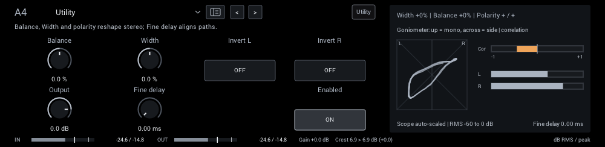
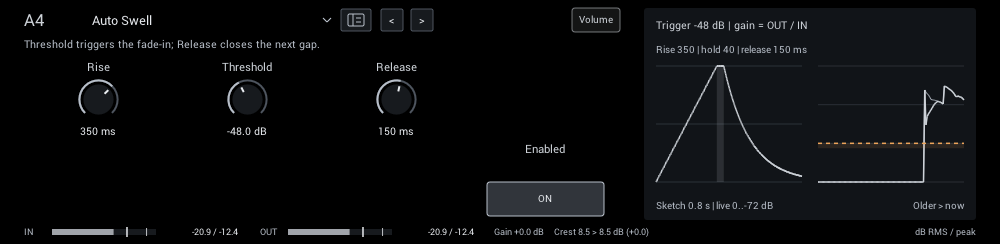

# Utility / Volume

Stereo utilities and volume swells. Screenshots show each parameter pane at its starting settings.

| Module | In short |
| --- | --- |
| [Utility](#utility) | Balance, Width and polarity reshape stereo; Fine delay aligns paths. |
| [Auto Swell](#auto-swell) | Threshold triggers the fade-in; Release closes the next gap. |

## Utility

Balance, width, polarity and a short fine delay for aligning parallel lanes.

**Balance** (-100% to 100%; starts at 0%) Attenuate one side of existing stereo; this does not pan a mono voice into new stereo.

**Width** (-100% to 100%; starts at 0%) -100 folds to mono, zero preserves stereo, +100 doubles the side signal. Mono input stays mono.

**Invert L** (off / on; starts at off) Reverse this channel's polarity for phase alignment; not an on/off mute.

**Invert R** (off / on; starts at off) Reverse this channel's polarity for phase alignment; not an on/off mute.

**Output** (-60 dB to 12 dB; starts at 0 dB) Final level after the dry/effect blend. Match bypass volume when comparing tones.

**Fine delay** (0 ms to 20 ms; starts at 0 ms) Delay both channels by a few milliseconds for parallel-path alignment; this is an audible offset.

**Display:** A goniometer, the left/right correlation and the channel levels.

**Tips:**

- Width cannot create stereo from a mono signal; place stereo effects after a mono capture.

## Auto Swell

A volume swell that removes the pick attack and fades each phrase in. Pause below the threshold to re-arm.

**Rise** (10 ms to 2000 ms; starts at 350 ms) Fade-in time after the input crosses threshold; longer settings soften the pick attack.

**Threshold** (-72 dB to -12 dB; starts at -48 dB) Input level that triggers a swell. Set below quiet notes but above background noise.

**Release** (20 ms to 800 ms; starts at 150 ms) How quickly the swell closes after the input falls below threshold.

**Display:** The swell envelope, and the input against the output.
