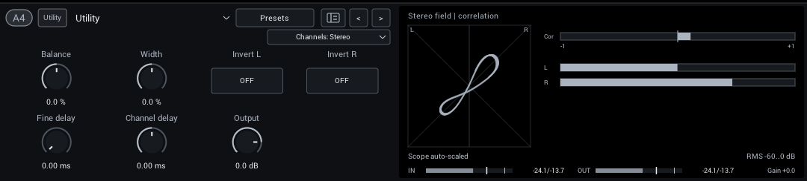
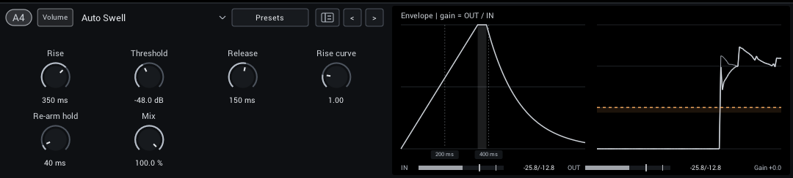

# Utility / Volume

Stereo utilities, volume swells and transparent signal inspection.

| Module | In short |
| --- | --- |
| [Utility](#utility) | Balance, Width and polarity reshape stereo; Fine delay aligns paths. |
| [Auto Swell](#auto-swell) | Threshold triggers the fade-in; Release closes the next gap. |
| [Volume Pedal](#volume-pedal) | Position or a MIDI expression pedal sets the volume; Curve shapes the travel between Heel and Toe. |

## Utility

Balance, width, polarity and a short fine delay for aligning parallel lanes.

| Control | Range | Start | What it does |
| --- | --- | --- | --- |
| **Balance** | -100 to +100% | 0% | Attenuate one side of existing stereo; this does not pan a mono voice into new stereo. |
| **Width** | -100 to +100% | 0% | -100 folds to mono, zero preserves stereo, +100 doubles the side signal. Mono input stays mono. |
| **Invert L** | Off / On | Off | Reverse this channel's polarity for phase alignment; not an on/off mute. |
| **Invert R** | Off / On | Off | Reverse this channel's polarity for phase alignment; not an on/off mute. |
| **Fine delay** | 0–20 ms | 0 ms | Delay both channels by a few milliseconds for parallel-path alignment; this is an audible offset. |
| **Channel delay** | -20–20 ms | 0 ms | Positive delays the right channel, negative the left, in addition to Fine delay. |
| **Output** | -60 to +12 dB | 0 dB | Final level. Match bypass volume when comparing tones. |

**Channels** in the header selects Stereo, Swap, Left to both or Right to both (starts at Stereo).

**Display:** A goniometer, the left/right correlation and the channel levels.

**Tips:**

- Width cannot create stereo from a mono signal; place stereo effects after a mono capture.

## Auto Swell

A volume swell that removes the pick attack and fades each phrase in. Pause below the threshold to re-arm.

| Control | Range | Start | What it does |
| --- | --- | --- | --- |
| **Rise** | 10–2000 ms | 350 ms | Fade-in time after the input crosses threshold; longer settings soften the pick attack. |
| **Threshold** | -72 to -12 dB | -48 dB | Input level that triggers a swell. Set below quiet notes but above background noise. |
| **Release** | 20–800 ms | 150 ms | How quickly the swell closes after the input falls below threshold. |
| **Rise curve** | 0.25–4 | 1 | Shape of the fade-in; one retains the original linear swell, higher values enter more slowly. |
| **Re-arm hold** | 0–500 ms | 40 ms | Time below the closing threshold before a new swell can re-arm; 40 ms retains the original hold. |
| **Mix** | 0–100% | 100% | Blend the swollen signal with dry guitar to retain some pick attack. |

**Display:** The swell envelope, and the input against the output.

## Volume Pedal

A volume pedal you play with Position, host automation or a MIDI expression pedal.

| Control | Range | Start | What it does |
| --- | --- | --- | --- |
| **Position** | 0–100% | 100% | Pedal position from heel (0%) to toe (100%). A MIDI pedal on the selected CC takes over until you move Position again. |
| **Curve** | -100–100% | 0% | Shape of the travel. 0% is an audio taper, -12 dB at half travel; negative values rise sooner (-50% is linear), positive values hold back longer. |
| **Heel level** | -60 to 0 dB | -60 dB | Level with the pedal fully back; -60 dB mutes. Raise it to switch between a rhythm and a lead level. |
| **Toe level** | -24 to +12 dB | 0 dB | Level with the pedal fully forward. |
| **Smoothing** | 1–500 ms | 20 ms | Glide between positions. It hides the 128 steps of a MIDI pedal; longer values give slower swells. |
| **MIDI CC** | 0–127 | 11 | Controller that moves the pedal, on any MIDI channel: 11 is Expression, 7 Volume, 4 Foot controller. 0 is Off. |

**MIDI:** In CLAP the pedal reads the CC directly: the latest pedal or Position move wins, and the pedal's position is not written to Position, so the project keeps the Position you set. In VST3 the host turns the CC into Position changes, which it can record as automation; there, each CC drives the first Volume Pedal set to it. Route the MIDI controller to the plugin's track in your host. Without MIDI, map Position to an expression pedal through host automation.

**Display:** The level along the pedal's travel, with the live position.

**Presets:** Rhythm to lead boost (heel at rhythm level, toe 4 dB louder), Slow swells (a later rise and a long glide) and Linear pedal, for controllers whose pedal already has a volume taper.

## Signal Monitor

Click a global input or output meter, or the output meter beside a grid slot,
to inspect the signal there. The monitor replaces the module editor without
occupying a slot or changing the rig. Click another meter to move it. Click the same
meter again, select a module or the tuner, press **Escape**, or click **Close** to leave.
Input measures after IN gain; Output measures the final signal sent to the host,
including OUT gain. Slot output meters open the monitor even when empty or
bypassed; lane output meters inspect their own branch before the lane mix.

- **Spectrum:** the louder channel at each frequency, rather than a mono sum.
  Opposite-polarity stereo cannot disappear from the spectrum through cancellation.
  A faint line shows a 6-second average while you play.
- **Resonance markers:** after a few seconds of playing, up to three of the most
  prominent narrow peaks in the average are marked with their frequency. Cabinet,
  room and EQ resonances stay put while you play different notes; a single repeated
  note also marks its own harmonics.
- **Meters:** vertical left/right meters from -60 to +6 dBFS with the sample peak
  (line), 300 ms RMS (fill) and held peak (tick, value above). A held peak at or above
  0 dBFS turns the value and the top of the meter red. These are sample peaks, not
  oversampled true-peak measurements.
- **Level history:** the last 20 seconds of monitoring, as a peak line over the RMS
  fill of the louder channel. Red marks along the top show where samples reached
  0 dBFS; a faint vertical line marks where monitoring resumed after a pause.
- **Headroom:** distance from the highest held peak to 0 dBFS; negative means over full scale.
- **Correlation:** +1 for matching channels, −1 for opposite polarity and near
  zero for unrelated signals. Silence has no useful correlation and reads zero.

Analysis runs while this panel and the plugin editor are open, independently of
the module visualization setting. Changing the measurement point or reopening the
panel clears its history and held peaks. Hover over each part for an explanation.
Other modules' footer meters remain available for quick input/output comparisons.
