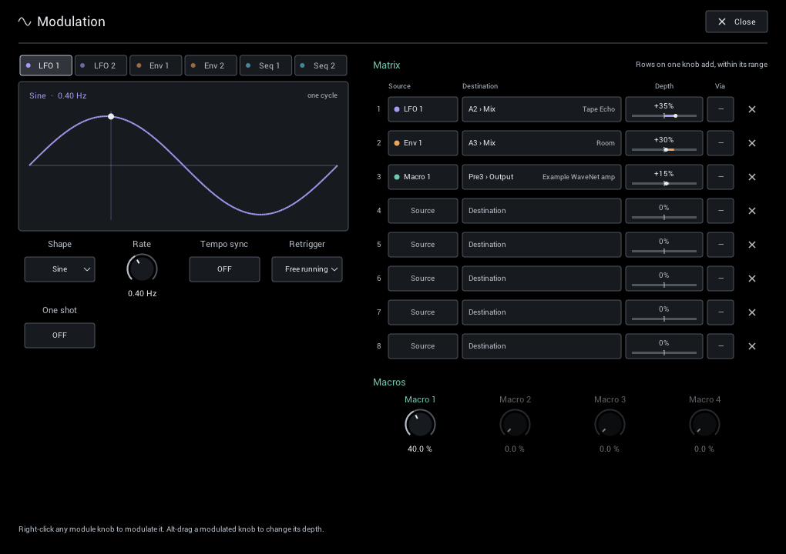

# Modulation & scenes

Let controls move with your playing, put the most useful ones on four macros, and switch between three snapshots of a rig while you play. For lane levels, timing and the frequency split, see [Routing](grid.md#routing).

## Modulation

Click **Modulation** in the header. Sources are on the left; assignments and macros are on the right.

### Quick assignment

Right-click a module knob, lane level, crossover, or A/B knob and choose **Modulate with**. NAM Grid uses the next free matrix row at +25% depth.

- The ring around a modulated knob shows its range; the dot shows its current value.
- **Alt/Option-drag** adjusts depth; hold Shift for finer moves.
- **Remove modulation** clears assignments from that control.

### Sources

- **LFO 1 / LFO 2:** sine, triangle, rising/falling saw, square, or random. Run freely or sync to your DAW tempo.
- **Env 1 / Env 2:** follows your playing. Choose where it listens, set **Threshold** to ignore background noise, and shape the response with **Sensitivity**, **Curve**, **Attack**, and **Release**.
- **Seq 1 / Seq 2:** draw eight bipolar steps. Drag above the center to add and below to subtract; use free rate or tempo sync.
- **Macros 1–4:** four manual or host-automatable controls for your most important assignments.

Each source has its own controls. The two envelope followers can listen at different grid positions. Audio-onset retrigger for LFO 1 and Seq 1 follows Env 1; LFO 2 and Seq 2 follow Env 2. Four macros remain available.

The LFOs and sequencers move above and below a knob's setting. The envelope and macros move in one direction.

The four macros also appear below **IN** on the main page. A macro with no matrix assignment is dimmed; using it as a source or **Via** makes it active. Hide this bank with **Settings > Main macros** if you prefer.

Double-click a macro's label on either page to rename it. Names are shared by both pages and saved with the rig preset and DAW project. Source menus are alphabetical and retain the macro number, for example **Macro 1: Test**. The compact **Via** cells use **L1/L2**, **E1/E2**, **S1/S2** and **M1–M4**. Clear the name to restore **Macro 1–4**. Your DAW keeps the stable **Macro 1–4** parameter names for automation.

**Retrigger** can restart the LFO or sequencer on an audio onset or incoming MIDI note. **One shot** plays one LFO cycle per trigger and then holds—useful for a fresh sweep on every note. MIDI notes trigger modulation; they do not change the guitar audio.

**Song position** locks the LFO or sequencer to your DAW's playback position. Cycles count from the song's first beat, so a synced 1/2 sweep or step 1 lands in the same place on every playback, after tempo changes and when a loop jumps back. Random repeats the same values at the same song position. When playback stops, the source keeps running from where it was; it locks again when playback starts. One shot has no effect in this mode. It needs a host that reports its beat position, as DAWs do.

### Matrix

Each of the eight rows has a **source**, **destination**, **depth**, and optional **Via** control. Via scales the assignment from another source—for example, let a macro control how much LFO reaches chorus Depth.

Depth is a share of the destination's range. Multiple rows can affect one knob without pushing it beyond its limits. Rows for controls the current module does not have remain saved but inactive. Click **×** to clear a row.

All assignments and source settings are saved with the rig. Depths, macros, and most source controls can also be automated by your DAW.

### Ideas to try

- **Ducked delay:** Envelope to delay **Mix** with negative depth. The repeats get out of the way while you play; Release sets how quickly they return.
- **Auto-wah:** Envelope to Filter **Cutoff** with positive depth, with some Resonance.
- **Lane morph:** a slow, tempo-synced LFO to **A/B**, moving between two amps.
- **Lead boost on one knob:** Macro 1 to a drive's **Drive** and a delay's **Mix** in two rows. Automate the macro or map it to a controller in your DAW.
- **Rhythmic sweeps:** the Sequencer, synced to tempo, to a filter or phaser control.

## Performance scenes

The header buttons **1 2 3** store three snapshots of the current rig.

- **Click** a scene to recall it.
- **Right-click** to store the current controls or clear that scene.
- An outlined button contains a scene; the filled button is the last one stored or recalled.

Scenes capture controls, bypass, routing, and modulation assignments. They keep the same modules, captures, IRs, and quality settings. Use them for changes such as rhythm to lead, more delay, or a different lane balance.

Scenes belong to the rig and are saved with its preset. To change modules or captures, load a different [rig preset](presets.md) instead. Scenes do not change tuner settings or held/frozen audio.

## Tails and bypass

Scene changes are smooth because the modules stay loaded. Bypass fades a module out over 5 ms rather than letting its tail ring on:

- Bypassing a delay or reverb fades its feedback out and silently clears the remaining repeats. Re-enable it within a few seconds and you may hear what is left; after that, an old tail never returns.
- Bypassing Freeze keeps its held sound for when you return; releasing Hold ends it.
- Quickly re-enabling a bypassed cabinet or Stutter can resume its remaining sound.

Use your ears with stereo routing and modulation: independent channel processing can change stereo balance, especially with an uneven input signal.
