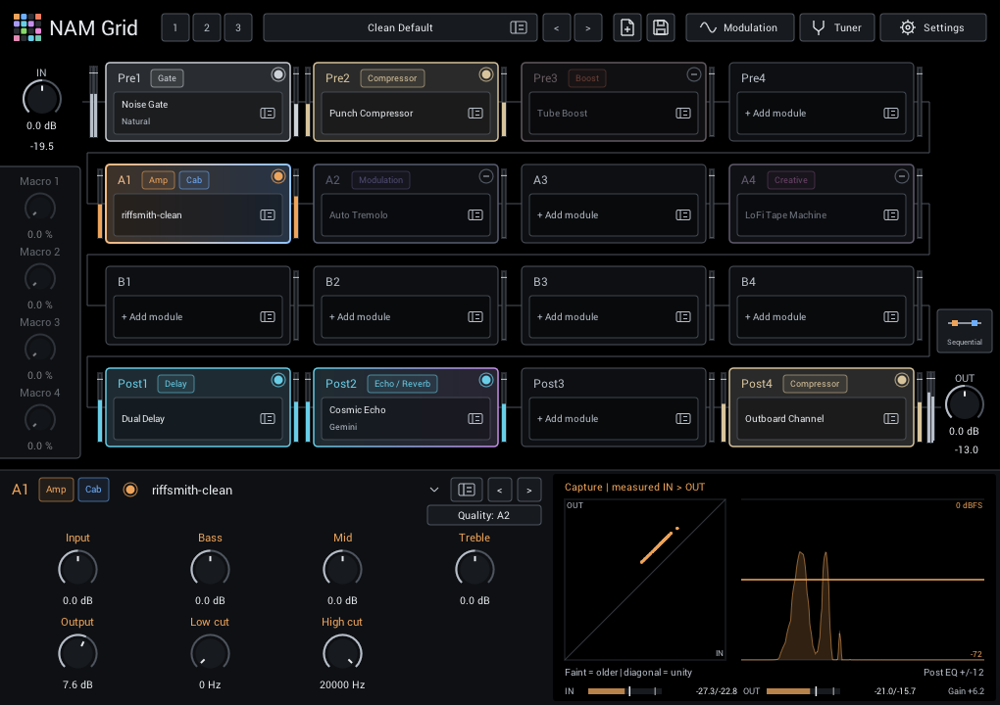

# Editor

Build your rig in the grid, then use the panel below it to shape the selected module. The main controls stay visible while you browse sounds, so you can compare tones without losing your place.

## Find your way around

| Area | What you can do |
| --- | --- |
| **Header** | Switch [scenes](performance.md#performance-scenes), load or save [rigs](presets.md), open **Modulation**, the [tuner](tuner.md), and **Settings**. |
| **Grid** | Arrange modules across Pre, lanes A/B, and Post. See [Grid & routing](grid.md). |
| **Module editor** | Adjust the selected module, switch its mode, and view its response. |
| **IN / OUT** | Set the level entering and leaving the whole rig. |
| **Macros** | Adjust four assignable controls below IN. Double-click a label to name it; names and values are saved with the rig. |
| **A/B** | Balance the two parallel lanes. **Routing** opens their [level, timing, and split controls](grid.md#routing). |

Settings, Tuner and Modulation have icons beside their names. The page-with-plus and disk icons beside the preset arrows are **New** and **Save**; hover over them for help. A divider and subtly lighter background mark the parameter area below the grid, including when auditioning modules in the browser.

Visualizations use the same black as the grid, with matching space above, below and to the right of the module display.

## Build and arrange a rig

Each grid card is one slot. Click **+ Add module** or a module's name to choose a module in the [library browser](browser.md), which lets you audition before you commit. Click the card's header to select it for editing, and use its switch to bypass it. A card with a mode selector shows the chosen style in muted text under the module name, and the module header repeats it next to the name, so a rig can be read at a glance.

Drag cards to move, swap or copy modules, or right-click a card for **Clear**, **Copy**, **Move** and **Swap**; the [mouse and keyboard](#mouse-and-keyboard) table lists the drag modifiers. Controls and bypass travel with the module, while host automation stays with the slot. Moving modules never copies or deletes files on disk.

## Shape a module

Every module editor uses the same layout:

- **Top row:** slot ID, category badges and the enable/bypass circle, then the module name with its selected mode. Browser and previous/next align on the right. The circle controls the same automatable Enabled parameter as the grid node.
- **Options:** tempo sync and sound-specific choices such as **Style**, **Mode**, **Quality** or **Heads**, on the right of the description row. Click a two-choice option to toggle it; longer lists open a menu.
- **Knobs:** up to four per row, filled from the left. **Output** comes before **Mix**. All eight positions are available for sound controls.
- **Display:** a visual guide to the module's response or your playing, with that module's input, output and gain in its footer.

Drag a knob or click its value to type a number; double-click restores its starting value, and right-click assigns [modulation](performance.md). Every knob and **Enabled** can be automated by your DAW; other header options are saved with the rig but cannot be automated.

The pointer becomes a text cursor over an editable value. Click the number below
the knob, type the new value, and press **Enter** to apply it or **Escape** to cancel.

If a module's description ends in `...`, hover over it to read the full description.

Previous/next stays within the current effect category or capture/IR folder. Adding a module gives you useful electric-guitar [starting settings](modules/README.md#starting-settings), with acoustic and bass suggestions.

### Displays and meters

Displays help answer practical questions: Is the compressor working? How dark are the repeats? Where is the EQ cutting? Some show live audio; others sketch the current settings. Their labels identify which is which.

Hover over a graph for its explanation and colour legend. Captions show live
measurements and useful derived information; axis ranges stay visible.

Compressor and limiter gain-reduction displays use a 0–16 dB scale, giving typical
2–4 dB compression more room while allowing heavier reduction. Outboard Channel
and Butter Comp histories mark 2, 4, 8 and 12 dB. The numeric GR readout continues
above 16 dB even when the graph or bar reaches its edge. A red lower edge on a
history, or a red tip on a bar, marks reduction beyond 16 dB; it indicates heavy
compression, not digital clipping. Gate attenuation displays
keep their wider scales.

Use the **level meters** in the display footer to compare tones at similar volume. They read the same scale as the slot meters, -60 to +6 dBFS:

- **Gain near 0 dB** means the module adds little overall level—useful for a fair bypass comparison.
- The bar is RMS over the last 0.4 seconds; the tick is the held peak. The two numbers read RMS, then peak, in dB.
- Red above 0 dBFS warns of a hot level. Between modules this is headroom information; at **OUT**, it is the level sent to your DAW.

Turn all displays on or off in **Settings > Visualizations**. This changes only the display, never the sound or saved settings. The [module guide](modules/README.md) explains each module's display.

## Settings

**Settings** in the header manages your capture, IR and preset folders (see [library folders](browser.md#library-folders)) and a few preferences:

- **Visualizations** turns all module displays on or off.
- **Main macros** shows or hides the four knobs below IN. They are shown by default; unassigned macros are dimmed. Hiding them preserves their values, names and assignments.
- **Preset switch** chooses how rigs change while you play; see [rig presets](presets.md#switching-while-you-play).
- **Startup rescan** rescans your folders whenever NAM Grid starts.
- **Settings folder** opens the folder that stores these choices; see [where settings are stored](troubleshooting.md#where-are-my-settings-stored).
- Links to this documentation, the source code and the issue tracker.

## Mouse and keyboard

| Where | Action | Result |
| --- | --- | --- |
| Knob | Drag, or click the value and type | Change the setting |
| Knob | Double-click | Restore the starting value |
| Knob | Right-click | Assign or remove [modulation](performance.md#quick-assignment) |
| Modulated knob | Alt/Option-drag (add Shift for finer steps) | Change the modulation depth |
| Grid card | Click the header | Select the module |
| Grid card | Click the name or **+ Add module** | Open the browser for that slot |
| Grid card | Right-click | Clear, Copy, Move or Swap |
| Grid card | Drag onto another card | Move or swap |
| Grid card | Shift-drag | Replace the target and empty the source |
| Grid card | Alt/Option-drag or Ctrl/Cmd-drag | Copy |
| Browser | Ctrl/Cmd+F | Search |
| Browser | Up/Down, Page Up/Down, Home/End | Move through results |
| Browser | Enter or double-click | Apply or load (from search, press Enter twice) |
| Browser | Escape | Leave search, then cancel |
| **Save** | Shift-click or Alt-click | Overwrite the loaded preset |
| Scene **1 2 3** | Click / right-click | Recall / store or clear |
| Tuner, Routing | Escape | Return to the module editor |
